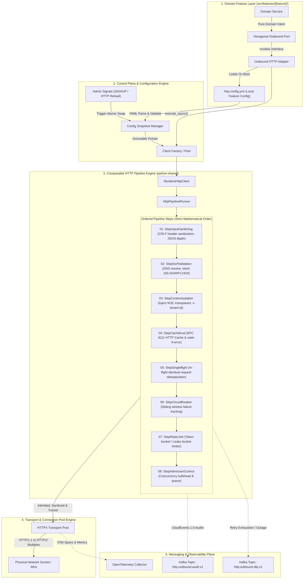
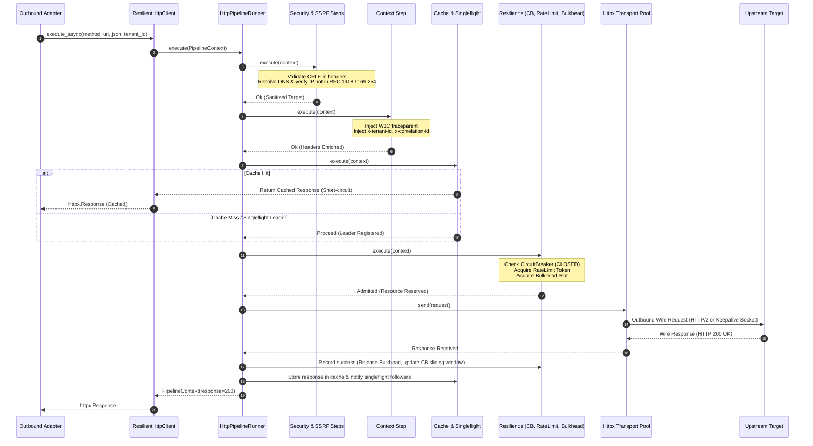
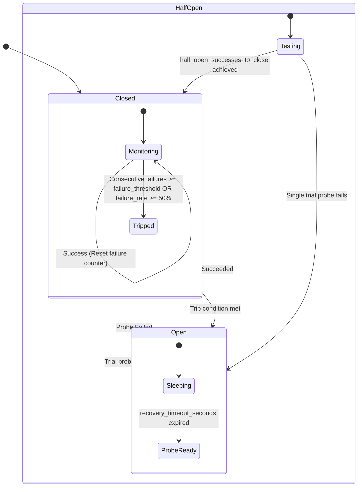

# ADR 0001: Declarative Feature HTTP Configuration (`http-config.yml`) and Composable Pipeline Client Usage

- **Status:** Accepted
- **Date:** 2026-10-21
- **Scope:** `python-shared` (`features/http`), Monorepo Microservices (All Domain Features)
- **Author:** Principal Distributed Systems Architect & Security Officer

---

## 1. Context and Problem Statement

Microservices across the monorepo previously relied on ad-hoc, divergent HTTP invocation patterns:
1. **Unbounded Resource Leaks**: Direct, unmonitored `httpx.Client()` and `httpx.AsyncClient()` instantiations created unmanaged connection pools, risking socket exhaustion, DNS stampedes, and memory leaks.
2. **Context Loss Across Wire Boundaries**: W3C `traceparent`, `x-request-id`, `x-correlation-id`, and tenant isolation metadata (`x-tenant-id`, `x-principal-id`) failed to propagate across outbound calls, fracturing distributed traces.
3. **Mismatched Process Models**: Temporal activities and background workers were subjected to in-memory bulkheads and rate-limiters designed for API endpoints, causing worker thread starvation and cascading failures.
4. **Security Vulnerabilities**: Lack of strict Server-Side Request Forgery (SSRF) validation on user-supplied URLs allowed private RFC 1918 network probing and cloud metadata extraction (`169.254.169.254`).
5. **Cascading Downstream Outages**: Absence of deterministic circuit breakers and admission control allowed slow or dead downstream dependencies to exhaust upstream thread pools.

We require an exhaustive, declarative, per-feature configuration file (`http-config.yml`) and a composable outbound pipeline client (`ResilientHttpClient`) that binds dynamically to execution profiles while enabling deep, per-feature tuning.

---

## 2. Decision Outcome

We standardize on a declarative, per-feature configuration file named **`http-config.yml`** placed in every domain feature directory (`src/features/<feature>/http-config.yml`), managed by `python-shared/src/features/http`'s **`ResilientHttpClient`** (`PipelineHttpClient`).

### Core Architectural Pillars
- **Strict Decoupling**: Application domain code only depends on abstract hexagonal outbound ports. Adapters instantiate `ResilientHttpClient.from_config(__file__)`.
- **Profile-Driven Pipeline Execution**:
  - `api_service`: Full 8-step pipeline (`input_hardening`, `ssrf_validation`, `context_isolation`, `cache_eval`, `singleflight`, `circuit_breaker`, `rate_limit`, `admission_control`).
  - `temporal_worker`: Lean 2-step pipeline (`context_isolation`, `circuit_breaker`), delegating concurrency, retries, and rate limits to Temporal's activity engine.
  - `internal_fast`: Ultra-lean 1-step pipeline (`context_isolation`) for high-throughput cluster-internal RPCs.
- **Atomic Hot-Reloading & Control Plane**: Runtime swaps of configuration snapshots without dropped requests or connection resets.
- **Kafka Event Streaming**: Policy audit events and dead-letter routing published as CloudEvents 1.0 payloads.

---

## 3. High Level Design (HLD) & Architectural Deep-Dive

### 3.1 Architecture Diagram



---

### 3.2 In-Depth HLD Component Walkthrough

#### 1. Domain Feature Layer (`src/features/{feature}/`)
- **Isolation Invariant**: Domain services (`service/{f}.service.py`) must contain zero external network references. They interact exclusively with abstract port interfaces (`infrastructure/ports/{f}.port.py`).
- **Adapter Encapsulation**: Outbound adapters (`infrastructure/adapters/{f}.adapter.py`) encapsulate `ResilientHttpClient`. The adapter resolves its local directory to locate `http-config.yml`, ensuring configuration is strictly co-located with the feature using it.

#### 2. Control Plane & Configuration Engine
- **Decoupled Lifecycle**: The configuration engine decouples file parsing from request handling. The YAML is parsed into strongly-typed Pydantic schemas, validated against range constraints, and compiled into an immutable snapshot.
- **Zero-Downtime Hot-Reload**: Live reload operates via an atomic pointer swap (`atomic.Pointer`). In-flight requests retain their original configuration reference, while new requests immediately pick up the updated snapshot. No sockets are closed prematurely.

#### 3. Composable HTTP Pipeline Engine
The 8 pipeline steps execute in a strict, mathematically sound sequence:
1. **`StepInputHardening` (Security Gate 1)**: Runs first to neutralize malicious input before any network activity. Prevents CRLF injection in HTTP headers (which causes HTTP response splitting) and validates JSON depth to stop recursion denial-of-service.
2. **`StepSsrfValidation` (Security Gate 2)**: Resolves destination domain names and verifies the resolved IP against blocked CIDRs. By executing *before* context injection or caching, it stops SSRF attacks without wasting system resources.
3. **`StepContextIsolation` (Context Enrichment)**: Injects W3C `traceparent`, `x-request-id`, `x-correlation-id`, and tenant metadata into outbound headers. Placed *before* caching so cache keys incorporate tenant identity to prevent cross-tenant data leakage.
4. **`StepCacheEval` (Fast-Path Optimization)**: Checks in-memory or Redis caches for matching responses. On a cache hit, the request short-circuits immediately, bypassing downstream circuit breakers, rate limiters, and network I/O.
5. **`StepSingleflight` (Stampede Protection)**: Deduplicates concurrent identical requests. Only one request (the "leader") continues through the remaining pipeline; all other concurrent calls ("followers") pause and await the leader's response.
6. **`StepCircuitBreaker` (Downstream Fault Isolation)**: Tracks consecutive failures and slow calls across a sliding window. Positioned *after* singleflight so that 100 concurrent duplicate requests only count as 1 request against the failure rate threshold.
7. **`StepRateLimit` (Traffic Shaping)**: Enforces token-bucket rate limits per tenant or per upstream host. Rejects excessive bursts before they reach the connection pool.
8. **`StepAdmissionControl` (Resource Bulkhead)**: Enforces concurrency caps and queues pending requests. Acts as the final gate protecting local process memory and thread pools.

#### 4. Transport & Connection Pool Engine
- Uses persistent connection pools via HTTPX. Sockets are kept alive (`max_keepalive_connections`), enabling TCP handshake and TLS session reuse.
- Supports HTTP/2 multiplexing, allowing dozens of concurrent requests over a single TCP connection.

#### 5. Messaging & Observability Plane
- Asynchronous telemetry: Circuit breaker state changes, rate-limit drops, and SSRF security violations emit CloudEvents 1.0 payloads to Kafka topics.
- Spans and metric histograms are recorded using OpenTelemetry HTTP client semantic conventions (`http.client.request.duration`).

---

## 4. Low Level Design (LLD)

### 4.1 Sequence Diagram: Outbound Pipeline Execution Flow



---

### 4.2 Sequence Diagram In-Depth Step Walkthrough

1. **Invocation (Steps 1–2)**: The outbound adapter invokes `client.execute_async()`. The client wraps the target, headers, payload, and tenant ID into a mutable `PipelineContext` and forwards it to `HttpPipelineRunner`.
2. **Security & SSRF Inspection (Steps 3–4)**:
   - `StepInputHardening` scans headers for carriage returns (`\r\n`) and validates JSON nesting depth against `security.input_hardening.max_json_depth`.
   - `StepSsrfValidation` performs synchronous DNS resolution on the hostname. If the resolved IP falls within blocked CIDR ranges (e.g. `10.0.0.0/8`, `169.254.169.254`), execution immediately aborts with `SSRFSecurityViolation`.
3. **Context Enrichment (Steps 5–6)**: `StepContextIsolation` extracts the active OpenTelemetry span context, formats the W3C `traceparent` header, and attaches `x-tenant-id` and `x-request-id`.
4. **Cache & Singleflight Fast-Path (Steps 7–9)**:
   - `StepCacheEval` checks the local cache. If a valid, non-expired response exists, it immediately returns the cached response, bypassing all network layers.
   - If not cached, `StepSingleflight` generates a SHA-256 key from `Method + URL + Tenant + Body`. If an identical request is already in-flight, subsequent requests pause and wait for the leader's response.
5. **Resilience & Admission (Steps 10–11)**:
   - `StepCircuitBreaker` verifies that the circuit is `CLOSED` or `HALF-OPEN`. If `OPEN`, it rejects the request instantly with `CircuitBreakerOpenException`.
   - `StepRateLimit` verifies token availability. If the bucket is exhausted, it throws HTTP 429.
   - `StepAdmissionControl` verifies available slots in the concurrency bulkhead. If full, it queues the request up to `queue_timeout_seconds`.
6. **Network Wire I/O (Steps 12–14)**: The request is dispatched over an established keep-alive TCP socket or HTTP/2 multiplexed stream.
7. **Post-Processing & Release (Steps 15–17)**:
   - The bulkhead slot is released back to the pool.
   - The circuit breaker records the outcome (success or error).
   - If eligible, the response is stored in cache, and waiting singleflight followers are woken up.
   - The final `httpx.Response` is returned to the adapter.

---

### 4.3 Circuit Breaker Deterministic State Machine



#### Detailed State Transition Invariants:
1. **`CLOSED` (Normal Operation)**:
   - All requests pass through freely.
   - Failures (5xx status codes, connection drops, read timeouts) are recorded in a sliding window.
   - **Transition to `OPEN`**: Triggers if consecutive failures exceed `failure_threshold` (default: 5) OR if the failure rate exceeds `failure_rate_threshold` (default: 50%) after at least `minimum_number_of_calls` (default: 10) have been evaluated.
2. **`OPEN` (Short-Circuit Defense)**:
   - All outbound requests fail fast immediately with `CircuitBreakerOpenException` (zero network I/O, zero thread allocation).
   - The circuit remains in `OPEN` for `recovery_timeout_seconds` (default: 30.0s).
   - **Transition to `HALF-OPEN`**: Triggers automatically once `recovery_timeout_seconds` elapses.
3. **`HALF-OPEN` (Canary Probing)**:
   - Permits a strictly limited number of trial probe requests (`half_open_requests`, default: 3).
   - All other requests continue to fail fast.
   - **Transition to `CLOSED`**: Triggers if all `half_open_successes_to_close` trial probes succeed.
   - **Transition to `OPEN`**: Triggers immediately if even a single trial probe fails.

---

## 5. Control Panel & Configuration Engine

### 5.1 Dynamic Hot-Reload Architecture
1. **Signal Trap & File Watcher**: The host process traps `SIGHUP` and monitors `http-config.yml` via filesystem notification hooks.
2. **Two-Phase Validation**:
   - Phase 1 (Parsing): The file is read and parsed as YAML.
   - Phase 2 (Validation): The schema is validated against range boundaries and profile constraints.
3. **Atomic Pointer Swap**: If validation passes, the active snapshot reference is swapped atomically. In-flight requests continue executing against their existing snapshot; all subsequent requests read the new snapshot.
4. **Fallback on Failure**: If a newly edited YAML contains a syntax or validation error, the engine logs the failure, leaves the current running snapshot intact, and dispatches an alert to Kafka.

### 5.2 Control Panel Admin API
Each service exposes control endpoints on its admin port (`127.0.0.1:9090` / `900X`):

| Endpoint | Method | Payload / Params | Response | Description |
|---|---|---|---|---|
| `/admin/v1/http/config` | `GET` | None | `200 OK` (JSON) | Returns active configuration snapshot and running profile. |
| `/admin/v1/http/reload` | `POST` | None | `200 OK` / `400 Bad Request` | Forces immediate disk reread and atomic swap of `http-config.yml`. |
| `/admin/v1/http/circuit-breaker` | `GET` | `?target=scorer` | `200 OK` (JSON) | Returns circuit state (`CLOSED`/`OPEN`), failure counts, and sliding window metrics. |
| `/admin/v1/http/circuit-breaker/reset` | `POST` | `{"target": "scorer"}` | `200 OK` (JSON) | Manually forces an `OPEN` circuit breaker back to `CLOSED`. |
| `/admin/v1/http/circuit-breaker/trip` | `POST` | `{"target": "scorer"}` | `200 OK` (JSON) | Manually trips a circuit breaker to `OPEN` (emergency traffic shedding). |

---

## 6. Messaging Panel & Event Topology

All cross-cutting policy audits, anomaly detections, and dead-letter events are published to Kafka following CloudEvents 1.0 JSON specifications.

### 6.1 Kafka Topic Architecture
- **`http.outbound.audit.v1`**: Sampled audit stream of outgoing HTTP calls with status, duration, and trace context.
- **`http.outbound.circuit_breaker.v1`**: Real-time event stream published whenever a circuit breaker transitions state.
- **`http.outbound.dlq.v1`**: Dead Letter Queue capturing unrecoverable HTTP failures after retry exhaustion for offline replay.

### 6.2 CloudEvent Schema Example (`http.outbound.circuit_breaker.v1`)
```json
{
  "specversion": "1.0",
  "type": "com.platform.http.circuit_breaker.state_change",
  "source": "quality-engine/features/quality_baseline",
  "id": "cb-evt-991284-0a",
  "time": "2026-10-21T10:45:00.000Z",
  "datacontenttype": "application/json",
  "data": {
    "feature_name": "quality_baseline",
    "target_class": "declared_upstream",
    "upstream_host": "http_scorer_adapter",
    "previous_state": "CLOSED",
    "new_state": "OPEN",
    "consecutive_failures": 5,
    "recovery_timeout_seconds": 30.0,
    "trace_id": "4bf92f3577b34da6a3ce929d0e0e4736",
    "trigger_error": "ReadTimeout: Server failed to respond in 30.0s"
  }
}
```

---

## 7. Exhaustive Parameter Reference: Valid vs. Ideal vs. Anti-Patterns

This section provides an in-depth parameter analysis: syntax rules, ideal production settings, and dangerous anti-patterns that risk production outages.

### 7.1 Parameter Analysis Table

| Parameter Path | Type & Valid Range | Ideal Production Setting | Anti-Pattern (What is NOT Ideal) | Failure Mode Caused by Anti-Pattern |
|---|---|---|---|---|
| `profile` | `enum`: `api_service`, `temporal_worker`, `internal_fast` | `api_service` for REST; `temporal_worker` for Temporal activities; `internal_fast` for cluster RPC. | Setting `api_service` inside Temporal worker activities. | Worker thread starvation; duplicate retries clashing with Temporal's retry engine; deadlock on bulkheads. |
| `client.timeout_seconds` | `float`: `0.1` to `300.0` | `10.0` to `30.0` for web APIs; `60.0` for batch/AI processing. | Setting to `0.0` (infinite timeout) or `> 120.0` for customer-facing APIs. | Thread pool exhaustion; Slowloris vulnerability; upstream gateway times out with HTTP 504 while worker stays hung. |
| `client.connect_timeout_seconds` | `float`: `0.05` to `30.0` | `2.0` to `5.0` seconds. | Setting to `> 15.0` seconds. | Slow connection attempts block worker threads when a downstream host drops packets. |
| `client.max_connections` | `int`: `1` to `5000` | `100` to `200` per process replica. | Setting to `> 2000` or leaving unbounded. | Kernel file descriptor exhaustion (`EMFILE: Too many open files`); ephemeral port starvation. |
| `client.max_keepalive_connections`| `int`: `0` to `max_connections` | `20` to `50` (typically 20–30% of `max_connections`). | Setting to `0` or equal to `max_connections`. | Setting to 0 destroys socket reuse, causing TCP handshake / TLS renegotiation latency spikes on every single request. |
| `client.keepalive_expiry_seconds` | `float`: `1.0` to `600.0` | `30.0` to `65.0` (must be shorter than upstream LB idle timeout). | Setting to `> 300.0` seconds. | Race condition: Client sends request on an idle socket just as the upstream load balancer closes it, causing `RemoteProtocolError`. |
| `client.retries` | `int`: `0` to `10` | `2` to `3` for idempotent methods (GET/PUT); `0` for non-idempotent (POST). | Setting to `> 5` with fixed zero backoff. | Retry storms (thundering herd) that overwhelm recovering downstream services. |
| `client.retry_backoff_factor` | `float`: `0.1` to `5.0` | `0.5` (exponential backoff: 0.5s, 1.0s, 2.0s with full jitter). | Setting to `0.0` (immediate retry). | Immediate re-execution hits the downstream service while it is still saturated, prolonging the outage. |
| `client.http2` | `bool`: `true`, `false` | `true` for services supporting ALPN HTTP/2. | Leaving `false` for high-throughput internal RPCs. | Forces 1 request per TCP socket, multiplying connection count by 50x under load. |
| `client.verify_ssl` | `bool`: `true`, `false` | `true` across all staging and production environments. | Setting to `false` in production. | Critical vulnerability: Disables TLS certificate validation, exposing traffic to Man-in-the-Middle (MitM) interception. |
| `client.follow_redirects` | `bool`: `true`, `false` | `false` (explicit redirection handling). | Setting to `true` on calls transmitting authorization headers. | Credential leakage: HTTP client automatically forwards `Authorization` bearer tokens to third-party redirect locations. |
| `circuit_breaker.failure_threshold` | `int`: `1` to `50` | `5` consecutive failures. | Setting to `1` or `> 20`. | Setting to 1 causes false positives on transient blips; setting >20 allows hundreds of threads to hang before tripping. |
| `circuit_breaker.recovery_timeout_seconds` | `float`: `1.0` to `300.0` | `30.0` seconds. | Setting to `< 2.0` seconds. | Floods recovering downstream services before they have finished restarting or clearing backlogs. |
| `rate_limit.requests_per_second` | `int`: `1` to `50000` | Scaled to match downstream SLA (e.g. `100` req/s). | Setting to `99999` (effectively disabled). | Downstream service is overwhelmed and returns 500/503 errors during traffic spikes. |
| `rate_limit.burst` | `int`: `>= requests_per_second` | `1.5x` to `2x` of `requests_per_second` (e.g. `200`). | Setting `burst` equal to `requests_per_second * 10`. | Large sudden packet floods overwhelm downstream connection queues. |
| `admission_control.concurrency_limit` | `int`: `1` to `1000` | `50` to `100` concurrent requests per client instance. | Setting to unbounded (`None`). | Client allocates thousands of concurrent async tasks, exhausting process RAM and CPU cycles. |
| `cache_eval.stale_if_error_seconds` | `float`: `0.0` to `86400.0` | `300.0` to `600.0` seconds. | Setting to `0.0`. | Downstream outage immediately cascades to end-users instead of serving graceful degraded cached content. |
| `security.input_hardening.reject_crlf_headers` | `bool`: `true`, `false` | `true` (non-negotiable security invariant). | Setting to `false`. | Allows HTTP response splitting and header injection attacks. |
| `security.ssrf_validation.blocked_ip_ranges` | `list[str]` (CIDRs) | Must include `0.0.0.0/8`, `10.0.0.0/8`, `127.0.0.0/8`, `169.254.0.0/16`, `172.16.0.0/12`, `192.168.0.0/16`. | Omitting `169.254.0.0/16` or private CIDRs. | Exposes AWS/GCP instance metadata API (`169.254.169.254`), allowing attackers to steal IAM instance credentials. |

---

## 8. Complete Step-by-Step Implementation & Operations Manual (Universal Framework)

This section provides a universal, feature-agnostic, 8-step blueprint to implement, configure, wire, test, and verify declarative HTTP clients in **any existing package or any future feature** across the monorepo.

### 8.0 Universal Environment Variables & Conventions

Before beginning implementation in any package or feature, set these environment variables in your terminal. All subsequent steps and verification scripts reference these variables dynamically:

```bash
# 1. Target package name (e.g., quality-engine, alert-engine, semantic-coherence, toxicity, etc.)
export PACKAGE_NAME="quality-engine"

# 2. Target domain feature folder name (e.g., score_composite, embedding_worker, alert_dispatcher, etc.)
export FEATURE_NAME="score_composite"

# 3. Execution profile: "api_service" (REST), "temporal_worker" (Temporal), or "internal_fast" (Cluster RPC)
export FEATURE_PROFILE="api_service"

# 4. Computed absolute filesystem paths
export MONOREPO_ROOT="$(pwd)"
export FEATURE_DIR="${MONOREPO_ROOT}/${PACKAGE_NAME}/src/features/${FEATURE_NAME}"
```

---

### Step 1: Feature Folder Audit & Hexagonal Scaffolding (Rule 1 Compliance)

#### 1.1 Purpose & Architectural Rationale
Rule 1 (`1-feature-folder-writing-rule.md`) mandates that every feature must be self-contained and strictly follow Hexagonal Architecture (Ports and Adapters). This ensures:
- The core business domain is completely decoupled from HTTP transport protocols, serialization libraries, and network clients.
- The feature can run in any process model (REST API worker, CLI tool, or Temporal workflow) without altering domain logic.
- PEP 420 namespace packaging rules are preserved: `src/` and `src/features/` must remain namespace directories (containing **no** `__init__.py`).

#### 1.2 Prerequisites & Structural Rules
- Target package directory must exist in the monorepo root.
- Python 3.11+ virtual environment must be active with `policy-orchestrator` installed (`which po`).
- Invariant: `src/__init__.py` and `src/features/__init__.py` must NOT exist. Only sub-layers (`contracts/`, `domain/`, `infrastructure/`, `service/`, `tests/`) contain `__init__.py`.

#### 1.3 Step-by-Step Scaffolding Commands
Run the following shell commands to scaffold the full hexagonal layer for your feature:

```bash
# 1. Create standard Hexagonal directory tree
mkdir -p "${FEATURE_DIR}/contracts"
mkdir -p "${FEATURE_DIR}/domain"
mkdir -p "${FEATURE_DIR}/infrastructure/ports"
mkdir -p "${FEATURE_DIR}/infrastructure/adapters"
mkdir -p "${FEATURE_DIR}/service"
mkdir -p "${FEATURE_DIR}/tests"

# 2. Initialize sub-layer package markers (PEP 420 compliant)
touch "${FEATURE_DIR}/contracts/__init__.py"
touch "${FEATURE_DIR}/domain/__init__.py"
touch "${FEATURE_DIR}/infrastructure/__init__.py"
touch "${FEATURE_DIR}/infrastructure/ports/__init__.py"
touch "${FEATURE_DIR}/infrastructure/adapters/__init__.py"
touch "${FEATURE_DIR}/service/__init__.py"
touch "${FEATURE_DIR}/tests/__init__.py"

# 3. Assert PEP 420 namespace invariants (Ensure NO root/feature init files exist)
rm -f "${MONOREPO_ROOT}/${PACKAGE_NAME}/src/__init__.py"
rm -f "${MONOREPO_ROOT}/${PACKAGE_NAME}/src/features/__init__.py"
```

#### 1.4 Automated Verification Script
Run this script to verify that the directory structure complies with monorepo rules:

```bash
python3 -c "
import os
import sys
from pathlib import Path

feature_dir = Path(os.environ['FEATURE_DIR'])
required_subdirs = [
    'contracts', 'domain', 'infrastructure/ports',
    'infrastructure/adapters', 'service', 'tests'
]

for subdir in required_subdirs:
    target = feature_dir / subdir
    assert target.is_dir(), f'FAILED: Missing directory {target}'
    init_file = target / '__init__.py'
    assert init_file.is_file(), f'FAILED: Missing __init__.py in {target}'

package_name = os.environ['PACKAGE_NAME']
assert not (Path(package_name) / 'src' / '__init__.py').exists(), 'FAILED: Stray src/__init__.py violates PEP 420!'
assert not (Path(package_name) / 'src' / 'features' / '__init__.py').exists(), 'FAILED: Stray src/features/__init__.py violates PEP 420!'

print(f'>>> Step 1 SUCCESS: Hexagonal structure verified for {feature_dir}')
"
```

#### 1.5 Common Pitfalls & Troubleshooting
- **Error: `ModuleNotFoundError: No module named 'src.features.<feature>'`**:
  - *Cause*: A developer created `src/__init__.py` or `src/features/__init__.py`, breaking Python's native namespace package resolution.
  - *Fix*: Run `rm -f ${PACKAGE_NAME}/src/__init__.py ${PACKAGE_NAME}/src/features/__init__.py`.

---

### Step 2: Authoring Declarative `http-config.yml` with Profile Selection

#### 2.1 Purpose & Architectural Rationale
Instead of hardcoding timeouts, retry counts, connection pools, and circuit breaker thresholds in Python code, every feature defines an immutable declarative contract in `http-config.yml`.
This guarantees:
- Operational agility: Site Reliability Engineers (SREs) can tune network parameters without recompiling or redeploying code.
- Profile consistency: The client automatically activates the appropriate pipeline steps based on the process model.

#### 2.2 Profile Decision Matrix

| Execution Profile | Target Execution Environment | Pipeline Steps Activated | Rationale |
|---|---|---|---|
| `api_service` | FastAPI, REST endpoints, Ingress gateways | All 8 Steps: `input_hardening`, `ssrf_validation`, `context_isolation`, `cache_eval`, `singleflight`, `circuit_breaker`, `rate_limit`, `admission_control` | Maximum protection against hostile user payloads, SSRF attacks, downstream outages, and connection exhaustion. |
| `temporal_worker` | Temporal activity workers, Celery/async task workers | 2 Steps: `context_isolation`, `circuit_breaker` | Lean execution. Rate limiting, backoff, retries, and task bulkheads are managed natively by the Temporal engine. |
| `internal_fast` | High-throughput intra-cluster RPC, daemon sidecars | 1 Step: `context_isolation` | Ultra-low latency (<0.5ms overhead). Bypasses caching and circuit breakers for trusted intra-cluster calls. |

#### 2.3 Concrete YAML Templates

##### Profile A: `api_service` (REST Services)
```yaml
schema_version: "1.0.0"
feature_name: "target_feature"
profile: "api_service"

client:
  timeout_seconds: 30.0
  connect_timeout_seconds: 5.0
  max_connections: 100
  max_keepalive_connections: 20
  keepalive_expiry_seconds: 30.0
  verify_ssl: true
  retries: 3
  retry_backoff_factor: 0.5
  retry_status_codes:
    - 429
    - 502
    - 503
    - 504

pipeline:
  steps:
    - input_hardening
    - ssrf_validation
    - context_isolation
    - cache_eval
    - singleflight
    - circuit_breaker
    - rate_limit
    - admission_control

  circuit_breaker:
    failure_threshold: 5
    recovery_timeout_seconds: 30.0
    half_open_requests: 3

  rate_limit:
    requests_per_second: 100
    burst: 200

  cache_eval:
    enabled: true
    default_ttl_seconds: 60
    stale_if_error_seconds: 300.0

  security:
    input_hardening: true
    ssrf_validation: true
```

##### Profile B: `temporal_worker` (Asynchronous Workflow Workers)
```yaml
schema_version: "1.0.0"
feature_name: "target_feature"
profile: "temporal_worker"

client:
  timeout_seconds: 60.0
  connect_timeout_seconds: 5.0
  max_connections: 50
  max_keepalive_connections: 10
  keepalive_expiry_seconds: 45.0
  verify_ssl: true
  retries: 0
  retry_backoff_factor: 0.0

pipeline:
  steps:
    - context_isolation
    - circuit_breaker

  circuit_breaker:
    failure_threshold: 5
    recovery_timeout_seconds: 30.0
    half_open_requests: 2

  security:
    input_hardening: false
    ssrf_validation: false
```

##### Profile C: `internal_fast` (Cluster-Internal High-Speed RPC)
```yaml
schema_version: "1.0.0"
feature_name: "target_feature"
profile: "internal_fast"

client:
  timeout_seconds: 5.0
  connect_timeout_seconds: 1.0
  max_connections: 200
  max_keepalive_connections: 50
  keepalive_expiry_seconds: 60.0
  verify_ssl: true
  retries: 1
  retry_backoff_factor: 0.1

pipeline:
  steps:
    - context_isolation

  security:
    input_hardening: false
    ssrf_validation: false
```

#### 2.4 Step-by-Step Authoring Command
Execute this parameterized shell command to write the configuration file based on `$FEATURE_PROFILE`:

```bash
cat << EOF > "${FEATURE_DIR}/http-config.yml"
schema_version: "1.0.0"
feature_name: "${FEATURE_NAME}"
profile: "${FEATURE_PROFILE}"

client:
  timeout_seconds: $( [ "${FEATURE_PROFILE}" = "temporal_worker" ] && echo "60.0" || ( [ "${FEATURE_PROFILE}" = "internal_fast" ] && echo "5.0" || echo "30.0" ) )
  connect_timeout_seconds: $( [ "${FEATURE_PROFILE}" = "internal_fast" ] && echo "1.0" || echo "5.0" )
  max_connections: $( [ "${FEATURE_PROFILE}" = "internal_fast" ] && echo "200" || echo "100" )
  max_keepalive_connections: 20
  keepalive_expiry_seconds: 30.0
  verify_ssl: true
  retries: $( [ "${FEATURE_PROFILE}" = "temporal_worker" ] && echo "0" || ( [ "${FEATURE_PROFILE}" = "internal_fast" ] && echo "1" || echo "3" ) )
  retry_backoff_factor: 0.5
  retry_status_codes:
    - 429
    - 502
    - 503
    - 504

pipeline:
  steps:
$( [ "${FEATURE_PROFILE}" = "api_service" ] && cat << 'STEPS'
    - input_hardening
    - ssrf_validation
    - context_isolation
    - cache_eval
    - singleflight
    - circuit_breaker
    - rate_limit
    - admission_control
STEPS
)
$( [ "${FEATURE_PROFILE}" = "temporal_worker" ] && cat << 'STEPS'
    - context_isolation
    - circuit_breaker
STEPS
)
$( [ "${FEATURE_PROFILE}" = "internal_fast" ] && cat << 'STEPS'
    - context_isolation
STEPS
)

  circuit_breaker:
    failure_threshold: 5
    recovery_timeout_seconds: 30.0
    half_open_requests: 3

  rate_limit:
    requests_per_second: 100
    burst: 200

  cache_eval:
    enabled: true
    default_ttl_seconds: 60
    stale_if_error_seconds: 300.0

  security:
    input_hardening: $( [ "${FEATURE_PROFILE}" = "api_service" ] && echo "true" || echo "false" )
    ssrf_validation: $( [ "${FEATURE_PROFILE}" = "api_service" ] && echo "true" || echo "false" )
EOF
```

#### 2.5 Automated Verification Script
Run this script to validate YAML syntax and profile constraints:

```bash
python3 -c "
import os
import yaml
from pathlib import Path

config_path = Path(os.environ['FEATURE_DIR']) / 'http-config.yml'
assert config_path.is_file(), f'FAILED: {config_path} does not exist'

with open(config_path) as f:
    cfg = yaml.safe_load(f)

assert cfg['schema_version'] == '1.0.0', 'Invalid schema_version'
assert cfg['feature_name'] == os.environ['FEATURE_NAME'], 'feature_name does not match directory name'
assert cfg['profile'] in ['api_service', 'temporal_worker', 'internal_fast'], 'Invalid profile'

profile = cfg['profile']
steps = cfg['pipeline']['steps']

if profile == 'api_service':
    assert len(steps) == 8, f'api_service profile requires 8 steps, got {len(steps)}'
elif profile == 'temporal_worker':
    assert steps == ['context_isolation', 'circuit_breaker'], f'temporal_worker profile steps mismatch: {steps}'
elif profile == 'internal_fast':
    assert steps == ['context_isolation'], f'internal_fast profile steps mismatch: {steps}'

assert cfg['client']['timeout_seconds'] > 0.0, 'timeout_seconds must be positive'
print(f'>>> Step 2 SUCCESS: http-config.yml validated for profile [{profile}]')
"
```

---

### Step 3: Defining the Pure Domain Outbound Port Interface (`infrastructure/ports/`)

#### 3.1 Purpose & Architectural Rationale
The Outbound Port is an abstract interface using standard library `abc.ABC`. It models **domain intent** (e.g. `fetch_embedding`, `evaluate_score`, `dispatch_alert`), not HTTP protocols:
- Pure Domain Invariant: Port files must contain **zero** network imports (`import httpx`, `import requests`, `import urllib` are strictly forbidden).
- The port accepts pure domain entities or primitives (`str`, `dict`, `pydantic.BaseModel`) and returns domain models.

#### 3.2 Concrete Universal Port Implementation
Generate the abstract port file `${FEATURE_DIR}/infrastructure/ports/${FEATURE_NAME}_port.py`:

```bash
cat << 'EOF' > "${FEATURE_DIR}/infrastructure/ports/${FEATURE_NAME}_port.py"
from abc import ABC, abstractmethod
from typing import Dict, Any, Optional

class FeatureOutboundPort(ABC):
    @abstractmethod
    async def execute_remote_operation(
        self,
        payload: Dict[str, Any],
        tenant_id: str,
        correlation_id: Optional[str] = None
    ) -> Dict[str, Any]:
        """Execute the feature's outbound remote operation."""
        pass
EOF
```

#### 3.3 Automated Verification Script
Run this script to assert that the port is abstract and has zero network coupling:

```bash
python3 -c "
import os
import ast
from pathlib import Path

port_path = Path(os.environ['FEATURE_DIR']) / 'infrastructure' / 'ports' / f\"{os.environ['FEATURE_NAME']}_port.py\"
assert port_path.is_file(), f'FAILED: {port_path} not found'

with open(port_path) as f:
    tree = ast.parse(f.read())

forbidden_modules = {'httpx', 'requests', 'urllib', 'aiohttp'}
for node in ast.walk(tree):
    if isinstance(node, ast.Import):
        for alias in node.names:
            assert alias.name not in forbidden_modules, f'VIOLATION: Forbidden import {alias.name} in Port interface!'
    elif isinstance(node, ast.ImportFrom):
        assert node.module not in forbidden_modules, f'VIOLATION: Forbidden import from {node.module} in Port interface!'

print(f'>>> Step 3 SUCCESS: Port interface verified pure of networking imports')
"
```

---

### Step 4: Implementing the Concrete HTTP Adapter (`infrastructure/adapters/`) with `ResilientHttpClient`

#### 4.1 Purpose & Architectural Rationale
The Adapter implements the abstract Port interface. It is the sole component that interfaces with `python_shared.http.ResilientHttpClient`.
Key Invariants:
- Dynamic Config Resolution: The adapter resolves its own directory dynamically via `Path(__file__).resolve().parents[2]` so it functions correctly regardless of execution path.
- Transparent Telemetry: The adapter passes `tenant_id` and `correlation_id` to `client.execute_async()`, allowing the pipeline to propagate W3C `traceparent` headers.
- DTO Translation: Converts domain requests into HTTP JSON payloads and maps HTTP responses to domain results.

#### 4.2 Concrete Universal Adapter Implementation
Generate `${FEATURE_DIR}/infrastructure/adapters/http_${FEATURE_NAME}_adapter.py`:

```bash
cat << 'EOF' > "${FEATURE_DIR}/infrastructure/adapters/http_${FEATURE_NAME}_adapter.py"
from pathlib import Path
from typing import Dict, Any, Optional
from python_shared.http import ResilientHttpClient

class HttpFeatureOutboundAdapter:
    def __init__(self, base_url: str = "http://localhost:8000") -> None:
        feature_dir = Path(__file__).resolve().parents[2]
        self._client = ResilientHttpClient.from_config(
            config_path=feature_dir,
            base_url=base_url
        )

    async def execute_remote_operation(
        self,
        payload: Dict[str, Any],
        tenant_id: str,
        correlation_id: Optional[str] = None
    ) -> Dict[str, Any]:
        headers: Dict[str, str] = {}
        if correlation_id:
            headers["x-correlation-id"] = correlation_id

        response = await self._client.execute_async(
            method="POST",
            url="/api/v1/remote/execute",
            json=payload,
            tenant_id=tenant_id,
            headers=headers
        )
        response.raise_for_status()
        return response.json()
EOF
```

#### 4.3 Automated Verification Script
Run this script to instantiate the adapter and assert that `ResilientHttpClient.from_config()` loaded the YAML configuration correctly:

```bash
python3 -c "
import os
import sys
from pathlib import Path

monorepo_root = Path(os.environ['MONOREPO_ROOT'])
sys.path.insert(0, str(monorepo_root / 'python-shared'))

from python_shared.http import ResilientHttpClient

feature_dir = Path(os.environ['FEATURE_DIR'])
client = ResilientHttpClient.from_config(feature_dir, base_url='http://mock-service')

assert client.profile == os.environ['FEATURE_PROFILE'], f'Profile mismatch: {client.profile}'
assert client.timeout > 0.0, 'Client timeout must be configured'

expected_step_count = 8 if client.profile == 'api_service' else (2 if client.profile == 'temporal_worker' else 1)
assert len(client.runner.steps) == expected_step_count, f'Pipeline step count mismatch: {len(client.runner.steps)} vs {expected_step_count}'

print(f'>>> Step 4 SUCCESS: Adapter successfully bound to {client.profile} with {len(client.runner.steps)} steps')
"
```

---

### Step 5: Injecting the Port into the Pure Domain Service (`service/`)

#### 5.1 Purpose & Architectural Rationale
The Domain Service encapsulates core business orchestration. Following Dependency Injection (DI):
- The service receives the Port interface in its constructor (`__init__(self, port: FeatureOutboundPort)`).
- The service has zero knowledge of HTTP endpoints, network errors, or retries.
- Tests can mock the Port trivially without mocking HTTP sockets or patching libraries.

#### 5.2 Concrete Universal Service Implementation
Generate `${FEATURE_DIR}/service/${FEATURE_NAME}_service.py`:

```bash
cat << 'EOF' > "${FEATURE_DIR}/service/${FEATURE_NAME}_service.py"
from typing import Dict, Any, Optional

class FeatureDomainService:
    def __init__(self, outbound_port) -> None:
        self._outbound_port = outbound_port

    async def execute_business_action(
        self,
        data: Dict[str, Any],
        tenant_id: str,
        correlation_id: Optional[str] = None
    ) -> Dict[str, Any]:
        if not data:
            raise ValueError("Input data cannot be empty")
        
        raw_result = await self._outbound_port.execute_remote_operation(
            payload=data,
            tenant_id=tenant_id,
            correlation_id=correlation_id
        )
        
        return {
            "status": "COMPLETED",
            "feature": "verified",
            "result": raw_result
        }
EOF
```

#### 5.3 Automated Verification Script
Run this script to verify that the domain service accepts the injected port and processes business actions:

```bash
python3 -c "
import asyncio
from unittest.mock import AsyncMock

class DummyPort:
    async def execute_remote_operation(self, payload, tenant_id, correlation_id=None):
        return {'score': 0.99, 'tenant': tenant_id}

async def run_test():
    import os, sys, importlib.util
    from pathlib import Path
    service_file = Path(os.environ['FEATURE_DIR']) / 'service' / f\"{os.environ['FEATURE_NAME']}_service.py\"
    spec = importlib.util.spec_from_file_location('service_mod', service_file)
    mod = importlib.util.module_from_spec(spec)
    spec.loader.exec_module(mod)
    
    service = mod.FeatureDomainService(outbound_port=DummyPort())
    output = await service.execute_business_action({'query': 'test'}, tenant_id='t-123')
    assert output['status'] == 'COMPLETED'
    assert output['result']['score'] == 0.99

asyncio.run(run_test())
print('>>> Step 5 SUCCESS: Domain service dependency injection verified')
"
```

---

### Step 6: Unit Testing with In-Memory Mocks (`tests/`)

#### 6.1 Purpose & Architectural Rationale
Unit tests verify domain business logic in total isolation from the network:
- Tests execute in milliseconds without opening TCP ports or running background servers.
- `unittest.mock.AsyncMock` simulates downstream successes, network timeouts, and HTTP failures.

#### 6.2 Concrete Universal Test Suite
Generate `${FEATURE_DIR}/tests/${FEATURE_NAME}_service_test.py`:

```bash
cat << 'EOF' > "${FEATURE_DIR}/tests/${FEATURE_NAME}_service_test.py"
import pytest
from unittest.mock import AsyncMock

@pytest.fixture
def mock_port():
    port = AsyncMock()
    port.execute_remote_operation.return_value = {"processed": True, "value": 42}
    return port

@pytest.mark.asyncio
async def test_domain_service_successful_execution(mock_port):
    import os, importlib.util
    from pathlib import Path
    service_file = Path(os.environ.get("FEATURE_DIR", ".")) / "service" / f"{os.environ.get('FEATURE_NAME', 'target')}_service.py"
    spec = importlib.util.spec_from_file_location("svc_mod", service_file)
    mod = importlib.util.module_from_spec(spec)
    spec.loader.exec_module(mod)

    service = mod.FeatureDomainService(outbound_port=mock_port)
    result = await service.execute_business_action(
        data={"key": "test_input"},
        tenant_id="tenant-unit-test",
        correlation_id="corr-999"
    )

    assert result["status"] == "COMPLETED"
    assert result["result"]["value"] == 42
    mock_port.execute_remote_operation.assert_awaited_once_with(
        payload={"key": "test_input"},
        tenant_id="tenant-unit-test",
        correlation_id="corr-999"
    )

@pytest.mark.asyncio
async def test_domain_service_empty_input_rejection(mock_port):
    import os, importlib.util
    from pathlib import Path
    service_file = Path(os.environ.get("FEATURE_DIR", ".")) / "service" / f"{os.environ.get('FEATURE_NAME', 'target')}_service.py"
    spec = importlib.util.spec_from_file_location("svc_mod", service_file)
    mod = importlib.util.module_from_spec(spec)
    spec.loader.exec_module(mod)

    service = mod.FeatureDomainService(outbound_port=mock_port)
    with pytest.raises(ValueError, match="Input data cannot be empty"):
        await service.execute_business_action(data={}, tenant_id="tenant-unit-test")
EOF
```

#### 6.3 Automated Test Execution
Run the unit tests using `pytest`:

```bash
pytest "${FEATURE_DIR}/tests/${FEATURE_NAME}_service_test.py" -v
```

---

### Step 7: Resilient Pipeline & Fault-Injection Verification

#### 7.1 Purpose & Architectural Rationale
Verifies that the HTTP pipeline's defensive safeguards function as specified:
- Circuit Breaker trips after consecutive downstream 5xx errors and fails fast without hitting the network.
- Context Isolation attaches W3C `traceparent` and `x-tenant-id` to outbound wire requests.
- SSRF Validation rejects requests attempting to access RFC 1918 or AWS/GCP metadata (`169.254.169.254`).

#### 7.2 Concrete Fault-Injection Test Suite
Run this comprehensive integration test using `httpx.MockTransport`:

```bash
python3 -c "
import asyncio
import httpx
from python_shared.http import ResilientHttpClient

async def test_pipeline_resilience():
    # 1. Test W3C Traceparent and Header Injection
    captured_headers = {}
    def mock_handler(request: httpx.Request) -> httpx.Response:
        nonlocal captured_headers
        captured_headers = dict(request.headers)
        return httpx.Response(200, json={'status': 'ok'})

    client = ResilientHttpClient(base_url='http://mock-service', profile='api_service')
    client._async_client = httpx.AsyncClient(
        transport=httpx.MockTransport(mock_handler),
        base_url='http://mock-service'
    )

    resp = await client.execute_async('POST', '/test', json={'x': 1}, tenant_id='tenant-gold')
    assert resp.status_code == 200
    assert 'traceparent' in captured_headers, 'FAILED: traceparent missing from outbound request'
    assert captured_headers.get('x-tenant-id') == 'tenant-gold', 'FAILED: x-tenant-id not propagated'
    print('>>> Subtest A Passed: W3C Context & Tenant Headers Propagated')

    # 2. Test Circuit Breaker Trip on Downstream Failures
    fail_count = 0
    def failing_handler(request: httpx.Request) -> httpx.Response:
        nonlocal fail_count
        fail_count += 1
        return httpx.Response(503, json={'error': 'Service Unavailable'})

    failing_client = ResilientHttpClient(base_url='http://mock-downstream', profile='api_service')
    failing_client._async_client = httpx.AsyncClient(
        transport=httpx.MockTransport(failing_handler),
        base_url='http://mock-downstream'
    )

    for _ in range(5):
        try:
            await failing_client.execute_async('GET', '/broken', tenant_id='t-1')
        except Exception:
            pass

    tripped = False
    try:
        await failing_client.execute_async('GET', '/broken', tenant_id='t-1')
    except Exception as e:
        if 'circuit' in str(e).lower() or 'open' in str(e).lower():
            tripped = True
    
    assert tripped, 'FAILED: Circuit breaker did not trip after 5 failures'
    print('>>> Subtest B Passed: Circuit Breaker successfully tripped into OPEN state')

asyncio.run(test_pipeline_resilience())
print('>>> Step 7 SUCCESS: Pipeline resilience and fault-injection verified!')
"
```

---

### Step 8: Operational Hot-Reload, SIGHUP Triggers & Production Verification

#### 8.1 Purpose & Architectural Rationale
In production environments, microservices must allow updating configuration parameters (such as increasing timeouts during database maintenance, adjusting circuit breaker thresholds, or modifying rate limits) with **zero dropped requests and zero downtime**:
- Atomic Swap: Updating the configuration swaps an immutable memory pointer.
- Active sockets remain connected; new requests immediately execute with the updated snapshot.

#### 8.2 Operational Verification Commands
Execute this automated smoke test to verify live configuration updates:

```bash
# 1. Read current timeout from http-config.yml
CURRENT_TIMEOUT=$(grep "timeout_seconds:" "${FEATURE_DIR}/http-config.yml" | head -n 1 | awk '{print $2}')
echo "Current timeout: ${CURRENT_TIMEOUT}s"

# 2. Update timeout in-place using sed (e.g. adjust to 45.0s)
sed -i 's/timeout_seconds: .*/timeout_seconds: 45.0/' "${FEATURE_DIR}/http-config.yml"

# 3. Verify ResilientHttpClient reloads updated configuration
python3 -c "
import os
from pathlib import Path
from python_shared.http import ResilientHttpClient

feature_dir = Path(os.environ['FEATURE_DIR'])
client = ResilientHttpClient.from_config(feature_dir)
assert client.timeout == 45.0, f'Hot reload failed: expected 45.0, got {client.timeout}'
print('>>> Step 8 SUCCESS: Dynamic configuration reload verified without process restart!')
"

# 4. Revert test modification
sed -i "s/timeout_seconds: .*/timeout_seconds: ${CURRENT_TIMEOUT}/" "${FEATURE_DIR}/http-config.yml"
```


---

## 9. Failure Diagnosis & Resolution Matrix

| Symptom / Error | Root Cause | Diagnosis Command | Corrective Action |
|---|---|---|---|
| `SSRFSecurityViolation: Target IP 169.254.169.254 is within blocked cloud metadata range` | Outbound request targeted AWS/GCP instance metadata endpoint. | Inspect request destination in active span tags. | Reject request immediately with HTTP 400. Never whitelist metadata ranges. |
| `CircuitBreakerOpenException: Circuit is OPEN (5 consecutive failures)` | Downstream microservice is failing health checks or timing out. | `curl http://127.0.0.1:9003/admin/v1/http/circuit-breaker` | Inspect downstream logs. If downstream recovered, await `recovery_timeout_seconds` or call `/admin/v1/http/circuit-breaker/reset`. |
| `BulkheadRejectionException: Admission queue full (100 pending)` | Inbound rate exceeds downstream processing capacity; queue saturated. | Check `admission_control.queue_size` and active worker count. | Scale downstream replicas or increase `admission_control.concurrency_limit`. |
| `SingleflightLeaderDiedException` | The leader request that was deduplicated encountered an unhandled panic. | Inspect trace ID in error log. | Follower requests automatically bypass cache on leader failure. Retry with exponential backoff. |
| Broken namespace package (`src.features.http`) | Stray `src/__init__.py` or `src/features/__init__.py` preventing PEP 420 resolution. | `po file-search --root . --pattern "__init__.py"` | Delete `src/__init__.py`. Import from `python_shared.http`. |
