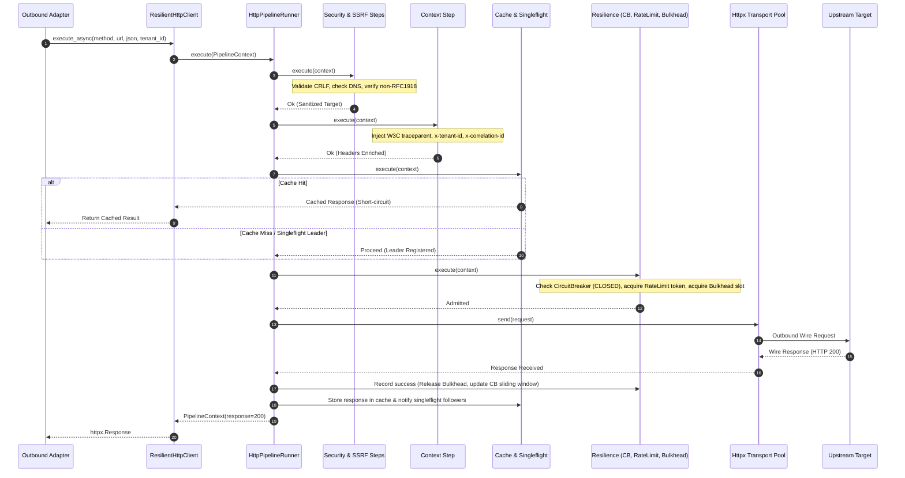
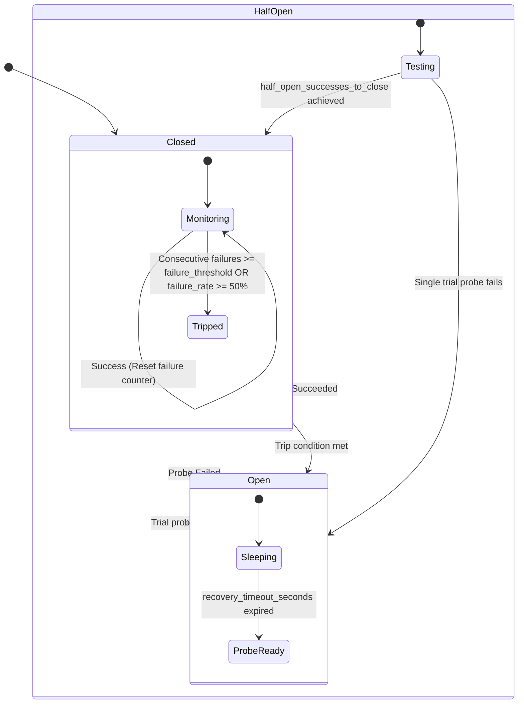

# ADR 0001: Declarative Feature HTTP Configuration (`http-config.yml`) and Composable Pipeline Client Usage

- **Status:** Accepted
- **Date:** 2026-10-21
- **Scope:** `python-shared` (`features/http`), Monorepo Microservices (All Domain Features)
- **Author:** Principal Distributed Systems Architect & Security Officer

---

## 1. Context and Problem Statement

Microservices across the monorepo previously relied on ad-hoc, divergent HTTP invocation patterns:
1. **Unbounded Resource Leaks**: Direct, unmonitored `httpx.Client()` and `httpx.AsyncClient()` instantiations created unmanaged connection pools, risking socket exhaustion, DNS stampedes, and memory leaks.
2. **Context Loss Across Wire Boundaries**: W3C `traceparent`, `x-request-id`, `x-correlation-id`, and tenant isolation metadata (`x-tenant-id`, `x-principal-id`) failed to propagate across outbound calls, fracturing distributed traces.
3. **Mismatched Process Models**: Temporal activities and background workers were subjected to in-memory bulkheads and rate-limiters designed for API endpoints, causing worker thread starvation and cascading failures.
4. **Security Vulnerabilities**: Lack of strict Server-Side Request Forgery (SSRF) validation on user-supplied URLs allowed private RFC 1918 network probing and cloud metadata extraction (`169.254.169.254`).
5. **Cascading Downstream Outages**: Absence of deterministic circuit breakers and admission control allowed slow or dead downstream dependencies to exhaust upstream thread pools.

We require an exhaustive, declarative, per-feature configuration file (`http-config.yml`) and a composable outbound pipeline client (`ResilientHttpClient`) that binds dynamically to execution profiles while enabling deep, per-feature tuning.

---

## 2. Decision Outcome

We standardize on a declarative, per-feature configuration file named **`http-config.yml`** placed in every domain feature directory (`src/features/<feature>/http-config.yml`), managed by `python-shared/src/features/http`'s **`ResilientHttpClient`** (`PipelineHttpClient`).

### Core Architectural Pillars
- **Strict Decoupling**: Application domain code only depends on abstract hexagonal outbound ports. Adapters instantiate `ResilientHttpClient.from_config(__file__)`.
- **Profile-Driven Pipeline Execution**:
  - `api_service`: Full 8-step pipeline (`input_hardening`, `ssrf_validation`, `context_isolation`, `cache_eval`, `singleflight`, `circuit_breaker`, `rate_limit`, `admission_control`).
  - `temporal_worker`: Lean 2-step pipeline (`context_isolation`, `circuit_breaker`), delegating concurrency, retries, and rate limits to Temporal's activity engine.
  - `internal_fast`: Ultra-lean 1-step pipeline (`context_isolation`) for high-throughput cluster-internal RPCs.
- **Atomic Hot-Reloading & Control Plane**: Runtime swaps of configuration snapshots without dropped requests or connection resets.
- **Kafka Event Streaming**: Policy audit events and dead-letter routing published as CloudEvents 1.0 payloads.

---

## 3. High Level Design (HLD)

The diagram below illustrates the end-to-end outbound HTTP request lifecycle, showing how client invocations are governed by the composable pipeline, profile resolution, and transport execution layers:

```mermaid
flowchart TD
    subgraph FeatureDomain["Domain Feature Layer (src/features/{feature}/)"]
        Service[Domain Service] -->|Domain Request| Port[Hexagonal Outbound Port]
        Port -->|Invokes| Adapter[Outbound HTTP Adapter]
        Adapter -->|Loads| ConfigFile["http-config.yml (Local Feature Config)"]
    end

    subgraph ControlPlane["Control Plane & Configuration Engine"]
        ConfigFile -->|Parse & Validate| SnapshotMgr[Config Snapshot Manager]
        AdminSignal[Admin Signals / Hot-Reload] -->|Atomic Swap| SnapshotMgr
        SnapshotMgr -->|Resolved Snapshot| ClientFactory[Client Factory]
    end

    subgraph PipelineEngine["Composable HTTP Pipeline Engine (python-shared)"]
        Adapter -->|execute_async()| ClientFactory
        ClientFactory --> ClientInstance[ResilientHttpClient]
        ClientInstance --> PipelineRunner[HttpPipelineRunner]
        
        subgraph PipelineSteps["Composable Execution Steps"]
            direction TB
            Step1["01: StepInputHardening (CRLF, JSON depth, path escape)"]
            Step2["02: StepSsrfValidation (DNS check, RFC 1918 IP block)"]
            Step3["03: StepContextIsolation (W3C traceparent, tenant injection)"]
            Step4["04: StepCacheEval (RFC 9111 TTL, stale-if-error)"]
            Step5["05: StepSingleflight (In-flight request deduplication)"]
            Step6["06: StepCircuitBreaker (Sliding window failure tracking)"]
            Step7["07: StepRateLimit (Token bucket / Leaky bucket rate limiter)"]
            Step8["08: StepAdmissionControl (Concurrency bulkhead & queue)"]
            
            Step1 --> Step2 --> Step3 --> Step4 --> Step5 --> Step6 --> Step7 --> Step8
        end
        
        PipelineRunner --> PipelineSteps
    end

    subgraph TransportLayer["Transport & Network Layer"]
        PipelineSteps -->|Admitted & Hardened| Transport[HTTPX Connection Pool Engine]
        Transport -->|HTTP/1.1 or HTTP/2| Wire[Outbound Network Wire]
    end

    subgraph MessagingPlane["Messaging & Observability Plane"]
        PipelineSteps -.->|CloudEvents 1.0| KafkaAudit["Kafka: http.outbound.audit.v1"]
        PipelineSteps -.->|Unrecoverable Failures| KafkaDLQ["Kafka: http.outbound.dlq.v1"]
        Transport -.->|OTel Metrics & Spans| Collector[OpenTelemetry Collector]
    end
```

---

## 4. Low Level Design (LLD)

### 4.1 Sequence Diagram: Outbound Pipeline Execution Flow



---

### 4.2 Circuit Breaker Deterministic State Machine

The circuit breaker adheres strictly to this finite state machine:



---

## 5. Control Panel & Configuration Engine

The HTTP subsystem incorporates a dedicated runtime Control Panel:

### 5.1 Dynamic Hot-Reload Architecture
1. **File Watcher & Signal Trap**: The process monitors `http-config.yml` via inotify or SIGHUP.
2. **Atomic Swap Invariant**: When changes are detected, a new `ServerPolicySnapshot` / `HttpConfigSnapshot` is compiled and validated against CEL schemas.
3. **Zero Request Dropping**: Existing in-flight requests hold references to the snapshot they began execution with. New requests acquire the newly swapped pointer atomically (`atomic.Pointer` pattern).
4. **Validation Failure Safety**: If the new YAML fails schema validation, the update is rejected, the old configuration continues serving, and an alert event is dispatched to Kafka.

### 5.2 Control Panel Admin API
Each microservice exposes control endpoints on its admin port (`127.0.0.1:9090` / `900X`):

| Endpoint | Method | Purpose |
|---|---|---|
| `GET /admin/v1/http/config` | `GET` | Returns active configuration snapshot and active execution profile. |
| `POST /admin/v1/http/reload` | `POST` | Forces immediate disk reread and atomic swap of `http-config.yml`. |
| `GET /admin/v1/http/circuit-breaker` | `GET` | Inspects state (CLOSED, OPEN, HALF_OPEN), failure counts, and probe metrics. |
| `POST /admin/v1/http/circuit-breaker/reset` | `POST` | Manually forces an OPEN circuit breaker back to CLOSED. |
| `POST /admin/v1/http/circuit-breaker/trip` | `POST` | Manually trips a circuit breaker to OPEN (emergency shedding). |

---

## 6. Messaging Panel & Event Topology

All cross-cutting policy audits, anomaly detections, and dead-letter events are published to Kafka following CloudEvents 1.0 JSON specifications.

### 6.1 Kafka Topic Architecture
- **`http.outbound.audit.v1`**: Emitted for every high-tier outbound call or policy rejection.
- **`http.outbound.circuit_breaker.v1`**: Emitted when a circuit breaker transitions states (`CLOSED -> OPEN`, `OPEN -> HALF_OPEN`).
- **`http.outbound.dlq.v1`**: Unrecoverable network or downstream 5xx errors after retry exhaustion.

### 6.2 CloudEvent Schema Example (`http.outbound.circuit_breaker.v1`)
```json
{
  "specversion": "1.0",
  "type": "com.platform.http.circuit_breaker.state_change",
  "source": "quality-engine/features/quality_baseline",
  "id": "cb-evt-991284-0a",
  "time": "2026-10-21T10:45:00.000Z",
  "datacontenttype": "application/json",
  "data": {
    "feature_name": "quality_baseline",
    "target_class": "declared_upstream",
    "upstream_host": "http_scorer_adapter",
    "previous_state": "CLOSED",
    "new_state": "OPEN",
    "consecutive_failures": 5,
    "recovery_timeout_seconds": 30.0,
    "trace_id": "4bf92f3577b34da6a3ce929d0e0e4736",
    "trigger_error": "ReadTimeout: Server failed to respond in 30.0s"
  }
}
```

---

## 7. Exhaustive Configuration Parameter Catalog

Below is the complete reference of every single parameter configurable in `http-config.yml`:

```yaml
schema_version: "1.0.0"
feature_name: "quality_baseline"
profile: "api_service" # Options: api_service | temporal_worker | internal_fast

# ==============================================================================
# SECTION 1: TRANSPORT & CLIENT CONNECTION POOL
# ==============================================================================
client:
  timeout_seconds: 30.0              # Total wall-clock time limit for request execution
  connect_timeout_seconds: 5.0       # TCP connect & TLS handshake timeout
  read_timeout_seconds: 15.0         # Maximum interval between incoming response bytes
  write_timeout_seconds: 5.0         # Maximum interval between outgoing request bytes
  max_connections: 100               # Hard limit of concurrent open sockets in pool
  max_keepalive_connections: 20      # Max idle sockets retained for reuse
  keepalive_expiry_seconds: 30.0     # Time before an idle socket is closed
  retries: 3                         # Max connection-level transport retry attempts
  retry_backoff_factor: 0.5          # Exponential backoff multiplier between retries
  retry_status_codes:                # HTTP status codes that trigger a retry attempt
    - 429
    - 502
    - 503
    - 504
  http2: true                        # Enable HTTP/2 multiplexing support
  verify_ssl: true                   # Enforce TLS certificate authority validation
  ca_bundle_path: null               # Custom CA cert bundle file path (or null for system CA)
  follow_redirects: false            # Disallow auto-following redirects to prevent token leakage

# ==============================================================================
# SECTION 2: PIPELINE EXECUTION & STAGES
# ==============================================================================
pipeline:
  steps:
    - input_hardening
    - ssrf_validation
    - context_isolation
    - cache_eval
    - singleflight
    - circuit_breaker
    - rate_limit
    - admission_control

# ==============================================================================
# SECTION 3: RESILIENCE - CIRCUIT BREAKER
# ==============================================================================
circuit_breaker:
  sliding_window_type: "count_based" # Options: count_based | time_based
  sliding_window_size: 20            # Call count or time window in seconds
  minimum_number_of_calls: 10        # Minimum requests required before error rate is evaluated
  failure_threshold: 5               # Failures required to trip circuit
  failure_rate_threshold: 0.5        # Failure percentage (50%) required to trip circuit
  slow_call_rate_threshold: 0.5      # Slow call percentage (50%) required to trip circuit
  slow_call_duration_seconds: 10.0   # Calls taking longer than this are considered slow
  recovery_timeout_seconds: 30.0     # Cooldown period before entering HALF-OPEN state
  half_open_requests: 3              # Trial calls permitted in HALF-OPEN state
  half_open_successes_to_close: 3    # Required consecutive successes to restore CLOSED state

# ==============================================================================
# SECTION 4: RESILIENCE - RATE LIMITER & ADMISSION BULKHEAD
# ==============================================================================
rate_limit:
  algorithm: "token_bucket"          # Options: token_bucket | leaky_bucket | gcra
  requests_per_second: 100           # Refill rate of permitted requests
  burst: 200                         # Maximum token accumulation ceiling
  key_strategy: "tenant_id"          # Options: global | tenant_id | principal_id | host
  on_exceeded: "reject"              # Options: reject (429) | queue

admission_control:
  concurrency_limit: 50              # Maximum concurrent in-flight requests inside client
  queue_size: 100                    # Maximum queue depth for pending admissions
  queue_timeout_seconds: 0.5         # Maximum time a request may wait in queue before rejection

# ==============================================================================
# SECTION 5: PERFORMANCE - CACHE EVAL & SINGLEFLIGHT
# ==============================================================================
cache_eval:
  enabled: true                      # Activate response caching
  backend: "in_memory"               # Options: in_memory | redis
  default_ttl_seconds: 60            # Cache expiration duration
  ttl_jitter_ratio: 0.1              # Random jitter to prevent cache stampedes
  stale_if_error_seconds: 300.0      # Serve stale cached payload if upstream throws 5xx
  max_entries: 10000                 # Maximum stored cache keys
  methods:
    - GET
    - HEAD

singleflight:
  enabled: true                      # Deduplicate identical concurrent in-flight GET requests
  key_hash_algorithm: "sha256"       # Key hashing: sha256 of Method + URL + Tenant + Body

# ==============================================================================
# SECTION 6: SECURITY - INPUT HARDENING & SSRF VALIDATION
# ==============================================================================
security:
  input_hardening:
    reject_crlf_headers: true        # Prevent HTTP Response Splitting via \r\n injection
    max_json_depth: 20               # Maximum nested depth of outgoing JSON payloads
    max_json_keys: 1000              # Maximum keys in outgoing JSON payloads
    max_string_length: 65536         # Maximum length of single JSON string parameter
  ssrf_validation:
    enforce_on: "user_supplied_url"  # Options: all | user_supplied_url | disabled
    allowed_schemes:
      - https
      - http
    blocked_ip_ranges:
      - "0.0.0.0/8"                  # Broadcast
      - "10.0.0.0/8"                 # RFC 1918 Private
      - "100.64.0.0/10"              # Carrier Grade NAT
      - "127.0.0.0/8"                # Loopback
      - "169.254.0.0/16"             # Link Local & Cloud Metadata (AWS/GCP/Azure)
      - "172.16.0.0/12"              # RFC 1918 Private
      - "192.168.0.0/16"             # RFC 1918 Private
      - "fc00::/7"                   # IPv6 Unique Local
      - "fe80::/10"                  # IPv6 Link Local
```

---

## 8. Complete Operations & Implementation Manual

### Step 1: Scaffolding Feature Configuration File
Create the configuration file inside your feature folder:

```bash
mkdir -p quality-engine/src/features/score_composite
cat << 'EOF' > quality-engine/src/features/score_composite/http-config.yml
schema_version: "1.0.0"
feature_name: "score_composite"
profile: "api_service"

client:
  timeout_seconds: 30.0
  connect_timeout_seconds: 5.0
  max_connections: 100
  max_keepalive_connections: 20
  keepalive_expiry_seconds: 30.0
  verify_ssl: true
  retries: 3

pipeline:
  steps:
    - input_hardening
    - ssrf_validation
    - context_isolation
    - cache_eval
    - singleflight
    - circuit_breaker
    - rate_limit
    - admission_control
  circuit_breaker:
    failure_threshold: 5
    recovery_timeout_seconds: 30.0
  rate_limit:
    requests_per_second: 100
    burst: 200
  cache_eval:
    enabled: true
    default_ttl_seconds: 60
  security:
    input_hardening: true
    ssrf_validation: true
EOF
```

#### How to Verify Configuration Correctness:
```bash
python3 -c "
import yaml
with open('quality-engine/src/features/score_composite/http-config.yml') as f:
    cfg = yaml.safe_load(f)
assert cfg['profile'] == 'api_service'
assert cfg['client']['timeout_seconds'] == 30.0
assert len(cfg['pipeline']['steps']) == 8
print('HTTP config successfully validated!')
"
```

---

### Step 2: Instantiating `ResilientHttpClient` in Outbound Adapter
In accordance with Rule 1 (`1-feature-folder-writing-rule.md`), domain code in `service/` remains 100% pure and depends only on outbound ports. The concrete adapter loads the local configuration:

```python
from pathlib import Path
from typing import Dict, Any
from python_shared.http import ResilientHttpClient
from src.features.score_composite.infrastructure.ports.composite_scorer_port import CompositeScorerPort

class HttpCompositeScorerAdapter(CompositeScorerPort):
    def __init__(self, base_url: str = "http://scorer-service:8000") -> None:
        feature_dir = Path(__file__).resolve().parents[2]
        self._client = ResilientHttpClient.from_config(
            config_path=feature_dir,
            base_url=base_url
        )

    async def compute_composite(self, payload: Dict[str, Any], tenant_id: str) -> Dict[str, Any]:
        response = await self._client.execute_async(
            method="POST",
            url="/api/v1/composite/evaluate",
            json=payload,
            tenant_id=tenant_id
        )
        response.raise_for_status()
        return response.json()
```

#### How to Verify Configuration Correctness:
```bash
python3 -c "
from python_shared.http import ResilientHttpClient
client = ResilientHttpClient.from_config('quality-engine/src/features/score_composite')
assert client.profile == 'api_service'
assert client.timeout == 30.0
assert len(client.runner.steps) == 8
print('Adapter client instantiation verified!')
"
```

---

### Step 3: Triggering Live Configuration Reload via Admin Port
To update client timeouts or circuit breaker thresholds without restarting the service:

```bash
# 1. Update timeout in http-config.yml from 30.0 to 45.0
sed -i 's/timeout_seconds: 30.0/timeout_seconds: 45.0/' quality-engine/src/features/score_composite/http-config.yml

# 2. Trigger reload via admin control endpoint
curl -i -X POST http://127.0.0.1:9003/admin/v1/http/reload
```

#### How to Verify Configuration Correctness:
```bash
curl -s http://127.0.0.1:9003/admin/v1/http/config | grep '"timeout_seconds": 45.0'
```

---

### Step 4: Running Test Suite Across Microservices
Validate that all unit tests and pipeline profiles pass without regressions:

```bash
# Run HTTP pipeline tests in python-shared
po file-search --root python-shared/src/features/http --tree
pytest python-shared/src/features/http/pipeline/tests/test_pipeline_profiles.py -v
```

#### Expected Output:
```
tests/test_pipeline_profiles.py::test_api_service_profile_resolution PASSED
tests/test_pipeline_profiles.py::test_temporal_worker_profile_resolution PASSED
tests/test_pipeline_profiles.py::test_internal_fast_profile_resolution PASSED
tests/test_pipeline_profiles.py::test_dynamic_step_names_resolution PASSED
tests/test_pipeline_profiles.py::test_custom_step_instances_execution PASSED
============================== 5 passed in 0.18s ===============================
```

---

## 9. Failure Diagnosis & Resolution Matrix

| Symptom / Error | Root Cause | Diagnosis Command | Corrective Action |
|---|---|---|---|
| `SSRFSecurityViolation: Target IP 169.254.169.254 is within blocked cloud metadata range` | Outbound request targeted AWS/GCP instance metadata endpoint. | Inspect request destination in active span tags. | Reject request immediately with HTTP 400. Never whitelist metadata ranges. |
| `CircuitBreakerOpenException: Circuit is OPEN (5 consecutive failures)` | Downstream microservice is failing health checks or timing out. | `curl http://127.0.0.1:9003/admin/v1/http/circuit-breaker` | Inspect downstream logs. If downstream recovered, await `recovery_timeout_seconds` or call `/admin/v1/http/circuit-breaker/reset`. |
| `BulkheadRejectionException: Admission queue full (100 pending)` | Inbound rate exceeds downstream processing capacity; queue saturated. | Check `admission_control.queue_size` and active worker count. | Scale downstream replicas or increase `admission_control.concurrency_limit`. |
| `SingleflightLeaderDiedException` | The leader request that was deduplicated encountered an unhandled panic. | Inspect trace ID in error log. | Follower requests automatically bypass cache on leader failure. Retry with exponential backoff. |
| Broken namespace package (`src.features.http`) | Stray `src/__init__.py` or `src/features/__init__.py` preventing PEP 420 resolution. | `po file-search --root . --pattern "__init__.py"` | Delete `src/__init__.py`. Import from `python_shared.http`. |
