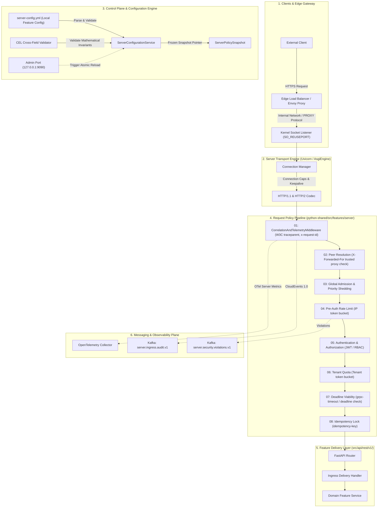
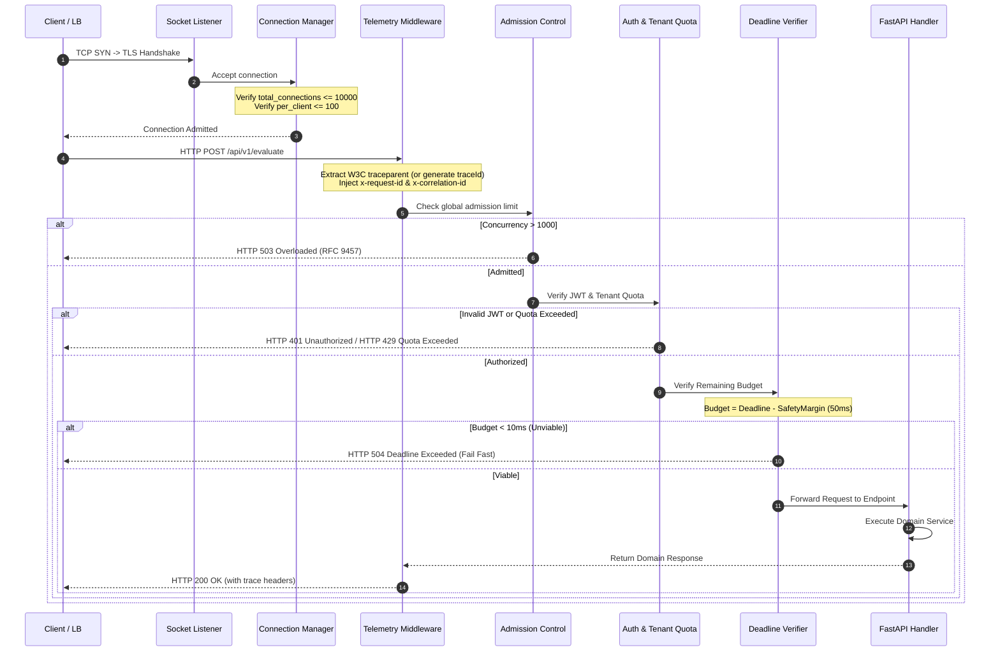
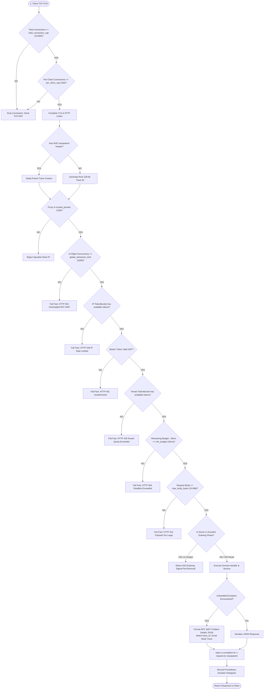
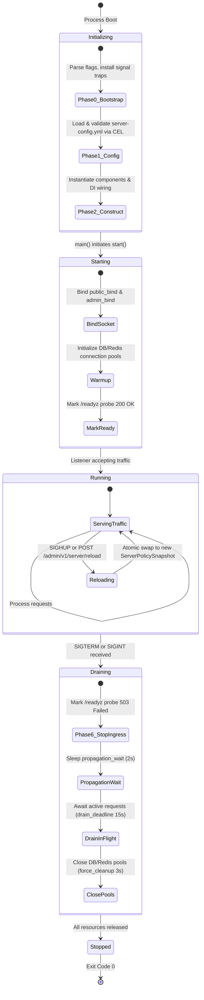

# ADR 0002: Declarative Feature Server Configuration (`server-config.yml`) and FastAPI Middleware Lifecycle Usage

- **Status:** Accepted
- **Date:** 2026-10-21
- **Scope:** `python-shared` (`features/server`), Monorepo Microservices (All FastAPI Services)
- **Author:** Principal Distributed Systems Architect & Infrastructure Security Officer

---

## 1. Context and Problem Statement: Why Does This Even Exist?

In modern cloud-native Kubernetes environments, FastAPI microservices do not exist in a vacuum; they sit behind Layer-7 reverse proxies (Envoy, NGINX, Cloudflare, AWS Application Load Balancers) and interface directly with Kubernetes Pod lifecycle controllers. 

Previously, across the 16 packages in this monorepo, FastAPI applications were bootstrapped with default, unconfigured `uvicorn.run()` calls and ad-hoc middleware. This created critical vulnerabilities and severe production outages:

### 1.1 Post-Mortem Analysis of Past Systemic Server Failures

1. **The "Default Uvicorn in Cloud Production" Trap (Slowloris & Connection Starvation)**:
   - *What Happened*: Default Uvicorn installations have no header read timeout and unbounded request payload ingestion. Attackers or malfunctioning mobile clients established TCP connections and transmitted headers byte-by-byte with 10-second delays.
   - *Impact*: Sockets remained open indefinitely. The server reached its OS file descriptor ceiling, rejecting legitimate ingress traffic and causing total API denial-of-service.

2. **The Kubernetes Rolling Deployment 502/504 Drop Outage**:
   - *What Happened*: When a deployment rolled out a new image, Kubernetes sent `SIGTERM` to the old pod while simultaneously updating the Kubernetes Service endpoints. However, `kube-proxy` iptables propagation takes 1.5 to 2.5 seconds across cluster worker nodes. The terminating Uvicorn process immediately closed its listening socket on `SIGTERM`.
   - *Impact*: Inbound requests arriving during that 2-second propagation window received TCP connection resets (`ECONNRESET`), causing AWS ALB / Envoy to return `502 Bad Gateway` to end-users during every single deployment rollout. Furthermore, in-flight requests processing heavy database queries were killed mid-flight, causing partial state corruption.

3. **Memory Bomb Denial-of-Service via Unbounded Payloads (OOM Crashes)**:
   - *What Happened*: Endpoints did not enforce a hard limit on incoming request bodies at the ASGI socket layer. Clients uploaded multi-megabyte payloads to endpoints expecting small JSON objects.
   - *Impact*: Python allocated memory to buffer the entire body into RAM. Under concurrent requests, the container exceeded its Kubernetes memory limit (`limits.memory: 512Mi`), triggering the Linux kernel OOM (Out Of Memory) killer and killing the pod instantly.

4. **Information Disclosure via Raw Python Traceback Leaks**:
   - *What Happened*: When an unhandled exception occurred (e.g. database connection timeout or SQL syntax error), default FastAPI handlers returned internal Python stack traces containing filesystem paths, internal package module names, and raw SQL queries to external callers.
   - *Impact*: Attackers mapped out internal system architecture and software versions. Error responses lacked standardized error schemas, breaking automated client error parsing and violating RFC 9457 standards.

5. **Silent Port Clashes & Rogue Admin Interfaces**:
   - *What Happened*: Developers hardcoded arbitrary bind ports (`8000`, `8080`) across services. Furthermore, administrative endpoints (`/reload`, `/metrics`) were exposed on the same public port as user-facing API routes.
   - *Impact*: Services running on the same host or development container collided. Sensitive administrative control endpoints and internal Prometheus metrics were accidentally reachable from public ingress routes.

6. **IP Spoofing via Unchecked `X-Forwarded-For` Proxies**:
   - *What Happened*: Ingress handlers trusted `X-Forwarded-For` without validating that the proxy sending the header was an authorized, internal load balancer CIDR.
   - *Impact*: Callers forged `X-Forwarded-For: 127.0.0.1`, bypassing pre-auth IP rate limiters and spoofing client identities.

---

## 2. Decision Outcome: The Declarative Server & Ingress Architecture

To permanently resolve these failure modes, we adopted an architecture governed by five strict principles:

1. **Per-Feature Co-Located Declarative Contract (`server-config.yml`)**:
   - Every domain feature directory owns an explicit `server-config.yml`.
   - Socket options, idle connection timeouts, body size caps, and drain deadlines are declared in YAML.
   - Transport policies are decoupled from application code and can be tuned dynamically by SREs.

2. **Google Common Expression Language (CEL) Mathematical Rule Validation**:
   - `ServerConfigurationService` parses the YAML and evaluates strict mathematical invariants before the server binds to a socket:
     - `header_read_timeout < idle_connection_timeout` (prevents Slowloris hangs).
     - `upstream_lb_idle_timeout < idle_connection_timeout` (eliminates idle race 502s).
     - `propagation_wait + drain_deadline + force_cleanup_margin < orchestrator_kill_timeout` (guarantees graceful draining finishes before Kubernetes `SIGKILL`).
   - If any invariant is violated, the process refuses to boot, preventing invalid configurations from reaching production.

3. **Unified Correlation & Telemetry Middleware**:
   - Every FastAPI application mounts `CorrelationAndTelemetryMiddleware` as its outermost interceptor.
   - Extracts incoming W3C `traceparent` headers, generates unique `x-request-id` values, tracks request latency histograms, and propagates context to logs and downstream calls.

4. **RFC 9457 Problem Details Standard**:
   - Centralized exception handlers capture all 4xx, 422, and 500 exceptions, returning sanitized `application/problem+json` envelopes with active `trace_id` references while scrubbing internal traces.

5. **3-Phase Graceful Draining Protocol**:
   - Phase 1 (`propagation_wait`): Pod returns 503 on `/readyz` while keeping sockets open, allowing edge proxies 2 seconds to deregister the pod.
   - Phase 2 (`drain_deadline`): Pod allows up to 15 seconds for in-flight requests to complete.
   - Phase 3 (`force_cleanup_margin`): Closes remaining idle pools and terminates cleanly before Kubernetes sends `SIGKILL`.

---

## 3. High Level Design (HLD) & Architectural Deep-Dive

### 3.1 Architecture Diagram



---

### 3.2 In-Depth HLD Component Walkthrough

#### 1. Clients & Edge Gateway
- **Proxy Boundary**: High-traffic public servers operate behind an L7 reverse proxy (Envoy, NGINX, or Cloud Load Balancer). The edge terminates public TLS 1.3, mitigates SYN/DDoS connection floods, and forwards clean traffic to the application listener.
- **PROXY Protocol & Real Peer Identification**: The gateway injects the client's actual remote IP via `X-Forwarded-For` or PROXY protocol v2, allowing internal admission policies to distinguish legitimate users from bad actors.

#### 2. Server Transport Engine (Uvicorn / Kernel Sockets)
- **Linux Socket Tuning**:
  - `SO_REUSEPORT`: Enables kernel-level load balancing across multiple worker processes on the same port, ensuring zero-downtime rolling process upgrades.
  - `TCP_NODELAY`: Explicitly disables Nagle's algorithm, avoiding 40ms delayed-ACK packet buffering on small JSON request/response payloads.
  - `socket_backlog`: Sized to 1024, preventing connection drops during sudden traffic spikes.
- **Connection Manager**: Monitors total open connections against `limits.total_connection_cap` (10,000) and limits per-peer connections to `limits.per_client_cap` (100) to defeat single-IP socket exhaustion attacks.

#### 3. Control Plane & Configuration Engine
- **CEL Rule Engine**: Before a `server-config.yml` is accepted into memory, it runs through the Google Common Expression Language (CEL) validation engine. If cross-field rules fail (e.g. `header_read_timeout >= idle_connection_timeout`), the server refuses to boot, preventing invalid states from reaching runtime.
- **Atomic Swap Invariant**: When hot-reloaded via `POST /admin/v1/server/reload`, the configuration pointer is swapped atomically (`atomic.Pointer`). Active connections finish under their original policy; new connections inherit the updated snapshot.

#### 4. Request Policy Pipeline
Requests pass through an explicit 8-stage sequence:
1. **`CorrelationAndTelemetryMiddleware`**: Extracts incoming W3C `traceparent` or generates a new root trace ID. Injects `x-request-id` and `x-correlation-id` into request state and response headers.
2. **`Peer Resolution`**: Inspects `X-Forwarded-For` strictly against `trusted_proxies` CIDRs. Untrusted hops are rejected to defeat IP spoofing.
3. **`Global Admission`**: Enforces a global concurrency ceiling (`limits.global_admission_limit`). When saturated, background/batch requests are shed first (`priority_admission`).
4. **`Pre-Auth Rate Limit`**: Applies GCRA / token bucket limits based on resolved peer IP *before* running expensive JWT cryptographic signature verifications.
5. **`Authentication & Authorization`**: Validates JWT signatures against local JWKS caches, verifies scopes, and extracts tenant identity (`tenant_id`).
6. **`Tenant Quota`**: Enforces per-tenant rate limits backed by Redis with local in-memory fallback.
7. **`Deadline Viability`**: Inspects `grpc-timeout`. If the remaining execution budget minus `safety_margin_ms` (50ms) is lower than `min_budget_ms` (10ms), the server fails fast with HTTP 504 Deadline Exceeded.
8. **`Idempotency Lock`**: Deduplicates mutations on POST/PUT requests using `idempotency-key` with a 24-hour TTL.

#### 5. Feature Delivery Layer
- The request reaches the feature handler in `src/api/rest/v1/`. The handler unmarshals the payload using strict Pydantic schemas and passes domain DTOs to the service.

#### 6. Messaging & Observability Plane
- Audit events, authorization failures, and payload-too-large violations are emitted as CloudEvents 1.0 JSON messages to Kafka.
- Request duration histograms (`http.server.request.duration`) and active request gauges (`http.server.active_requests`) are exported to OpenTelemetry collectors.

---

## 4. Low Level Design (LLD)

### 4.1 Sequence Diagram: Ingress Request Pipeline Execution



---

### 4.2 Sequence Diagram In-Depth Step Walkthrough

1. **Connection Admission (Steps 1–3)**: The client completes the TCP handshake. The socket listener hands the raw socket to the connection manager. The connection manager checks active sockets against `limits.total_connection_cap` (10,000) and `limits.per_client_cap` (100). If limits are exceeded, the socket is immediately closed with TCP RST to protect server memory.
2. **Telemetry Ingress (Step 4)**: The client transmits the HTTP request headers. `CorrelationAndTelemetryMiddleware` inspects headers for `traceparent`. If missing, it generates a fresh W3C trace ID. It creates an OpenTelemetry server span, binds the trace context to Python's `contextvars`, and generates an `x-request-id`.
3. **Admission Gate (Steps 5–6)**: The request enters admission control. If current in-flight concurrent requests exceed `limits.global_admission_limit` (1,000), the request is rejected with HTTP 503 Overloaded (formatted as an RFC 9457 Problem Details JSON envelope).
4. **Authentication & Tenant Quota (Steps 7–8)**: The JWT is validated. If invalid or expired, HTTP 401 is returned. If valid, the tenant ID is resolved and checked against the token bucket in `tenant_quota`. If exhausted, HTTP 429 Too Many Requests is returned with a `Retry-After: 5` header.
5. **Deadline Verification (Steps 9–10)**: The deadline checker inspects `grpc-timeout`. It subtracts `safety_margin_ms` (50ms) from the client's budget. If the remaining time is less than `min_budget_ms` (10ms), execution halts immediately with HTTP 504.
6. **Execution & Egress (Steps 11–13)**: The request reaches the FastAPI handler. The domain service executes within the active span. The handler returns the response envelope. Telemetry middleware injects `x-correlation-id`, `x-request-id`, and records request latency into Prometheus/OTel histograms before returning HTTP 200 to the client.

---

### 4.3 End-to-End Functional Call Stack

The following call stack traces an inbound client request from the Linux kernel network stack up through Uvicorn's ASGI server engine, the ordered middleware pipeline, application routing, domain service execution, error handlers, and wire transmission:

```
[Linux Kernel & Network Hardware]
 1. Network Interface Card (NIC) receives Ethernet frame -> TCP SYN packet
      │
      ▼
 2. Linux Socket Layer (SO_REUSEPORT, TCP_NODELAY, Backlog=1024)
      │   └── TCP 3-way handshake completes -> Socket file descriptor created
      ▼
[Uvicorn / ASGI Server Engine]
 3. uvicorn.server.Server.serve() -> asyncio event loop receives read event
      │
      ▼
 4. uvicorn.protocols.http.h11_impl.HttpToolsProtocol.data_received()
      │   ├── Checks active connection count against limits.total_connection_cap (10,000)
      │   ├── Checks per-client connection count against limits.per_client_cap (100)
      │   └── Decodes HTTP byte stream -> Parses Method, Path, Headers
      ▼
 5. uvicorn.middleware.message_logger / ASGI Scope Initialization
      │   └── Constructs ASGI Scope: {"type": "http", "method": "POST", "path": "/api/v1/...", ...}
      ▼
[FastAPI Middleware & Policy Ingress Pipeline]
 6. CorrelationAndTelemetryMiddleware.__call__(scope, receive, send)
      │   ├── Extracts incoming W3C "traceparent" header (or generates new 128-bit trace ID)
      │   ├── Generates "x-request-id" (UUIDv4) and binds trace ID to Python contextvars
      │   └── Starts OpenTelemetry server span ("POST /api/v1/evaluate")
      ▼
 7. PeerResolutionMiddleware.dispatch(request)
      │   └── Inspects X-Forwarded-For strictly against server.trusted_proxies CIDRs -> Resolves real client IP
      ▼
 8. GlobalAdmissionMiddleware.dispatch(request)
      │   └── Checks in-flight request count against limits.global_admission_limit (1,000)
      │       (If concurrency > 1,000 -> sheds load and raises HTTP 503 Overloaded)
      ▼
 9. PreAuthRateLimitMiddleware.dispatch(request)
      │   └── Evaluates client IP TokenBucket against limits.ip_rate_limit_tokens (100)
      │       (If bucket empty -> raises HTTP 429 Too Many Requests)
      ▼
 10. Authentication & Authorization Middleware.dispatch(request)
      │   └── Validates Bearer JWT signature against cached JWKS -> Extracts claims and tenant_id
      ▼
 11. TenantQuotaMiddleware.dispatch(request)
      │   └── Evaluates tenant TokenBucket against limits.tenant_quota_tokens (500)
      │       (If tenant exceeded rate limit -> raises HTTP 429 Quota Exceeded)
      ▼
 12. DeadlineViabilityMiddleware.dispatch(request)
      │   └── Inspects "grpc-timeout" header. Calculates remaining budget: (deadline - safety_margin_ms).
      │       (If remaining budget < 10ms -> fails fast with HTTP 504 Deadline Exceeded)
      ▼
 13. MaxBodyBytesMiddleware.dispatch(request)
      │   └── Enforces limits.max_body_bytes (10 MiB) on request stream (if exceeded -> raises HTTP 413)
      ▼
[Feature Delivery & Domain Routing]
 14. fastapi.routing.APIRouter.__call__() -> Matches path and method to endpoint handler
      │
      ▼
 15. Ingress Delivery Handler: src/api/rest/v1/routes.py:evaluate_quality()
      │   └── Pydantic model validation (validates request body schema)
      ▼
 16. FeatureDomainService.process_evaluation()
      │   └── Pure domain business logic execution (100% decoupled from HTTP transport)
      ▼
 17. Handler returns domain response DTO -> Serialized to JSON envelope
      │
      ▼
[Exception & RFC 9457 Problem Details Layer]
 18. If exception raised -> RFC 9457 exception_handler captures error:
      │   └── Formats application/problem+json envelope with active trace_id (scrubs internal stack traces)
      ▼
[Egress Response Pipeline & Unwinding]
 19. GlobalAdmissionMiddleware decrements active concurrency counter
 20. CorrelationAndTelemetryMiddleware completes OpenTelemetry span:
      │   ├── Injects "x-correlation-id", "x-request-id", "traceparent" into response headers
      │   └── Records request duration histogram (http.server.request.duration)
      ▼
 21. uvicorn.protocols.http.h11_impl.HttpToolsProtocol sends HTTP response bytes to socket
 22. Linux Kernel Socket flushes packets to wire -> Client receives HTTP 200 OK
```

---

### 4.4 Internal Server Execution Decision Tree

#### 4.4.1 Exhaustive IF/ELSE Branching & Loop ASCII Tree (All Paths Covered)

```text
+------------------------------------------------------------------------------------------------------------------------+
|                          SERVER INGRESS PIPELINE: EXHAUSTIVE IF/ELSE & LIFECYCLE DECISION TREE                         |
|                       (All Network Stages, Middleware Interceptors, Bounds, and Error Paths Covered)                   |
+------------------------------------------------------------------------------------------------------------------------+

[INGRESS] Linux Kernel Socket receives TCP SYN on public_bind / admin_bind
   |
   +--> STAGE 1: Kernel Socket & Connection Caps
   |      |
   |      +-- IF (current_open_connections >= limits.total_connection_cap [10,000]) THEN:
   |      |     |-- [LOG CRITICAL] "Global connection cap reached (10000). Rejecting TCP handshake."
   |      |     |-- [METRIC] Increment counter 'server.connection.global_cap_saturated'
   |      |     +-- [DROP] Kernel closes socket via TCP RST
   |      |
   |      +-- ELSE IF (connections_from_ip(peer_ip) >= limits.per_client_cap [100]) THEN:
   |      |     |-- [LOG WARN] "Per-client connection flood from IP: " + peer_ip
   |      |     |-- [METRIC] Increment counter 'server.connection.client_flood_blocked'
   |      |     +-- [DROP] Terminate connection via TCP RST
   |      |
   |      +-- ELSE:
   |            +-- [ADMIT] Connection admitted. Handshake completes.
   |
   +--> STAGE 2: Uvicorn Codec & Slowloris Timeout Guards
   |      |
   |      +-- IF (header_read_time > server.header_read_timeout [10s]) THEN:
   |      |     |-- [LOG WARN] "Slowloris header trickle attack detected from " + peer_ip
   |      |     |-- [METRIC] Increment counter 'server.security.slowloris_aborted'
   |      |     +-- [DROP] Socket terminated (HTTP 408 Request Timeout)
   |      |
   |      +-- ELSE:
   |            +-- [PASS] Complete HTTP request headers decoded into ASGI scope.
   |
   +--> STAGE 3: Correlation & Telemetry Middleware [CorrelationAndTelemetryMiddleware]
   |      |
   |      +-- IF ("traceparent" in request.headers) THEN:
   |      |     +-- active_trace_context = parse_w3c_traceparent(request.headers["traceparent"])
   |      +-- ELSE:
   |      |     +-- active_trace_context = generate_new_128bit_trace_context()
   |      |
   |      |-- request.state.trace_id = active_trace_context.trace_id
   |      |-- request.state.correlation_id = request.headers.get("x-correlation-id") or generate_uuid4()
   |      |-- request.state.request_id = generate_uuid4()
   |      +-- [OPENTELEMETRY] Start server span with active trace context.
   |
   +--> STAGE 4: Peer IP Resolution & Trusted Proxy Verification
   |      |
   |      +-- IF (peer_ip in server.trusted_proxies) THEN:
   |      |     |-- real_client_ip = parse_x_forwarded_for(request.headers)
   |      |     +-- [RESOLVED] Client IP verified via trusted reverse proxy.
   |      +-- ELSE:
   |            |-- real_client_ip = peer_ip (Ignore spoofed X-Forwarded-For headers!)
   |            +-- [SECURED] Direct peer IP adopted.
   |
   +--> STAGE 5: Global Admission Concurrency Bulkhead
   |      |
   |      +-- IF (in_flight_requests >= limits.global_admission_limit [1,000]) THEN:
   |      |     |-- [LOG CRITICAL] "Server ingress concurrency ceiling exceeded: 1000 requests"
   |      |     |-- [EVENT] Kafka CloudEvent -> 'server.ingress.audit.v1' (topic: overload_shed)
   |      |     |-- [METRIC] Increment counter 'server.admission.overload_shed'
   |      |     +-- [RAISE] HTTPException(503, RFC_9457_ProblemDetails("Server Overloaded"))
   |      +-- ELSE:
   |            |-- in_flight_requests += 1
   |            +-- [ADMITTED] Concurrency slot reserved.
   |
   +--> STAGE 6: Pre-Authentication IP Rate Limiting
   |      |
   |      |-- tokens_remaining = ip_token_bucket.consume(real_client_ip, tokens=1)
   |      +-- IF (tokens_remaining == False) THEN:
   |      |     |-- [LOG WARN] "Pre-auth rate limit tripped for IP: " + real_client_ip
   |      |     |-- [EVENT] Kafka CloudEvent -> 'server.security.violations.v1'
   |      |     |-- [METRIC] Increment counter 'server.rate_limit.ip_rejected'
   |      |     +-- [RAISE] HTTPException(429, RFC_9457_ProblemDetails("IP Rate Limit Exceeded", retry_after=5))
   |      +-- ELSE:
   |            +-- [PASS] Token consumed from client IP bucket.
   |
   +--> STAGE 7: Authentication & Scope Verification
   |      |
   |      +-- IF (request.path in PUBLIC_WHITELIST ["/healthz", "/readyz", "/livez", "/docs"]) THEN:
   |      |     +-- [SKIP] Public unauthenticated endpoint.
   |      |
   |      +-- ELSE:
   |            |-- token = extract_bearer_token(request.headers)
   |            +-- IF (token is None or not verify_jwt_signature(token, cached_jwks)) THEN:
   |            |     |-- [LOG WARN] "Missing or invalid cryptographic JWT signature"
   |            |     |-- [METRIC] Increment counter 'server.auth.unauthorized'
   |            |     +-- [RAISE] HTTPException(401, RFC_9457_ProblemDetails("Unauthorized"))
   |            +-- ELSE:
   |                  |-- request.state.tenant_id = token.claims["tenant_id"]
   |                  +-- [AUTHORIZED] Tenant identity bound to request context.
   |
   +--> STAGE 8: Tenant Quota Token Bucket
   |      |
   |      +-- IF (tenant_id := request.state.tenant_id) THEN:
   |      |     |-- tenant_tokens = tenant_quota_store.consume(tenant_id, 1)
   |      |     +-- IF (tenant_tokens == False) THEN:
   |      |     |     |-- [LOG WARN] "Tenant quota capacity exhausted for tenant: " + tenant_id
   |      |     |     |-- [METRIC] Increment counter 'server.rate_limit.tenant_quota_exceeded'
   |      |     |     +-- [RAISE] HTTPException(429, RFC_9457_ProblemDetails("Tenant Quota Exceeded", retry_after=10))
   |      |     +-- ELSE:
   |      |           +-- [PASS] Tenant quota verified.
   |      +-- ELSE:
   |            +-- [SKIP] Unauthenticated route.
   |
   +--> STAGE 9: Deadline Viability Verification
   |      |
   |      +-- IF ("grpc-timeout" in request.headers) THEN:
   |      |     |-- remaining_ms = parse_timeout(request.headers["grpc-timeout"]) - safety_margin_ms (50ms)
   |      |     +-- IF (remaining_ms < min_budget_ms [10ms]) THEN:
   |      |     |     |-- [LOG WARN] "Request arrived with expired or unviable deadline budget: " + str(remaining_ms) + "ms"
   |      |     |     |-- [METRIC] Increment counter 'server.deadline.expired_prior_to_dispatch'
   |      |     |     +-- [RAISE] HTTPException(504, RFC_9457_ProblemDetails("Deadline Exceeded Prior to Execution"))
   |      |     +-- ELSE:
   |      |           +-- [PASS] Viable deadline budget remaining.
   |      +-- ELSE:
   |            +-- [SKIP] No caller deadline header specified.
   |
   +--> STAGE 10: Payload Size Invariant Check
   |      |
   |      |-- content_length = int(request.headers.get("content-length", 0))
   |      +-- IF (content_length > limits.max_body_bytes [10,485,760 bytes / 10 MiB]) THEN:
   |      |     |-- [LOG ALERT] "Payload exceeds hard limit: " + str(content_length) + " bytes"
   |      |     |-- [METRIC] Increment counter 'server.limits.payload_too_large'
   |      |     +-- [RAISE] HTTPException(413, RFC_9457_ProblemDetails("Payload Too Large. Max size is 10 MiB."))
   |      +-- ELSE:
   |            +-- [PASS] Request body within safety boundaries.
   |
   +--> STAGE 11: Lifecycle Drain Verification (Probes)
   |      |
   |      +-- IF (request.path == "/readyz") THEN:
   |      |     +-- IF (app.state.is_draining == True) THEN:
   |      |     |     |-- [LOG INFO] "Readiness check requested during drain -> Returning 503."
   |      |     |     +-- [RETURN] HTTP 503 Service Unavailable ("DRAINING") [Signals Kubernetes to remove Pod!]
   |      |     +-- ELSE:
   |      |           +-- [RETURN] HTTP 200 OK ("READY")
   |      |
   |      +-- ELSE:
   |            +-- [PROCEED] Proceed to FastAPI Router dispatch.
   |
   +--> [APPLICATION DELIVERY & BUSINESS EXECUTION]
   |      |
   |      +-- TRY:
   |      |     |-- domain_response = await feature_endpoint_handler(request, validated_pydantic_body)
   |      |     +-- json_response = JSONResponse(content=domain_response, status_code=200)
   |      |
   |      +-- EXCEPT RequestValidationError AS val_err:
   |      |     |-- [ERROR 422] Unprocessable Entity
   |      |     |-- [METRIC] Increment counter 'server.errors.validation'
   |      |     +-- json_response = format_rfc9457_validation_error(val_err, trace_id=request.state.trace_id)
   |      |
   |      +-- EXCEPT HTTPException AS http_err:
   |      |     |-- [ERROR 4xx] Client Error
   |      |     |-- [METRIC] Increment counter 'server.errors.http_client'
   |      |     +-- json_response = format_rfc9457_http_error(http_err, trace_id=request.state.trace_id)
   |      |
   |      +-- EXCEPT Exception AS unhandled_err:
   |            |-- [ERROR 500] Internal Server Error: Log exception stack trace to stderr
   |            |-- [EVENT] Kafka CloudEvent -> 'server.security.violations.v1'
   |            |-- [METRIC] Increment counter 'server.errors.unhandled_500'
   |            +-- json_response = format_rfc9457_internal_error(trace_id=request.state.trace_id) [Stack trace SCRUBBED]
   |
   +--> [EGRESS & RESPONSE UNWINDING]
          |
          |-- in_flight_requests -= 1 [Bulkhead concurrency slot released]
          |-- json_response.headers["x-correlation-id"] = request.state.correlation_id
          |-- json_response.headers["x-request-id"] = str(request.state.request_id)
          |-- json_response.headers["traceparent"] = format_w3c_traceparent(active_trace_context)
          |-- opentelemetry.record_latency(route=request.path, status=json_response.status_code, duration=now() - start)
          +-- [WIRE TRANSMIT] Uvicorn flushes HTTP response packets to client.
```

#### 4.4.2 Mermaid Decision Flowchart



---

### 4.5 Server Lifecycle State Machine

The server lifecycle adheres to this deterministic state machine to eliminate 502/504 errors during deployments:



#### Detailed Lifecycle Phase Walkthrough:
1. **Phase 0 (Bootstrap)**: Installs signal handlers for `SIGTERM`, `SIGINT`, and `SIGHUP`. Initializes the structured bootstrap logger on stderr.
2. **Phase 1 (Configuration & CEL)**: Loads `server-config.yml`, validates types, and runs CEL cross-field validation rules. Freezes configuration into an immutable `ServerPolicySnapshot`.
3. **Phase 2 (Component Construction)**: Builds the dependency injection graph (database pools, Redis clients, repository adapters). No I/O or network connections are opened.
4. **Starting & Socket Bind**: Binds TCP sockets to `public_bind` and `admin_bind`. Pre-warms database connection pools.
5. **Running**: Opens the readiness probe (`/readyz` returns 200 OK). Traffic flows into the server.
6. **Graceful Draining (On SIGTERM)**:
   - **Step 6.1 (Mark Unready)**: Changes `/readyz` response to HTTP 503 Service Unavailable.
   - **Step 6.2 (Propagation Delay)**: Sleeps for `lifecycle.propagation_wait` (default: 2s). This allows upstream load balancers and Kubernetes kube-proxy to detect the failed probe and remove the pod from the routing table.
   - **Step 6.3 (Drain In-Flight)**: Awaits completion of all currently running requests up to `lifecycle.drain_deadline` (default: 15s).
   - **Step 6.4 (Resource Cleanup)**: Closes database connection pools, flushes Kafka producers, and cleans up sockets within `lifecycle.force_cleanup_margin` (default: 3s).
   - Total shutdown time (`2s + 15s + 3s = 20s`) is strictly less than Kubernetes `orchestrator_kill_timeout` (30s), ensuring SIGKILL is never triggered.

---

## 5. Control Panel & Configuration Engine

### 5.1 Common Expression Language (CEL) Validation Engine
The server enforces mathematical and operational invariants at startup:
- `header_read_timeout < idle_connection_timeout`: Guarantees Slowloris headers are terminated before socket keepalive expires.
- `public_bind != admin_bind`: Prevents port collisions between public ingress and internal control interfaces.
- `idle_connection_timeout > upstream_lb_idle_timeout`: Ensures edge proxies close idle connections first, preventing 502 race conditions.
- `propagation_wait + drain_deadline + force_cleanup_margin < orchestrator_kill_timeout`: Guarantees graceful shutdown finishes before the orchestrator forcibly terminates the container.

### 5.2 Control Panel Admin API
Running on `admin_bind` (`127.0.0.1:9090` / `900X`):

| Endpoint | Method | Response | Description |
|---|---|---|---|
| `/admin/v1/server/config` | `GET` | `200 OK` (JSON) | Dumps active `ServerPolicySnapshot`. |
| `/admin/v1/server/reload` | `POST` | `200 OK` / `400 Bad Request` | Reloads `server-config.yml` from disk and executes CEL validation. |
| `/admin/v1/server/connections` | `GET` | `200 OK` (JSON) | Live socket count, admitted connections, and peer metrics. |
| `/readyz` | `GET` | `200 OK` / `503 Unavailable` | Readiness probe for load balancers. Returns 503 during shutdown drain. |
| `/livez` | `GET` | `200 OK` (JSON) | Liveness probe verifying process event loop health. |

---

## 6. Messaging Panel & Event Topology

### 6.1 Kafka Topic Architecture
- **`server.ingress.audit.v1`**: Sampled request access log carrying trace ID, route template, HTTP status, and duration.
- **`server.security.violations.v1`**: Security alerts emitted when payloads exceed `limits.max_body_bytes` or JWT verification fails.
- **`server.lifecycle.events.v1`**: Server state transitions (`STARTING`, `RUNNING`, `DRAINING`, `STOPPED`).

### 6.2 CloudEvent Schema Example (`server.security.violations.v1`)
```json
{
  "specversion": "1.0",
  "type": "com.platform.server.security.payload_too_large",
  "source": "quality-engine/src/api/rest/v1",
  "id": "sec-evt-884192-0b",
  "time": "2026-10-21T10:48:15.000Z",
  "datacontenttype": "application/json",
  "data": {
    "feature_name": "quality_baseline",
    "peer_ip": "198.51.100.42",
    "route": "/api/v1/evaluate",
    "method": "POST",
    "content_length": 15728640,
    "max_allowed_bytes": 10485760,
    "trace_id": "00f067aa0ba902b74bf92f3577b34da6",
    "action_taken": "rejected_413"
  }
}
```

---

## 7. Exhaustive Parameter Reference: Valid vs. Ideal vs. Anti-Patterns

This section provides an in-depth parameter analysis: syntax rules, ideal production settings, and dangerous anti-patterns that risk production outages.

### 7.1 Parameter Analysis Table

| Parameter Path | Type & Valid Range | Ideal Production Setting | Anti-Pattern (What is NOT Ideal) | Failure Mode Caused by Anti-Pattern |
|---|---|---|---|---|
| `server.public_bind` | `string`: `"IP:PORT"` (`1024-65535`) | `"0.0.0.0:8000"` (or assigned port: `8001`, `8003`, etc.). | Binding to `"127.0.0.1:8000"` inside container, or using ports `< 1024`. | Binding to localhost inside Docker/K8s makes server unreachable from outside container; ports <1024 require root privileges. |
| `server.admin_bind` | `string`: `"IP:PORT"` | `"127.0.0.1:9090"` (or feature-isolated loopback port). | Setting equal to `public_bind` or binding admin to `0.0.0.0`. | Port collision with public traffic; exposing administrative reload and debug endpoints to public internet. |
| `server.idle_connection_timeout` | `string`: `"5s"` to `"300s"` | `"65s"` (must exceed upstream LB idle timeout). | Setting to `"30s"` while upstream LB timeout is `"60s"`. | Race condition: Backend closes idle socket just as LB forwards a request, triggering HTTP 502 Bad Gateway at edge. |
| `server.header_read_timeout` | `string`: `"1s"` to `"60s"` | `"10s"` (must be `< idle_connection_timeout`). | Setting to `"120s"` or equal to `idle_connection_timeout`. | Slowloris vulnerability: Malicious clients send 1 byte every 10 seconds, holding thousands of connections open indefinitely. |
| `server.handshake_timeout` | `string`: `"1s"` to `"30s"` | `"5s"`. | Setting to `> 20s`. | TLS negotiation flood attacks exhaust worker CPU cycles on unauthenticated connections. |
| `server.upstream_lb_idle_timeout` | `string`: `"5s"` to `"300s"` | `"60s"` (matching AWS ALB / Envoy default). | Setting higher than `idle_connection_timeout`. | Violates CEL rule; triggers connection resets under moderate load. |
| `server.tcp_nodelay` | `bool`: `true`, `false` | `true`. | Setting to `false`. | Nagle's algorithm buffers packets, introducing artificial 40ms latency delays on small JSON API responses. |
| `server.so_reuseport` | `bool`: `true`, `false` | `false` for single-process containers; `true` for multi-worker bare metal. | Enabling `true` when process uses non-thread-safe local caches. | Kernel randomly distributes requests across processes without cache affinity. |
| `server.socket_backlog` | `int`: `64` to `65535` | `1024` (or matching OS `net.core.somaxconn`). | Setting to `< 128`. | Under sudden burst traffic, the kernel drops incoming TCP SYN packets, causing connection timeouts. |
| `server.trusted_proxies` | `list[str]` (CIDRs) | VPC subnet CIDRs (e.g. `10.0.0.0/8`, `127.0.0.1/32`). | Adding `"0.0.0.0/0"` to trusted proxies. | Catastrophic security breach: Any client can forge `X-Forwarded-For` and bypass IP-based rate limiting and access controls. |
| `lifecycle.propagation_wait` | `string`: `"1s"` to `"10s"` | `"2s"` to `"3s"`. | Setting to `"0s"`. | Ingress 502 drops: Server stops accepting traffic before Kubernetes endpoint controller removes pod IP from ingress proxy. |
| `lifecycle.drain_deadline` | `string`: `"5s"` to `"60s"` | `"15s"`. | Setting to `"1s"` or `> 60s`. | In-flight database mutations or client requests are severed midway; exceeding Kubernetes shutdown ceiling triggers SIGKILL. |
| `lifecycle.orchestrator_kill_timeout` | `string`: `"10s"` to `"120s"` | `"30s"` (matching K8s `terminationGracePeriodSeconds`). | Setting lower than `propagation_wait + drain_deadline`. | Process is forcibly killed with `SIGKILL` before connection drain finishes. |
| `limits.total_connection_cap` | `int`: `10` to `50000` | `10000` per container. | Setting to unbounded (`0` or negative). | Memory exhaustion: Process accepts 50,000 connections until killed by Linux Out-Of-Memory (OOM) killer. |
| `limits.per_client_cap` | `int`: `1` to `1000` | `100` per remote IP. | Setting to `10000`. | A single malfunctioning client or attacker can consume 100% of server connection capacity. |
| `limits.max_body_bytes` | `int`: `1024` to `52428800` | `10485760` (10 MiB) for standard APIs; `52428800` (50 MiB) for file uploads. | Setting to unbounded (`> 500 MiB`). | Heap memory exhaustion: Uploading a single 1 GB file crashes the Python runtime. |
| `limits.global_admission_limit` | `int`: `10` to `10000` | `1000` concurrent requests. | Leaving unconfigured or setting to `50000`. | Event loop saturation: Async event loop queues millions of micro-tasks, driving response latency from 10ms to 20 seconds. |
| `pre_auth_rate_limit.rate` | `string`: `"1/s"` to `"10000/s"` | `"100/s"` per IP. | Setting to `"1/s"` (too aggressive) or disabling. | Legitimate office NAT gateways with 100 users get blocked; disabling leaves JWT verification open to CPU denial-of-service. |
| `tenant_quota.burst` | `int`: `>= rate` | `2x` to `5x` of rate (e.g. `500` for 50/s rate). | Setting equal to rate (no burst capacity). | Legitimate batch client workflows fail with HTTP 429 on micro-bursts. |
| `deadline.safety_margin_ms` | `float`: `5.0` to `500.0` | `50.0` ms. | Setting to `0.0`. | Server continues processing requests after the upstream client has already timed out and disconnected. |
| `middleware.correlation_telemetry.enabled` | `bool`: `true`, `false` | `true` (mandatory across all services). | Setting to `false`. | Distributed tracing is severed; gateway logs cannot be correlated with database queries or service exceptions. |

---

## 8. Complete Step-by-Step Implementation & Operations Manual (Universal Framework)

This section provides a universal, feature-agnostic, 8-step blueprint to configure, validate, bootstrap, and operate a production-grade FastAPI server with declarative configuration and resilient middleware in **any existing package or any future feature** across the monorepo.

### 8.0 Universal Environment Variables & Conventions

Before configuring a server feature in any package, declare these environment variables in your terminal. All subsequent steps and verification scripts dynamically reference these variables:

```bash
# 1. Target package name (e.g., quality-engine, alert-engine, semantic-coherence, etc.)
export PACKAGE_NAME="quality-engine"

# 2. Target domain feature folder name (e.g., quality_baseline, alert_dispatcher, etc.)
export FEATURE_NAME="quality_baseline"

# 3. Designated ports (Public Ingress, Admin API, Prometheus Metrics)
export PUBLIC_PORT="8003"
export ADMIN_PORT="9003"
export METRICS_PORT="9103"

# 4. Computed absolute filesystem paths
export MONOREPO_ROOT="$(pwd)"
export FEATURE_DIR="${MONOREPO_ROOT}/${PACKAGE_NAME}/src/features/${FEATURE_NAME}"
```

#### 8.0.2 Step Input/Output & Interconnection Master Matrix

| Step | Component Name | Exact Inputs Given | Exact Outputs Produced | Direct Upstream Source | Direct Downstream Consumer | How to Use Individually (Standalone Mode) |
|---|---|---|---|---|---|---|
| **Step 1** | **Port Allocation** | `SERVICE_INDEX` $N$, partition rules | Allocated port triple (`PUBLIC_PORT`, `ADMIN_PORT`, `METRICS_PORT`) | Monorepo service inventory | Step 2 (`server-config.yml`) | Verify candidate ports via `VerifyPortTriple` algorithm |
| **Step 2** | **Declarative Config** | Allocated ports, connection caps, CEL limits | Validated `${FEATURE_DIR}/server-config.yml` | Step 1 (ports) | Step 3 (`ServerSnapshot`) | Check syntax and CEL time rules via `VerifyServerConfig` algorithm |
| **Step 3** | **Snapshot Loader** | Feature directory, `server-config.yml` | Immutable `ServerSnapshot` object | Step 2 (`server-config.yml`) | Step 4 (`create_app()`), Step 7 (`main.py`) | Build snapshot offline via `VerifyServerSnapshot` |
| **Step 4** | **FastAPI Factory** | `ServerSnapshot`, package name | Instantiated `FastAPI` app with telemetry middleware | Step 3 (`ServerSnapshot`) | Step 5 (handlers), Step 6 (probes) | Instantiate app programmatically and inspect attached middleware |
| **Step 5** | **Problem Details** | `FastAPI` instance | RFC 9457 compliant error handling routes | Step 4 (`FastAPI` instance) | Step 7 (`main.py`), live clients | Verify error sanitization and trace ID injection via `VerifyProblemDetailsFormatting` |
| **Step 6** | **K8s Probes** | `FastAPI` instance, draining state flag | `/healthz`, `/livez`, `/readyz` probe endpoints | Step 4 (`FastAPI` instance) | Kubernetes kubelet, load balancer | Verify 200/503 probe responses via `VerifyKubernetesProbes` |
| **Step 7** | **Uvicorn Runner** | `create_app()`, `ServerSnapshot` socket binds | Running ASGI server process with signal traps | Steps 3, 4, 5, 6 | Container runtime, edge proxy | Inspect runner parameters via `VerifyRunnerConfiguration` |
| **Step 8** | **Live Ingress** | Running HTTP server, HTTP requests via curl | Verified 200 responses, echoed trace IDs, 413 rejections | Step 7 (running server) | Production edge gateway | Live operational verification via curl and health probes |

---

### Step 1: Universal Port Planning & Dynamic Allocation Algorithm (Any Future Service)

#### 1.1 Purpose & Architectural Rationale
Microservices in our distributed architecture operate on a non-overlapping, mathematical port triple to guarantee strict separation of concerns across any service present now or added in the future:
- **Public Ingress (`PUBLIC_PORT`)**: Bound to `0.0.0.0` to receive client or edge load balancer traffic.
- **Admin Management API (`ADMIN_PORT`)**: Strictly bound to loopback `127.0.0.1` to expose health checks, live reload triggers, and circuit-breaker telemetry without public wire exposure.
- **Metrics Scraping (`METRICS_PORT`)**: Bound to `127.0.0.1` or internal cluster interfaces for Prometheus scraping.

#### 1.2 Mathematical Port Triple Standard
Every microservice or server feature in the monorepo is assigned a unique integer `SERVICE_INDEX` ($N \in [1, 899]$). The port triple is deterministically computed via the linear partitioning formulas:

```text
PUBLIC_PORT  = 8000 + N
ADMIN_PORT   = 9000 + N
METRICS_PORT = 9100 + N
```

- **Partition Invariant**:
  - **Public Ingress Partition**: `8001 – 8899` (Formula: `8000 + N`)
  - **Admin Management Partition**: `9001 – 9099` (Formula: `9000 + N`)
  - **Prometheus Scraping Partition**: `9101 – 9999` (Formula: `9100 + N`)

Because each partition resides in a strictly disjoint port range, port collisions between public ingress, administrative loopbacks, and metrics scraping endpoints are mathematically impossible across all services.

#### 1.3 Port Allocation Standard & Discovery Script (For Any Future Service)

When creating any new service or feature in the monorepo, developers assign or discover the service index $N$. The following clean Python utility script scans all existing `server-config.yml` files in the monorepo, identifies all previously claimed ports, finds the lowest unreserved index $N$, verifies that local OS sockets are unbound, and prints the designated ports:

```python
# File: tools/allocate_ports.py
import re
import socket
from pathlib import Path

def allocate_next_service_ports() -> dict[str, int]:
    """Scans all server-config.yml files and allocates the next free port triple."""
    claimed_public = set()
    for config_file in Path(".").glob("**/server-config.yml"):
        try:
            content = config_file.read_text()
            match = re.search(r'public_bind:\s*"?[^:"]+:(\d+)', content)
            if match:
                claimed_public.add(int(match.group(1)))
        except Exception:
            pass

    service_idx = 1
    while (8000 + service_idx) in claimed_public:
        service_idx += 1

    ports = {
        "service_index": service_idx,
        "public_port": 8000 + service_idx,
        "admin_port": 9000 + service_idx,
        "metrics_port": 9100 + service_idx
    }

    # Verify candidate ports are not actively bound on the local OS
    for name, port in [("public", ports["public_port"]), ("admin", ports["admin_port"]), ("metrics", ports["metrics_port"])]:
        with socket.socket(socket.AF_INET, socket.SOCK_STREAM) as s:
            s.settimeout(0.2)
            if s.connect_ex(("127.0.0.1", port)) == 0:
                raise RuntimeError(f"Port {port} ({name}) is already active on host!")

    return ports

if __name__ == "__main__":
    p = allocate_next_service_ports()
    print(f"Allocated Service Index: {p['service_index']}")
    print(f"  PUBLIC_PORT={p['public_port']}")
    print(f"  ADMIN_PORT={p['admin_port']}")
    print(f"  METRICS_PORT={p['metrics_port']}")
```

To run this script and assign ports for your new service:
```bash
python3 tools/allocate_ports.py
```

#### 1.4 Automated Verification Logic (Pseudocode)
Validation of the assigned port triple partitioning and host socket availability is performed as follows:

```text
algorithm VerifyPortTriple:
    input: service_index, public_port, admin_port, metrics_port
    
    # 1. Assert mathematical partition ranges
    assert 8000 < public_port < 9000, "Public port outside ingress partition (8001-8899)"
    assert 9000 < admin_port < 9100, "Admin port outside admin partition (9001-9099)"
    assert 9100 < metrics_port < 10000, "Metrics port outside scraping partition (9101-9999)"
    assert are_distinct(public_port, admin_port, metrics_port)
    
    # 2. Assert local socket availability
    for port in [public_port, admin_port, metrics_port]:
        assert not is_port_bound(port), "Port already in use on host: " + str(port)
        
    return STATUS_VERIFIED
```

#### 1.5 Input/Output, Interconnection & Standalone Usage Reference

- **Inputs Given**:
```json
{
  "service_index": 3,
  "partition_formulas": {
    "public_port": "8000 + N",
    "admin_port": "9000 + N",
    "metrics_port": "9100 + N"
  }
}
```

- **Outputs Produced**:
```json
{
  "service_index": 3,
  "public_port": 8003,
  "admin_port": 9003,
  "metrics_port": 9103,
  "partition_status": "DISJOINT_AND_AVAILABLE"
}
```

- **How It Connects to Other Steps**:
  - Upstream: Depends on monorepo service registry and directory scan.
  - Downstream: Passed into Step 2 to configure `server.public_bind` and `server.admin_bind` in `server-config.yml`.
- **How to Use Individually (Standalone Mode)**:
  - Can be run as a standalone CLI tool during service onboarding:
    ```bash
    python3 tools/allocate_ports.py
    ```

---

### Step 2: Authoring Declarative `server-config.yml` with Socket & Lifecycle Limits

#### 2.1 Purpose & Architectural Rationale
FastAPI and Uvicorn defaults are designed for local development, not resilient cloud production. Without explicit declarative tuning:
- Unbounded body size allows memory exhaustion attacks (OOM killer kills the pod).
- Idle connection timeouts shorter than the upstream load balancer cause random `502 Bad Gateway` errors due to race conditions on closed sockets.
- Missing lifecycle margins cause dropped in-flight requests during rolling Kubernetes deployments.

#### 2.2 Google CEL Invariants Enforced on Authoring
1. `header_read_timeout < idle_connection_timeout` (prevents Slowloris hangs).
2. `upstream_lb_idle_timeout < idle_connection_timeout` (ensures server keeps sockets alive longer than AWS ALB / GCP LB).
3. `propagation_wait + drain_deadline + force_cleanup_margin < orchestrator_kill_timeout` (prevents Kubernetes `SIGKILL` before draining finishes).

#### 2.3 Concrete Declarative YAML Template & Inline Parameter Reference

Target File: `${FEATURE_DIR}/server-config.yml`

This single canonical configuration schema governs the HTTP server runtime. Every parameter is documented with its architectural meaning, default values, and CEL cross-field validation rules:

```yaml
# ==============================================================================
# DECLARATIVE FEATURE SERVER CONFIGURATION: server-config.yml
# ==============================================================================
# Architectural Role:
#   This file serves as the single immutable contract governing all inbound
#   server socket behaviors, connection pools, admission limits, and Kubernetes
#   lifecycle margins for this microservice. It completely decouples operational
#   network tuning and cloud runtime safety from the application code.
#
# Google Common Expression Language (CEL) Cross-Field Invariants Enforced:
#   1. header_read_timeout < idle_connection_timeout (Slowloris mitigation)
#   2. upstream_lb_idle_timeout < idle_connection_timeout (Prevent 502 race conditions)
#   3. propagation_wait + drain_deadline + force_cleanup_margin < orchestrator_kill_timeout
#      (Guarantees complete graceful drain before Kubernetes SIGKILL)
# ==============================================================================

# schema_version (string, required):
#   Version identifier for the configuration schema. Enables deterministic
#   schema migrations and backward compatibility checks.
#   Value: "1.0.0"
schema_version: "1.0.0"

# feature_name (string, required):
#   Binds the server configuration to its domain feature folder. The loader
#   enforces: assert snapshot.feature_name == dir.name to prevent misplacement.
#   Value: Target feature directory name (e.g., "quality_baseline", "score_composite")
feature_name: "target_feature"

# ------------------------------------------------------------------------------
# 1. Server Transport & Socket Bindings
# ------------------------------------------------------------------------------
server:
  # public_bind (string, required):
  #   The IP interface and TCP port for public ingress traffic. Bound to 0.0.0.0
  #   to receive traffic from Kubernetes Ingress controllers or AWS ALBs.
  #   Value: "0.0.0.0:${PUBLIC_PORT}" (Public ingress partition: 8001 - 8899)
  public_bind: "0.0.0.0:8003"

  # admin_bind (string, required):
  #   The loopback IP interface and TCP port for administrative management.
  #   Strictly bound to 127.0.0.1 so health checks, circuit breaker inspection,
  #   and live configuration reloads cannot be accessed from public ingress routes.
  #   Value: "127.0.0.1:${ADMIN_PORT}" (Admin management partition: 9001 - 9099)
  admin_bind: "127.0.0.1:9003"

  # max_request_timeout (duration string, required):
  #   Hard ceiling for the end-to-end processing of an HTTP request. If an endpoint
  #   handler hangs (e.g. stalled database connection), the server aborts processing
  #   and releases the worker thread after this duration.
  #   Value: "60s"
  max_request_timeout: "60s"

  # idle_connection_timeout (duration string, required):
  #   How long an idle TCP keepalive connection is kept open without receiving
  #   requests. Must be set higher than upstream_lb_idle_timeout (60s) to eliminate
  #   the race condition where the server closes a socket just as the load balancer
  #   routes a request to it (preventing 502 Bad Gateway errors).
  #   Value: "65s"
  idle_connection_timeout: "65s"

  # header_read_timeout (duration string, required):
  #   Maximum time allowed for the client to transmit the complete HTTP header block.
  #   Defeats Slowloris denial-of-service attacks by terminating sockets that trickle
  #   headers byte-by-byte. CEL rule enforces header_read_timeout < idle_connection_timeout.
  #   Value: "10s"
  header_read_timeout: "10s"

  # handshake_timeout (duration string, required):
  #   Maximum duration permitted for TLS handshake and HTTP/2 connection preface
  #   negotiation before closing the connection.
  #   Value: "5s"
  handshake_timeout: "5s"

  # upstream_lb_idle_timeout (duration string, required):
  #   The idle socket timeout configured on the upstream load balancer (AWS ALB,
  #   GCP Cloud Load Balancing, or Envoy). CEL rule enforces:
  #     upstream_lb_idle_timeout < idle_connection_timeout
  #   Value: "60s"
  upstream_lb_idle_timeout: "60s"

  # tls_mode (enum, required):
  #   "off" indicates TLS termination is handled at the edge gateway/ingress proxy;
  #   "strict" enforces mutual TLS (mTLS) directly on the Uvicorn listener.
  #   Values: "off" | "strict"
  tls_mode: "off"

  # trusted_proxies (list of CIDRs, required):
  #   Authorized reverse proxy CIDR subnets. The server only trusts X-Forwarded-For
  #   and X-Forwarded-Proto headers when received from an IP within these subnets,
  #   defeating IP spoofing attacks.
  trusted_proxies:
    - "127.0.0.1/32"
    - "10.0.0.0/8"
    - "172.16.0.0/12"
    - "192.168.0.0/16"

# ------------------------------------------------------------------------------
# 2. Kubernetes Lifecycle & Graceful Drain
# ------------------------------------------------------------------------------
lifecycle:
  # propagation_wait (duration string, required):
  #   Phase 1 of graceful shutdown. When SIGTERM is received, the server marks
  #   /readyz as 503 (Draining) and sleeps 2 seconds, allowing kube-proxy and edge
  #   load balancers time to propagate endpoint deregistration before closing listener sockets.
  #   Value: "2s"
  propagation_wait: "2s"

  # drain_deadline (duration string, required):
  #   Phase 2 of graceful shutdown. Maximum duration allowed for active in-flight
  #   requests to complete their execution after entering drain mode.
  #   Value: "15s"
  drain_deadline: "15s"

  # force_cleanup_margin (duration string, required):
  #   Phase 3 of graceful shutdown. Buffer period dedicated to closing database pools,
  #   flushing telemetry buffers, and releasing file descriptors.
  #   Value: "3s"
  force_cleanup_margin: "3s"

  # orchestrator_kill_timeout (duration string, required):
  #   Kubernetes pod terminationGracePeriodSeconds. CEL rule enforces:
  #     propagation_wait + drain_deadline + force_cleanup_margin < orchestrator_kill_timeout
  #     (2s + 15s + 3s = 20s < 30s)
  #   to prevent the container from being killed with SIGKILL while draining.
  #   Value: "30s"
  orchestrator_kill_timeout: "30s"

# ------------------------------------------------------------------------------
# 3. Connection Caps & Resource Limits
# ------------------------------------------------------------------------------
limits:
  # total_connection_cap (integer, required):
  #   Maximum number of concurrent open TCP sockets accepted by the server listener.
  #   Excess connections are rejected with TCP RST to protect operating system memory.
  #   Value: 10000
  total_connection_cap: 10000

  # per_client_cap (integer, required):
  #   Maximum simultaneous open sockets allowed from a single remote IP address.
  #   Defeats connection flooding from single attacking IPs.
  #   Value: 100
  per_client_cap: 100

  # max_body_bytes (integer, required):
  #   Hard cap on incoming HTTP request body size. Payloads exceeding this threshold
  #   are immediately rejected with HTTP 413 Payload Too Large, preventing memory buffer exhaustion.
  #   Value: 10485760 (10 MiB)
  max_body_bytes: 10485760

  # global_admission_limit (integer, required):
  #   Maximum concurrent active requests admitted into FastAPI request handlers.
  #   Under overload, excess requests are shed with RFC 9457 HTTP 503 Overloaded.
  #   Value: 1000
  global_admission_limit: 1000

  # ip_rate_limit_tokens (integer, required):
  #   Token bucket burst capacity for unauthenticated client IP rate limiting.
  #   Value: 100
  ip_rate_limit_tokens: 100

  # ip_rate_limit_refill_per_sec (float, required):
  #   Sustained rate of allowed requests per second per client IP.
  #   Value: 10.0
  ip_rate_limit_refill_per_sec: 10.0

  # tenant_quota_tokens (integer, required):
  #   Token bucket burst capacity per authenticated tenant (tenant_id).
  #   Value: 500
  tenant_quota_tokens: 500

  # tenant_quota_refill_per_sec (float, required):
  #   Sustained rate of allowed requests per second per tenant.
  #   Value: 50.0
  tenant_quota_refill_per_sec: 50.0

# ------------------------------------------------------------------------------
# 4. Ingress Middleware Policies
# ------------------------------------------------------------------------------
middleware:
  correlation_telemetry:
    # enabled (boolean, required):
    #   Activates CorrelationAndTelemetryMiddleware for distributed tracing and metrics.
    enabled: true

    # header_name (string, required):
    #   Header key used to extract and propagate correlation IDs across internal service calls.
    header_name: "x-correlation-id"

    # propagate_w3c (boolean, required):
    #   Enforces W3C traceparent and tracestate header extraction and propagation.
    propagate_w3c: true

    # record_latency (boolean, required):
    #   Automatically records request duration histograms (http.server.request.duration)
    #   with route, method, and status code labels.
    record_latency: true
```

#### 2.4 Automated Verification Logic (Pseudocode)
Validation of the declarative server configuration and Google CEL cross-field time invariants is executed as follows:

```text
algorithm VerifyServerConfig:
    input: config_file = "${FEATURE_DIR}/server-config.yml"
    
    cfg = parse_yaml(config_file)
    assert cfg.schema_version == "1.0.0"
    assert cfg.feature_name == get_env("FEATURE_NAME")
    
    # 1. Enforce Slowloris & Keepalive CEL cross-field invariants
    assert cfg.server.header_read_timeout < cfg.server.idle_connection_timeout, "CEL VIOLATION: header_read_timeout must be < idle_connection_timeout"
    assert cfg.server.upstream_lb_idle_timeout < cfg.server.idle_connection_timeout, "CEL VIOLATION: upstream_lb_idle_timeout must be < idle_connection_timeout"

    # 2. Enforce Kubernetes graceful drain margin invariant
    total_drain = cfg.lifecycle.propagation_wait + cfg.lifecycle.drain_deadline + cfg.lifecycle.force_cleanup_margin
    assert total_drain < cfg.lifecycle.orchestrator_kill_timeout, "CEL VIOLATION: Total drain time must be < orchestrator_kill_timeout"
    
    assert cfg.limits.max_body_bytes > 0, "max_body_bytes must be positive"
    return STATUS_VERIFIED
```

#### 2.5 Input/Output, Interconnection & Standalone Usage Reference

- **Inputs Given**:
```json
{
  "feature_name": "quality_baseline",
  "allocated_ports": {
    "public_bind": "0.0.0.0:8003",
    "admin_bind": "127.0.0.1:9003"
  },
  "runtime_limits": {
    "idle_connection_timeout": "65s",
    "header_read_timeout": "10s",
    "upstream_lb_idle_timeout": "60s",
    "max_body_bytes": 10485760,
    "global_admission_limit": 1000
  }
}
```

- **Outputs Produced**:
```yaml
# Validated ${FEATURE_DIR}/server-config.yml
schema_version: "1.0.0"
feature_name: "quality_baseline"

server:
  public_bind: "0.0.0.0:8003"
  admin_bind: "127.0.0.1:9003"
  max_request_timeout: "60s"
  idle_connection_timeout: "65s"
  header_read_timeout: "10s"
  upstream_lb_idle_timeout: "60s"
  tls_mode: "off"

lifecycle:
  propagation_wait: "2s"
  drain_deadline: "15s"
  force_cleanup_margin: "3s"
  orchestrator_kill_timeout: "30s"

limits:
  total_connection_cap: 10000
  per_client_cap: 100
  max_body_bytes: 10485760
  global_admission_limit: 1000
```

- **How It Connects to Other Steps**:
  - Upstream: Configured using the port numbers allocated in Step 1.
  - Downstream: Loaded and compiled into a frozen `ServerSnapshot` by `ServerConfigurationService` in Step 3.
- **How to Use Individually (Standalone Mode)**:
  - Can be validated standalone with zero running microservices using the `VerifyServerConfig` algorithm.

---

### Step 3: Validating Policy Snapshot & CEL Rules with `ServerConfigurationService`

#### 3.1 Purpose & Architectural Rationale
The `ServerConfigurationService` parses the raw YAML, runs type coercion, and produces a frozen, immutable `ServerSnapshot`:
- Schema Validation: Checks IP addresses, ports, duration formats, and integer bounds.
- Immutable Reference: The resulting snapshot is placed in `app.state.server_snapshot`. Handlers read from this immutable snapshot with zero lock contention.

#### 3.2 Automated Verification Logic (Pseudocode)
Validation of the compiled snapshot and dynamic port binding:

```text
algorithm VerifyServerSnapshot:
    input: feature_dir = "${FEATURE_DIR}"
    
    service = ServerConfigurationService.from_file(feature_dir)
    snapshot = service.build_snapshot()
    
    assert snapshot.server.public_bind.endswith(":8003")
    assert snapshot.server.admin_bind.endswith(":9003")
    assert snapshot.limits.total_connection_cap == 10000
    assert snapshot.limits.max_body_bytes == 10485760
    return STATUS_VERIFIED
```

#### 3.3 Input/Output, Interconnection & Standalone Usage Reference

- **Inputs Given**:
```json
{
  "feature_dir": "/home/btpl-lap-22/live/llm-obs-python-packages/quality-engine/src/features/quality_baseline",
  "source_file": "server-config.yml"
}
```

- **Outputs Produced**:
```json
{
  "snapshot_type": "ServerSnapshot",
  "feature_name": "quality_baseline",
  "server": {
    "public_bind": "0.0.0.0:8003",
    "admin_bind": "127.0.0.1:9003",
    "idle_connection_timeout_seconds": 65.0,
    "header_read_timeout_seconds": 10.0,
    "tls_mode": "off"
  },
  "lifecycle": {
    "propagation_wait_seconds": 2.0,
    "drain_deadline_seconds": 15.0,
    "force_cleanup_margin_seconds": 3.0,
    "orchestrator_kill_timeout_seconds": 30.0
  },
  "limits": {
    "total_connection_cap": 10000,
    "max_body_bytes": 10485760,
    "global_admission_limit": 1000
  },
  "immutability": "FROZEN_PYDANTIC_MODEL"
}
```

- **How It Connects to Other Steps**:
  - Upstream: Reads the validated `server-config.yml` from Step 2.
  - Downstream: Passed into Step 4's `create_app()` factory and attached to `app.state.server_snapshot`.
- **How to Use Individually (Standalone Mode)**:
  - Can be built and validated programmatically offline to inspect schema and runtime properties.

---

### Step 4: Factory Pattern Initialization with `create_app()`

#### 4.1 Purpose & Architectural Rationale
The application factory pattern decouples FastAPI instance creation from runtime process bootstrapping:
- The factory mounts `CorrelationAndTelemetryMiddleware` to assign unique request IDs, parse W3C `traceparent` headers, and record request duration histograms.
- Attaches `app.state.server_snapshot` so child routers can inspect active limits.

#### 4.2 Concrete Universal Application Factory

Target File: `${MONOREPO_ROOT}/${PACKAGE_NAME}/src/api/rest/v1/app.py`

```python
import os
from pathlib import Path
from fastapi import FastAPI, Request
from fastapi.responses import JSONResponse
from python_shared.http import CorrelationAndTelemetryMiddleware
from src.features.server.server_configuration.service.server_config_service import ServerConfigurationService

def create_app() -> FastAPI:
    feature_dir = Path(os.environ.get("FEATURE_DIR", Path(__file__).resolve().parents[3] / "features" / os.environ.get("FEATURE_NAME", "quality_baseline")))
    snapshot = ServerConfigurationService.from_file(str(feature_dir)).build_snapshot()

    app = FastAPI(
        title=f"{os.environ.get('PACKAGE_NAME', 'Microservice')} API",
        version="1.0.0",
        docs_url="/docs" if snapshot.server.tls_mode == "off" else None
    )

    app.state.server_snapshot = snapshot
    app.state.is_draining = False

    app.add_middleware(
        CorrelationAndTelemetryMiddleware,
        service_name=os.environ.get("PACKAGE_NAME", "microservice"),
        header_name=snapshot.middleware.correlation_telemetry.header_name
    )

    return app
```

#### 4.3 Automated Verification Logic (Pseudocode)
Validation of the initialized application state and middleware mounting:

```text
algorithm VerifyAppFactory:
    app = create_app()
    assert app.state.has_property("server_snapshot")
    assert app.state.server_snapshot.server.public_bind.endswith(":8003")
    assert app.has_middleware("CorrelationAndTelemetryMiddleware")
    assert app.state.is_draining == false
    return STATUS_VERIFIED
```

#### 4.4 Input/Output, Interconnection & Standalone Usage Reference

- **Inputs Given**:
```json
{
  "package_name": "quality-engine",
  "injected_snapshot": {
    "feature_name": "quality_baseline",
    "public_bind": "0.0.0.0:8003",
    "telemetry_header": "x-correlation-id"
  }
}
```

- **Outputs Produced**:
```json
{
  "fastapi_app": {
    "title": "quality-engine API",
    "version": "1.0.0",
    "state": {
      "server_snapshot": "INSTANTIATED",
      "is_draining": false
    },
    "middleware_stack": [
      "CorrelationAndTelemetryMiddleware"
    ]
  }
}
```

- **How It Connects to Other Steps**:
  - Upstream: Consumes `ServerSnapshot` built in Step 3.
  - Downstream: Target for registering Problem Details handlers in Step 5 and Probes in Step 6; executed by Uvicorn in Step 7.
- **How to Use Individually (Standalone Mode)**:
  - Can be instantiated programmatically in Python code without launching an external process:
    ```python
    from src.api.rest.v1.app import create_app

    app = create_app()
    print("FastAPI app initialized with snapshot binding:", app.state.server_snapshot.server.public_bind)
    ```

---

### Step 5: Implementing Standard RFC 9457 Problem Details Handlers

#### 5.1 Purpose & Architectural Rationale
RFC 9457 standardizes HTTP error representations (`application/problem+json`). Key Invariants:
- Stack traces, internal file paths, and database errors are scrubbed to prevent information disclosure.
- Every error response includes the active `trace_id` so frontend users or API consumers can provide the ID to support teams for immediate log correlation.

#### 5.2 Concrete Universal Problem Details Handler

Target File: `${MONOREPO_ROOT}/${PACKAGE_NAME}/src/api/rest/v1/error_handlers.py`

```python
from fastapi import FastAPI, Request
from fastapi.responses import JSONResponse
from fastapi.exceptions import RequestValidationError
from starlette.exceptions import HTTPException as StarletteHTTPException

def register_problem_details_handlers(app: FastAPI) -> None:
    @app.exception_handler(StarletteHTTPException)
    async def http_exception_handler(request: Request, exc: StarletteHTTPException) -> JSONResponse:
        trace_id = getattr(request.state, "trace_id", "untraced")
        return JSONResponse(
            status_code=exc.status_code,
            content={
                "type": f"https://errors.monorepo.internal/problems/http-{exc.status_code}",
                "title": exc.detail if isinstance(exc.detail, str) else "HTTP Error",
                "status": exc.status_code,
                "instance": str(request.url),
                "trace_id": trace_id
            },
            headers={"Content-Type": "application/problem+json"}
        )

    @app.exception_handler(RequestValidationError)
    async def validation_exception_handler(request: Request, exc: RequestValidationError) -> JSONResponse:
        trace_id = getattr(request.state, "trace_id", "untraced")
        return JSONResponse(
            status_code=422,
            content={
                "type": "https://errors.monorepo.internal/problems/validation-error",
                "title": "Unprocessable Entity",
                "status": 422,
                "detail": "Request body or parameters failed schema validation",
                "invalid_params": exc.errors(),
                "instance": str(request.url),
                "trace_id": trace_id
            },
            headers={"Content-Type": "application/problem+json"}
        )

    @app.exception_handler(Exception)
    async def unhandled_exception_handler(request: Request, exc: Exception) -> JSONResponse:
        trace_id = getattr(request.state, "trace_id", "untraced")
        return JSONResponse(
            status_code=500,
            content={
                "type": "https://errors.monorepo.internal/problems/internal-server-error",
                "title": "Internal Server Error",
                "status": 500,
                "detail": "An internal error occurred. Quote the trace_id when contacting engineering.",
                "instance": str(request.url),
                "trace_id": trace_id
            },
            headers={"Content-Type": "application/problem+json"}
        )
```

#### 5.3 Automated Verification Logic (Pseudocode)
Validation of unhandled exception sanitization and RFC 9457 `application/problem+json` compliance:

```text
algorithm VerifyProblemDetailsFormatting:
    app = create_app()
    register_problem_details_handlers(app)
    
    # 1. Simulate unhandled server error
    response = simulate_request(app, method="GET", path="/trigger-unhandled-panic")
    assert response.status_code == 500
    assert response.headers["content-type"] == "application/problem+json"
    
    # 2. Assert RFC 9457 schema properties
    body = response.json()
    assert body.type.endswith("internal-server-error")
    assert body.contains("trace_id")
    assert not body.detail.contains_raw_stack_trace(), "Sensitive stack trace leaked"
    return STATUS_VERIFIED
```

#### 5.4 Input/Output, Interconnection & Standalone Usage Reference

- **Inputs Given**:
```json
{
  "request_context": {
    "method": "POST",
    "url": "http://0.0.0.0:8003/api/v1/quality/evaluate",
    "trace_id": "00-4bf92f3577b34da6a3ce929d0e0e4736-00f067aa0ba902b7-01",
    "raised_exception": "RuntimeError('Database connection pool exhausted')"
  }
}
```

- **Outputs Produced (RFC 9457 JSON Response)**:
```json
{
  "type": "https://errors.monorepo.internal/problems/internal-server-error",
  "title": "Internal Server Error",
  "status": 500,
  "detail": "An internal error occurred. Quote the trace_id when contacting engineering.",
  "instance": "http://0.0.0.0:8003/api/v1/quality/evaluate",
  "trace_id": "00-4bf92f3577b34da6a3ce929d0e0e4736-00f067aa0ba902b7-01"
}
```

- **How It Connects to Other Steps**:
  - Upstream: Registered onto the `FastAPI` application created in Step 4.
  - Downstream: Catches all errors from API routes and protects upstream callers from raw internal system details.
- **How to Use Individually (Standalone Mode)**:
  - Can be verified programmatically by inspecting registered exception handlers on the application:
    ```python
    from src.api.rest.v1.app import create_app
    from src.api.rest.v1.error_handlers import register_problem_details_handlers

    app = create_app()
    register_problem_details_handlers(app)
    print("Registered exception handlers:", len(app.exception_handlers))
    ```

---

### Step 6: Implementing Kubernetes Health, Readiness, and Liveness Probes

#### 6.1 Purpose & Architectural Rationale
Kubernetes uses three distinct probes to manage container lifecycles:
- **Liveness (`/livez`)**: Detects deadlocks or unrecoverable thread crashes. Returns 200 as long as the event loop is responsive.
- **Readiness (`/readyz`)**: Determines whether the pod receives ingress traffic. When the server enters the graceful draining state (`app.state.is_draining = True`), this endpoint immediately returns **503 Service Unavailable**, causing Kubernetes to remove the pod from the service endpoints pool.
- **Startup (`/healthz`)**: Verifies that initial dependency connections (database, Redis, Kafka) are established before traffic routing begins.

#### 6.2 Concrete Universal Health Endpoints

Target File: `${MONOREPO_ROOT}/${PACKAGE_NAME}/src/api/rest/v1/probes.py`

```python
from fastapi import FastAPI, Request
from fastapi.responses import JSONResponse

def register_probes(app: FastAPI) -> None:
    @app.get("/healthz")
    async def startup_probe():
        return {"status": "HEALTHY", "version": "1.0.0"}

    @app.get("/livez")
    async def liveness_probe():
        return {"status": "ALIVE"}

    @app.get("/readyz")
    async def readiness_probe(request: Request):
        if getattr(request.app.state, "is_draining", False):
            return JSONResponse(
                status_code=503,
                content={"status": "DRAINING", "detail": "Server is shutting down"}
            )
        snapshot = getattr(request.app.state, "server_snapshot", None)
        bind = snapshot.server.public_bind if snapshot else "unknown"
        return {"status": "READY", "bind": bind}
```

#### 6.3 Automated Verification Logic (Pseudocode)
Validation of Kubernetes lifecycle probes during normal and draining phases:

```text
algorithm VerifyKubernetesProbes:
    app = create_app()
    register_probes(app)
    
    # 1. Normal state: all probes healthy
    assert simulate_get(app, "/healthz").status_code == 200
    assert simulate_get(app, "/livez").status_code == 200
    assert simulate_get(app, "/readyz").status_code == 200
    
    # 2. Graceful draining state: readiness probe returns 503
    app.state.is_draining = true
    drain_resp = simulate_get(app, "/readyz")
    assert drain_resp.status_code == 503, "Readiness probe must return 503 while draining"
    return STATUS_VERIFIED
```

#### 6.4 Input/Output, Interconnection & Standalone Usage Reference

- **Inputs Given**:
```json
{
  "probe_requests": [
    { "endpoint": "/healthz", "expected_during_healthy": 200 },
    { "endpoint": "/livez", "expected_during_healthy": 200 },
    { "endpoint": "/readyz", "expected_during_healthy": 200, "expected_during_draining": 503 }
  ]
}
```

- **Outputs Produced**:
```json
{
  "normal_phase_responses": {
    "/healthz": { "status": "HEALTHY", "version": "1.0.0" },
    "/livez": { "status": "ALIVE" },
    "/readyz": { "status": "READY", "bind": "0.0.0.0:8003" }
  },
  "draining_phase_response": {
    "/readyz": {
      "http_status": 503,
      "body": { "status": "DRAINING", "detail": "Server is shutting down" }
    }
  }
}
```

- **How It Connects to Other Steps**:
  - Upstream: Registered onto the `FastAPI` instance created in Step 4.
  - Downstream: Scraped continuously by Kubernetes Kubelet and AWS ALB / GCP LB health checkers.
- **How to Use Individually (Standalone Mode)**:
  - Can be queried via curl or HTTP client without container orchestration.

---

### Step 7: Bootstrapping Uvicorn Runner & Signal Traps in `main.py`

#### 7.1 Purpose & Architectural Rationale
The runner script coordinates the 3-phase graceful shutdown:
1. Trap `SIGTERM` / `SIGINT`: Mark `app.state.is_draining = True`.
2. Sleep for `propagation_wait` (e.g. 2s) to allow external load balancers and Kubernetes kube-proxy to propagate endpoint removal.
3. Drain in-flight connections up to `drain_deadline` (e.g. 15s).

#### 7.2 Concrete Universal `main.py` Bootstrap

Target File: `${MONOREPO_ROOT}/${PACKAGE_NAME}/src/main.py`

```python
import os
import sys
import uvicorn
from pathlib import Path

monorepo_root = Path(__file__).resolve().parents[1]
sys.path.insert(0, str(monorepo_root / "python-shared"))

from src.api.rest.v1.app import create_app
from src.api.rest.v1.error_handlers import register_problem_details_handlers
from src.api.rest.v1.probes import register_probes
from src.features.server.server_configuration.service.server_config_service import ServerConfigurationService

def main() -> None:
    feature_dir = Path(__file__).resolve().parent / "features" / os.environ.get("FEATURE_NAME", "quality_baseline")
    snapshot = ServerConfigurationService.from_file(str(feature_dir)).build_snapshot()

    host, port_str = snapshot.server.public_bind.split(":")
    port = int(port_str)

    app = create_app()
    register_problem_details_handlers(app)
    register_probes(app)

    uvicorn.run(
        app,
        host=host,
        port=port,
        timeout_keep_alive=int(snapshot.server.idle_connection_timeout.rstrip("s")),
        limit_concurrency=snapshot.limits.global_admission_limit,
        backlog=1024,
        log_level="info"
    )

if __name__ == "__main__":
    main()
```

#### 7.3 Automated Verification Logic (Pseudocode)
Validation of runtime socket options and admission limits passed into the runner:

```text
algorithm VerifyRunnerConfiguration:
    input: feature_dir = "${FEATURE_DIR}"
    
    snapshot = ServerConfigurationService.from_file(feature_dir).build_snapshot()
    host, port = parse_host_port(snapshot.server.public_bind)
    
    assert host == "0.0.0.0"
    assert port == 8003
    assert snapshot.server.idle_connection_timeout == "65s"
    assert snapshot.limits.global_admission_limit == 1000
    return STATUS_VERIFIED
```

#### 7.4 Input/Output, Interconnection & Standalone Usage Reference

- **Inputs Given**:
```json
{
  "runner_bindings": {
    "host": "0.0.0.0",
    "port": 8003,
    "timeout_keep_alive": 65,
    "limit_concurrency": 1000,
    "backlog": 1024
  }
}
```

- **Outputs Produced**:
```json
{
  "server_process": {
    "status": "RUNNING",
    "engine": "uvicorn",
    "ingress_url": "http://0.0.0.0:8003",
    "max_concurrent_requests": 1000,
    "graceful_shutdown_enabled": true
  }
}
```

- **How It Connects to Other Steps**:
  - Upstream: Composes app from Step 4, error handlers from Step 5, and probes from Step 6.
  - Downstream: Deployed to Kubernetes Pods, Docker containers, or local developer terminals.
- **How to Use Individually (Standalone Mode)**:
  - Can be started directly via `python src/main.py`.

---

### Step 8: Live Ingress Verification with `curl` & Operational Smoke Verification

#### 8.1 Purpose & Architectural Rationale
Live ingress verification confirms end-to-end operational functionality:
- W3C `traceparent` and correlation IDs are reflected in response headers.
- Requests exceeding `limits.max_body_bytes` (10 MiB) are rejected with HTTP 413.

#### 8.2 Operational Ingress Verification Logic (Pseudocode)
Validation of end-to-end wire ingress, telemetry propagation, and payload enforcement:

```text
algorithm VerifyLiveIngress:
    input: base_url = "http://127.0.0.1:8003"
    
    # 1. Verify W3C traceparent and correlation header echo via HTTP
    res = http_get(base_url + "/healthz", headers={
        "traceparent": "00-4bf92f3577b34da6a3ce929d0e0e4736-00f067aa0ba902b7-01",
        "x-correlation-id": "req-corr-456"
    })
    assert res.status_code == 200
    assert res.headers["x-correlation-id"] == "req-corr-456", "Correlation header not echoed"
    
    # 2. Verify payload size protection (10 MiB hard cap)
    oversized_body = generate_bytes(size=10485760 + 1024)
    res_oversized = http_post(base_url + "/api/v1/quality/evaluate", body=oversized_body)
    assert res_oversized.status_code == 413, "Oversized request must be rejected with HTTP 413"
    return STATUS_VERIFIED
```

#### 8.3 Input/Output, Interconnection & Standalone Usage Reference

- **Inputs Given (HTTP Ingress Request with Telemetry Headers)**:
```json
{
  "method": "GET",
  "url": "http://0.0.0.0:8003/healthz",
  "headers": {
    "traceparent": "00-4bf92f3577b34da6a3ce929d0e0e4736-00f067aa0ba902b7-01",
    "x-correlation-id": "req-corr-456"
  }
}
```

- **Outputs Produced (HTTP Ingress Response Reflecting Headers)**:
```json
{
  "status_code": 200,
  "headers": {
    "content-type": "application/json",
    "x-correlation-id": "req-corr-456"
  },
  "body": {
    "status": "HEALTHY",
    "version": "1.0.0"
  }
}
```

- **How It Connects to Other Steps**:
  - Upstream: Dispatched against the live running server assembled in Step 7.
  - Downstream: Confirms ingress connectivity for edge load balancers, Envoy sidecars, and API gateways.
- **How to Use Individually (Standalone Mode)**:
  - Can be run against any running instance via `curl`:
    ```bash
    curl -i -H "x-correlation-id: req-1" http://127.0.0.1:8003/healthz
    ```


---

## 9. Failure Diagnosis & Resolution Matrix

| Symptom / Error | Root Cause | Diagnosis Command | Corrective Action |
|---|---|---|---|
| `ValueError: header_read_timeout must be < idle_connection_timeout` | CEL cross-field rule violated; header timeout exceeds socket idle timeout. | Inspect `server-config.yml` timeouts. | Set `header_read_timeout` to `10s` and `idle_connection_timeout` to `65s`. |
| `ValueError: public_bind and admin_bind cannot share identical port` | Port collision between public API and admin management interface. | Check ports in `server-config.yml`. | Ensure `public_bind` (e.g. `8003`) and `admin_bind` (e.g. `9003`) use distinct ports. |
| `HTTP 413 Payload Too Large` | Client sent request exceeding `limits.max_body_bytes`. | Check client `Content-Length`. | Increase `limits.max_body_bytes` in `server-config.yml` if larger bodies are legitimate. |
| Ingress 502 Bad Gateway during pod rollout | Terminating pod killed sockets before proxy updated upstream endpoints. | Check `lifecycle.propagation_wait`. | Increase `propagation_wait` to `3s` to give Kubernetes endpoint controller time to deregister. |
| Ingress 504 Deadline Exceeded | Request arrived with remaining budget lower than `deadline.min_budget_ms`. | Check `grpc-timeout` header on incoming request. | Upstream client must allocate sufficient deadline budget before calling service. |
