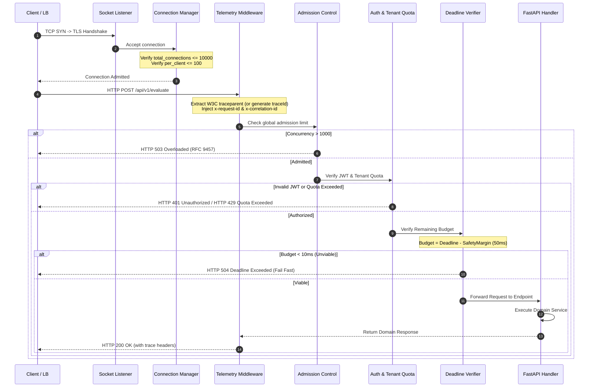
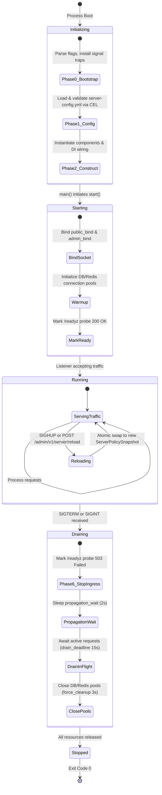

# ADR 0002: Declarative Feature Server Configuration (`server-config.yml`) and FastAPI Middleware Lifecycle Usage

- **Status:** Accepted
- **Date:** 2026-10-21
- **Scope:** `python-shared` (`features/server`), Monorepo Microservices (All FastAPI Services)
- **Author:** Principal Distributed Systems Architect & Infrastructure Security Officer

---

## 1. Context and Problem Statement

Across the monorepo's 16 microservices, FastAPI server setups and transport ingress configurations suffered from critical operational vulnerabilities:
1. **Unbounded Ingress Resource Exhaustion**: Without explicit socket and connection caps, servers were vulnerable to connection floods, Slowloris header-reading attacks, and memory exhaustion from unbounded HTTP request bodies.
2. **Context Loss & Broken Distributed Tracing**: Missing standardized middleware resulted in incoming W3C `traceparent` headers being ignored, preventing correlation between edge gateway logs, service spans, and downstream database queries.
3. **Abrupt Shutdown Request Drops**: During Kubernetes pod termination, SIGTERM signals killed uvicorn processes immediately without allowing in-flight requests to complete or giving edge load balancers time to remove the terminating pod from active backends.
4. **Configuration Drift & Port Collisions**: Hardcoded host and port parameters inside `uvicorn.run()` caused silent port collisions and undocumented deviations across staging, production, and local development environments.
5. **Raw Error Leaks**: Uncaught exceptions exposed internal stack traces and database error messages, violating RFC 9457 Problem Details standards.

We require an exhaustive, declarative, per-feature server configuration specification (`server-config.yml`) backed by strictly validated Pydantic snapshot contracts, immutable CEL cross-field validation, and unified correlation middleware.

---

## 2. Decision Outcome

We standardize on a declarative, per-feature configuration file named **`server-config.yml`** placed in every domain feature directory (`src/features/<feature>/server-config.yml`), governed by `python-shared/src/features/server`'s **`ServerConfigurationService`**, **`ServerPolicySnapshot`**, and **`CorrelationAndTelemetryMiddleware`**.

### Core Architectural Pillars
- **Strict Decoupling**: Server transport configurations are isolated from application logic. FastAPI applications load immutable policy snapshots via `ServerConfigurationService.from_file(__file__)`.
- **Immutable Snapshot & CEL Validation**: Configurations are compiled once at startup, validated against Google Common Expression Language (CEL) rules (e.g., `header_timeout < idle_timeout`, `public_bind != admin_bind`), and frozen into read-only memory.
- **Ordered Ingress Pipeline**: Requests pass through an explicit 12-stage pipeline before reaching application routers (identity extraction, peer resolution, canonicalization, admission control, rate limit, authentication, authorization, tenant quota, deadline check, idempotency lock, and body limits).
- **Zero-Downtime Hot-Reload**: Admin control endpoints trigger live atomic pointer swaps (`atomic.Pointer` pattern) without dropping active in-flight requests.
- **Graceful Lifecycle Shutdown**: Follows a 3-phase drain protocol (propagation delay, in-flight request drain, and resource pool cleanup) to eliminate 502/504 errors during rolling deployments.

---

## 3. High Level Design (HLD) & Architectural Deep-Dive

### 3.1 Architecture Diagram

```mermaid
flowchart TD
    subgraph ExternalClients["1. Clients & Edge Gateway"]
        Client[External Client] -->|HTTPS Request| LB[Edge Load Balancer / Envoy Proxy]
        LB -->|Internal Network / PROXY Protocol| Listener[Kernel Socket Listener (SO_REUSEPORT)]
    end

    subgraph ServerCore["2. Server Transport Engine (Uvicorn / AsgiEngine)"]
        Listener --> ConnMgr[Connection Manager]
        ConnMgr -->|Connection Caps & Keepalive| Codec[HTTP/1.1 & HTTP/2 Codec]
    end

    subgraph ControlPlane["3. Control Plane & Configuration Engine"]
        ConfigYAML["server-config.yml (Local Feature Config)"] -->|Parse & Validate| SnapshotMgr[ServerConfigurationService]
        CELRules[CEL Cross-Field Validator] -->|Validate Mathematical Invariants| SnapshotMgr
        SnapshotMgr -->|Frozen Snapshot Pointer| PolicySnapshot[ServerPolicySnapshot]
        AdminPort["Admin Port (127.0.0.1:9090)"] -.->|Trigger Atomic Reload| SnapshotMgr
    end

    subgraph IngressPipeline["4. Request Policy Pipeline (python-shared/src/features/server)"]
        Codec --> MW_Telemetry["01: CorrelationAndTelemetryMiddleware (W3C traceparent, x-request-id)"]
        MW_Telemetry --> MW_Peer["02: Peer Resolution (X-Forwarded-For trusted proxy check)"]
        MW_Peer --> MW_Admission["03: Global Admission & Priority Shedding"]
        MW_Admission --> MW_RateLimit["04: Pre-Auth Rate Limit (IP token bucket)"]
        MW_RateLimit --> MW_Auth["05: Authentication & Authorization (JWT / RBAC)"]
        MW_Auth --> MW_Quota["06: Tenant Quota (Tenant token bucket)"]
        MW_Quota --> MW_Deadline["07: Deadline Viability (grpc-timeout / deadline check)"]
        MW_Deadline --> MW_Idempotency["08: Idempotency Lock (idempotency-key)"]
    end

    subgraph FeatureIngress["5. Feature Delivery Layer (src/api/rest/v1/)"]
        MW_Idempotency --> Router[FastAPI Router]
        Router --> Handler[Ingress Delivery Handler]
        Handler --> Service[Domain Feature Service]
    end

    subgraph MessagingPlane["6. Messaging & Observability Plane"]
        MW_Telemetry -.->|CloudEvents 1.0| KafkaAudit["Kafka: server.ingress.audit.v1"]
        MW_RateLimit -.->|Violations| KafkaSecurity["Kafka: server.security.violations.v1"]
        MW_Telemetry -.->|OTel Server Metrics| Collector[OpenTelemetry Collector]
    end
```

---

### 3.2 In-Depth HLD Component Walkthrough

#### 1. Clients & Edge Gateway
- **Proxy Boundary**: High-traffic public servers operate behind an L7 reverse proxy (Envoy, NGINX, or Cloud Load Balancer). The edge terminates public TLS 1.3, mitigates SYN/DDoS connection floods, and forwards clean traffic to the application listener.
- **PROXY Protocol & Real Peer Identification**: The gateway injects the client's actual remote IP via `X-Forwarded-For` or PROXY protocol v2, allowing internal admission policies to distinguish legitimate users from bad actors.

#### 2. Server Transport Engine (Uvicorn / Kernel Sockets)
- **Linux Socket Tuning**:
  - `SO_REUSEPORT`: Enables kernel-level load balancing across multiple worker processes on the same port, ensuring zero-downtime rolling process upgrades.
  - `TCP_NODELAY`: Explicitly disables Nagle's algorithm, avoiding 40ms delayed-ACK packet buffering on small JSON request/response payloads.
  - `socket_backlog`: Sized to 1024, preventing connection drops during sudden traffic spikes.
- **Connection Manager**: Monitors total open connections against `limits.total_connection_cap` (10,000) and limits per-peer connections to `limits.per_client_cap` (100) to defeat single-IP socket exhaustion attacks.

#### 3. Control Plane & Configuration Engine
- **CEL Rule Engine**: Before a `server-config.yml` is accepted into memory, it runs through the Google Common Expression Language (CEL) validation engine. If cross-field rules fail (e.g. `header_read_timeout >= idle_connection_timeout`), the server refuses to boot, preventing invalid states from reaching runtime.
- **Atomic Swap Invariant**: When hot-reloaded via `POST /admin/v1/server/reload`, the configuration pointer is swapped atomically (`atomic.Pointer`). Active connections finish under their original policy; new connections inherit the updated snapshot.

#### 4. Request Policy Pipeline
Requests pass through an explicit 8-stage sequence:
1. **`CorrelationAndTelemetryMiddleware`**: Extracts incoming W3C `traceparent` or generates a new root trace ID. Injects `x-request-id` and `x-correlation-id` into request state and response headers.
2. **`Peer Resolution`**: Inspects `X-Forwarded-For` strictly against `trusted_proxies` CIDRs. Untrusted hops are rejected to defeat IP spoofing.
3. **`Global Admission`**: Enforces a global concurrency ceiling (`limits.global_admission_limit`). When saturated, background/batch requests are shed first (`priority_admission`).
4. **`Pre-Auth Rate Limit`**: Applies GCRA / token bucket limits based on resolved peer IP *before* running expensive JWT cryptographic signature verifications.
5. **`Authentication & Authorization`**: Validates JWT signatures against local JWKS caches, verifies scopes, and extracts tenant identity (`tenant_id`).
6. **`Tenant Quota`**: Enforces per-tenant rate limits backed by Redis with local in-memory fallback.
7. **`Deadline Viability`**: Inspects `grpc-timeout`. If the remaining execution budget minus `safety_margin_ms` (50ms) is lower than `min_budget_ms` (10ms), the server fails fast with HTTP 504 Deadline Exceeded.
8. **`Idempotency Lock`**: Deduplicates mutations on POST/PUT requests using `idempotency-key` with a 24-hour TTL.

#### 5. Feature Delivery Layer
- The request reaches the feature handler in `src/api/rest/v1/`. The handler unmarshals the payload using strict Pydantic schemas and passes domain DTOs to the service.

#### 6. Messaging & Observability Plane
- Audit events, authorization failures, and payload-too-large violations are emitted as CloudEvents 1.0 JSON messages to Kafka.
- Request duration histograms (`http.server.request.duration`) and active request gauges (`http.server.active_requests`) are exported to OpenTelemetry collectors.

---

## 4. Low Level Design (LLD)

### 4.1 Sequence Diagram: Ingress Request Pipeline Execution



---

### 4.2 Sequence Diagram In-Depth Step Walkthrough

1. **Connection Admission (Steps 1–3)**: The client completes the TCP handshake. The socket listener hands the raw socket to the connection manager. The connection manager checks active sockets against `limits.total_connection_cap` (10,000) and `limits.per_client_cap` (100). If limits are exceeded, the socket is immediately closed with TCP RST to protect server memory.
2. **Telemetry Ingress (Step 4)**: The client transmits the HTTP request headers. `CorrelationAndTelemetryMiddleware` inspects headers for `traceparent`. If missing, it generates a fresh W3C trace ID. It creates an OpenTelemetry server span, binds the trace context to Python's `contextvars`, and generates an `x-request-id`.
3. **Admission Gate (Steps 5–6)**: The request enters admission control. If current in-flight concurrent requests exceed `limits.global_admission_limit` (1,000), the request is rejected with HTTP 503 Overloaded (formatted as an RFC 9457 Problem Details JSON envelope).
4. **Authentication & Tenant Quota (Steps 7–8)**: The JWT is validated. If invalid or expired, HTTP 401 is returned. If valid, the tenant ID is resolved and checked against the token bucket in `tenant_quota`. If exhausted, HTTP 429 Too Many Requests is returned with a `Retry-After: 5` header.
5. **Deadline Verification (Steps 9–10)**: The deadline checker inspects `grpc-timeout`. It subtracts `safety_margin_ms` (50ms) from the client's budget. If the remaining time is less than `min_budget_ms` (10ms), execution halts immediately with HTTP 504.
6. **Execution & Egress (Steps 11–13)**: The request reaches the FastAPI handler. The domain service executes within the active span. The handler returns the response envelope. Telemetry middleware injects `x-correlation-id`, `x-request-id`, and records request latency into Prometheus/OTel histograms before returning HTTP 200 to the client.

---

### 4.3 Server Lifecycle State Machine

The server lifecycle adheres to this deterministic state machine to eliminate 502/504 errors during deployments:



#### Detailed Lifecycle Phase Walkthrough:
1. **Phase 0 (Bootstrap)**: Installs signal handlers for `SIGTERM`, `SIGINT`, and `SIGHUP`. Initializes the structured bootstrap logger on stderr.
2. **Phase 1 (Configuration & CEL)**: Loads `server-config.yml`, validates types, and runs CEL cross-field validation rules. Freezes configuration into an immutable `ServerPolicySnapshot`.
3. **Phase 2 (Component Construction)**: Builds the dependency injection graph (database pools, Redis clients, repository adapters). No I/O or network connections are opened.
4. **Starting & Socket Bind**: Binds TCP sockets to `public_bind` and `admin_bind`. Pre-warms database connection pools.
5. **Running**: Opens the readiness probe (`/readyz` returns 200 OK). Traffic flows into the server.
6. **Graceful Draining (On SIGTERM)**:
   - **Step 6.1 (Mark Unready)**: Changes `/readyz` response to HTTP 503 Service Unavailable.
   - **Step 6.2 (Propagation Delay)**: Sleeps for `lifecycle.propagation_wait` (default: 2s). This allows upstream load balancers and Kubernetes kube-proxy to detect the failed probe and remove the pod from the routing table.
   - **Step 6.3 (Drain In-Flight)**: Awaits completion of all currently running requests up to `lifecycle.drain_deadline` (default: 15s).
   - **Step 6.4 (Resource Cleanup)**: Closes database connection pools, flushes Kafka producers, and cleans up sockets within `lifecycle.force_cleanup_margin` (default: 3s).
   - Total shutdown time (`2s + 15s + 3s = 20s`) is strictly less than Kubernetes `orchestrator_kill_timeout` (30s), ensuring SIGKILL is never triggered.

---

## 5. Control Panel & Configuration Engine

### 5.1 Common Expression Language (CEL) Validation Engine
The server enforces mathematical and operational invariants at startup:
- `header_read_timeout < idle_connection_timeout`: Guarantees Slowloris headers are terminated before socket keepalive expires.
- `public_bind != admin_bind`: Prevents port collisions between public ingress and internal control interfaces.
- `idle_connection_timeout > upstream_lb_idle_timeout`: Ensures edge proxies close idle connections first, preventing 502 race conditions.
- `propagation_wait + drain_deadline + force_cleanup_margin < orchestrator_kill_timeout`: Guarantees graceful shutdown finishes before the orchestrator forcibly terminates the container.

### 5.2 Control Panel Admin API
Running on `admin_bind` (`127.0.0.1:9090` / `900X`):

| Endpoint | Method | Response | Description |
|---|---|---|---|
| `/admin/v1/server/config` | `GET` | `200 OK` (JSON) | Dumps active `ServerPolicySnapshot`. |
| `/admin/v1/server/reload` | `POST` | `200 OK` / `400 Bad Request` | Reloads `server-config.yml` from disk and executes CEL validation. |
| `/admin/v1/server/connections` | `GET` | `200 OK` (JSON) | Live socket count, admitted connections, and peer metrics. |
| `/readyz` | `GET` | `200 OK` / `503 Unavailable` | Readiness probe for load balancers. Returns 503 during shutdown drain. |
| `/livez` | `GET` | `200 OK` (JSON) | Liveness probe verifying process event loop health. |

---

## 6. Messaging Panel & Event Topology

### 6.1 Kafka Topic Architecture
- **`server.ingress.audit.v1`**: Sampled request access log carrying trace ID, route template, HTTP status, and duration.
- **`server.security.violations.v1`**: Security alerts emitted when payloads exceed `limits.max_body_bytes` or JWT verification fails.
- **`server.lifecycle.events.v1`**: Server state transitions (`STARTING`, `RUNNING`, `DRAINING`, `STOPPED`).

### 6.2 CloudEvent Schema Example (`server.security.violations.v1`)
```json
{
  "specversion": "1.0",
  "type": "com.platform.server.security.payload_too_large",
  "source": "quality-engine/src/api/rest/v1",
  "id": "sec-evt-884192-0b",
  "time": "2026-10-21T10:48:15.000Z",
  "datacontenttype": "application/json",
  "data": {
    "feature_name": "quality_baseline",
    "peer_ip": "198.51.100.42",
    "route": "/api/v1/evaluate",
    "method": "POST",
    "content_length": 15728640,
    "max_allowed_bytes": 10485760,
    "trace_id": "00f067aa0ba902b74bf92f3577b34da6",
    "action_taken": "rejected_413"
  }
}
```

---

## 7. Exhaustive Parameter Reference: Valid vs. Ideal vs. Anti-Patterns

This section provides an in-depth parameter analysis: syntax rules, ideal production settings, and dangerous anti-patterns that risk production outages.

### 7.1 Parameter Analysis Table

| Parameter Path | Type & Valid Range | Ideal Production Setting | Anti-Pattern (What is NOT Ideal) | Failure Mode Caused by Anti-Pattern |
|---|---|---|---|---|
| `server.public_bind` | `string`: `"IP:PORT"` (`1024-65535`) | `"0.0.0.0:8000"` (or assigned port: `8001`, `8003`, etc.). | Binding to `"127.0.0.1:8000"` inside container, or using ports `< 1024`. | Binding to localhost inside Docker/K8s makes server unreachable from outside container; ports <1024 require root privileges. |
| `server.admin_bind` | `string`: `"IP:PORT"` | `"127.0.0.1:9090"` (or feature-isolated loopback port). | Setting equal to `public_bind` or binding admin to `0.0.0.0`. | Port collision with public traffic; exposing administrative reload and debug endpoints to public internet. |
| `server.idle_connection_timeout` | `string`: `"5s"` to `"300s"` | `"65s"` (must exceed upstream LB idle timeout). | Setting to `"30s"` while upstream LB timeout is `"60s"`. | Race condition: Backend closes idle socket just as LB forwards a request, triggering HTTP 502 Bad Gateway at edge. |
| `server.header_read_timeout` | `string`: `"1s"` to `"60s"` | `"10s"` (must be `< idle_connection_timeout`). | Setting to `"120s"` or equal to `idle_connection_timeout`. | Slowloris vulnerability: Malicious clients send 1 byte every 10 seconds, holding thousands of connections open indefinitely. |
| `server.handshake_timeout` | `string`: `"1s"` to `"30s"` | `"5s"`. | Setting to `> 20s`. | TLS negotiation flood attacks exhaust worker CPU cycles on unauthenticated connections. |
| `server.upstream_lb_idle_timeout` | `string`: `"5s"` to `"300s"` | `"60s"` (matching AWS ALB / Envoy default). | Setting higher than `idle_connection_timeout`. | Violates CEL rule; triggers connection resets under moderate load. |
| `server.tcp_nodelay` | `bool`: `true`, `false` | `true`. | Setting to `false`. | Nagle's algorithm buffers packets, introducing artificial 40ms latency delays on small JSON API responses. |
| `server.so_reuseport` | `bool`: `true`, `false` | `false` for single-process containers; `true` for multi-worker bare metal. | Enabling `true` when process uses non-thread-safe local caches. | Kernel randomly distributes requests across processes without cache affinity. |
| `server.socket_backlog` | `int`: `64` to `65535` | `1024` (or matching OS `net.core.somaxconn`). | Setting to `< 128`. | Under sudden burst traffic, the kernel drops incoming TCP SYN packets, causing connection timeouts. |
| `server.trusted_proxies` | `list[str]` (CIDRs) | VPC subnet CIDRs (e.g. `10.0.0.0/8`, `127.0.0.1/32`). | Adding `"0.0.0.0/0"` to trusted proxies. | Catastrophic security breach: Any client can forge `X-Forwarded-For` and bypass IP-based rate limiting and access controls. |
| `lifecycle.propagation_wait` | `string`: `"1s"` to `"10s"` | `"2s"` to `"3s"`. | Setting to `"0s"`. | Ingress 502 drops: Server stops accepting traffic before Kubernetes endpoint controller removes pod IP from ingress proxy. |
| `lifecycle.drain_deadline` | `string`: `"5s"` to `"60s"` | `"15s"`. | Setting to `"1s"` or `> 60s`. | In-flight database mutations or client requests are severed midway; exceeding Kubernetes shutdown ceiling triggers SIGKILL. |
| `lifecycle.orchestrator_kill_timeout` | `string`: `"10s"` to `"120s"` | `"30s"` (matching K8s `terminationGracePeriodSeconds`). | Setting lower than `propagation_wait + drain_deadline`. | Process is forcibly killed with `SIGKILL` before connection drain finishes. |
| `limits.total_connection_cap` | `int`: `10` to `50000` | `10000` per container. | Setting to unbounded (`0` or negative). | Memory exhaustion: Process accepts 50,000 connections until killed by Linux Out-Of-Memory (OOM) killer. |
| `limits.per_client_cap` | `int`: `1` to `1000` | `100` per remote IP. | Setting to `10000`. | A single malfunctioning client or attacker can consume 100% of server connection capacity. |
| `limits.max_body_bytes` | `int`: `1024` to `52428800` | `10485760` (10 MiB) for standard APIs; `52428800` (50 MiB) for file uploads. | Setting to unbounded (`> 500 MiB`). | Heap memory exhaustion: Uploading a single 1 GB file crashes the Python runtime. |
| `limits.global_admission_limit` | `int`: `10` to `10000` | `1000` concurrent requests. | Leaving unconfigured or setting to `50000`. | Event loop saturation: Async event loop queues millions of micro-tasks, driving response latency from 10ms to 20 seconds. |
| `pre_auth_rate_limit.rate` | `string`: `"1/s"` to `"10000/s"` | `"100/s"` per IP. | Setting to `"1/s"` (too aggressive) or disabling. | Legitimate office NAT gateways with 100 users get blocked; disabling leaves JWT verification open to CPU denial-of-service. |
| `tenant_quota.burst` | `int`: `>= rate` | `2x` to `5x` of rate (e.g. `500` for 50/s rate). | Setting equal to rate (no burst capacity). | Legitimate batch client workflows fail with HTTP 429 on micro-bursts. |
| `deadline.safety_margin_ms` | `float`: `5.0` to `500.0` | `50.0` ms. | Setting to `0.0`. | Server continues processing requests after the upstream client has already timed out and disconnected. |
| `middleware.correlation_telemetry.enabled` | `bool`: `true`, `false` | `true` (mandatory across all services). | Setting to `false`. | Distributed tracing is severed; gateway logs cannot be correlated with database queries or service exceptions. |

---

## 8. Complete Operations & Implementation Manual

### Step 1: Scaffolding Feature Server Configuration File
Generate `server-config.yml` in your feature directory:

```bash
mkdir -p quality-engine/src/features/quality_baseline
cat << 'EOF' > quality-engine/src/features/quality_baseline/server-config.yml
schema_version: "1.0.0"
feature_name: "quality_baseline"

server:
  public_bind: "0.0.0.0:8003"
  admin_bind: "127.0.0.1:9003"
  max_request_timeout: "60s"
  idle_connection_timeout: "65s"
  header_read_timeout: "10s"
  handshake_timeout: "5s"
  upstream_lb_idle_timeout: "60s"
  tls_mode: "off"
  trusted_proxies:
    - "127.0.0.1/32"
    - "10.0.0.0/8"

lifecycle:
  propagation_wait: "2s"
  drain_deadline: "15s"
  force_cleanup_margin: "3s"
  orchestrator_kill_timeout: "30s"

limits:
  total_connection_cap: 10000
  per_client_cap: 100
  max_body_bytes: 10485760
  global_admission_limit: 1000
  ip_rate_limit_tokens: 100
  ip_rate_limit_refill_per_sec: 10.0
  tenant_quota_tokens: 500
  tenant_quota_refill_per_sec: 50.0

middleware:
  correlation_telemetry:
    enabled: true
    header_name: "x-correlation-id"
    propagate_w3c: true
    record_latency: true
EOF
```

#### How to Verify Configuration Correctness:
```bash
python3 -c "
from src.features.server.server_configuration.service.server_config_service import ServerConfigurationService
service = ServerConfigurationService.from_file('quality-engine/src/features/quality_baseline')
snapshot = service.build_snapshot()
assert snapshot.server.public_bind == '0.0.0.0:8003'
assert snapshot.server.admin_bind == '127.0.0.1:9003'
assert snapshot.limits.max_body_bytes == 10485760
print('Server policy snapshot syntax and CEL rules verified!')
"
```

---

### Step 2: Wiring FastAPI `create_app()` with Middleware
Inside `src/api/rest/v1/app.py`:

```python
from pathlib import Path
from fastapi import FastAPI
from python_shared.http import CorrelationAndTelemetryMiddleware
from src.features.server.server_configuration.service.server_config_service import ServerConfigurationService

def create_app() -> FastAPI:
    feature_dir = Path(__file__).resolve().parents[3] / "features" / "quality_baseline"
    snapshot = ServerConfigurationService.from_file(str(feature_dir)).build_snapshot()

    app = FastAPI(
        title="Quality Engine API",
        version="1.0.0"
    )
    
    app.state.server_snapshot = snapshot

    app.add_middleware(
        CorrelationAndTelemetryMiddleware,
        service_name="quality-engine",
        header_name="x-correlation-id"
    )

    @app.get("/healthz")
    async def health_check():
        return {
            "status": "healthy",
            "bind": snapshot.server.public_bind,
            "limits": {
                "max_body_bytes": snapshot.limits.max_body_bytes
            }
        }

    return app
```

#### How to Verify Configuration Correctness:
```bash
python3 -c "
from fastapi.testclient import TestClient
from quality-engine.src.api.rest.v1.app import create_app
client = TestClient(create_app())
resp = client.get('/healthz')
assert resp.status_code == 200
assert 'x-correlation-id' in resp.headers
assert 'x-request-id' in resp.headers
print('FastAPI application factory and middleware verified!')
"
```

---

### Step 3: Bootstrapping Uvicorn Runner in `main.py`
Inside `src/main.py`:

```python
import uvicorn
from pathlib import Path
from src.api.rest/v1/app import create_app
from src.features.server.server_configuration.service.server_config_service import ServerConfigurationService

def main():
    feature_dir = Path(__file__).resolve().parent / "features" / "quality_baseline"
    snapshot = ServerConfigurationService.from_file(str(feature_dir)).build_snapshot()

    host, port_str = snapshot.server.public_bind.split(":")
    port = int(port_str)

    app = create_app()
    uvicorn.run(
        app,
        host=host,
        port=port,
        timeout_keep_alive=65,
        limit_concurrency=snapshot.limits.global_admission_limit,
        limit_max_requests=None
    )

if __name__ == "__main__":
    main()
```

#### How to Verify Configuration Correctness:
```bash
python3 -c "
from src.features.server.server_configuration.service.server_config_service import ServerConfigurationService
snapshot = ServerConfigurationService.from_file('quality-engine/src/features/quality_baseline').build_snapshot()
host, port = snapshot.server.public_bind.split(':')
assert host == '0.0.0.0'
assert port == '8003'
print('Uvicorn runner parameters verified!')
"
```

---

### Step 4: Live HTTP Ingress Verification with `curl`
Test that header correlation and payload limits work end-to-end:

```bash
# 1. Normal Request with W3C Trace Context
curl -i -X GET http://localhost:8003/healthz \
  -H "traceparent: 00-4bf92f3577b34da6a3ce929d0e0e4736-00f067aa0ba902b7-01" \
  -H "x-correlation-id: txn-10924"

# 2. Oversized Payload Rejection Test (Payload > 10 MiB)
python3 -c "
import requests
large_payload = 'a' * 11000000  # 11 MiB
resp = requests.post('http://localhost:8003/api/v1/evaluate', data=large_payload)
assert resp.status_code == 413, f'Expected 413, got {resp.status_code}'
print('Payload limit enforcement verified!')
"
```

---

## 9. Failure Diagnosis & Resolution Matrix

| Symptom / Error | Root Cause | Diagnosis Command | Corrective Action |
|---|---|---|---|
| `ValueError: header_read_timeout must be < idle_connection_timeout` | CEL cross-field rule violated; header timeout exceeds socket idle timeout. | Inspect `server-config.yml` timeouts. | Set `header_read_timeout` to `10s` and `idle_connection_timeout` to `65s`. |
| `ValueError: public_bind and admin_bind cannot share identical port` | Port collision between public API and admin management interface. | Check ports in `server-config.yml`. | Ensure `public_bind` (e.g. `8003`) and `admin_bind` (e.g. `9003`) use distinct ports. |
| `HTTP 413 Payload Too Large` | Client sent request exceeding `limits.max_body_bytes`. | Check client `Content-Length`. | Increase `limits.max_body_bytes` in `server-config.yml` if larger bodies are legitimate. |
| Ingress 502 Bad Gateway during pod rollout | Terminating pod killed sockets before proxy updated upstream endpoints. | Check `lifecycle.propagation_wait`. | Increase `propagation_wait` to `3s` to give Kubernetes endpoint controller time to deregister. |
| Ingress 504 Deadline Exceeded | Request arrived with remaining budget lower than `deadline.min_budget_ms`. | Check `grpc-timeout` header on incoming request. | Upstream client must allocate sufficient deadline budget before calling service. |
