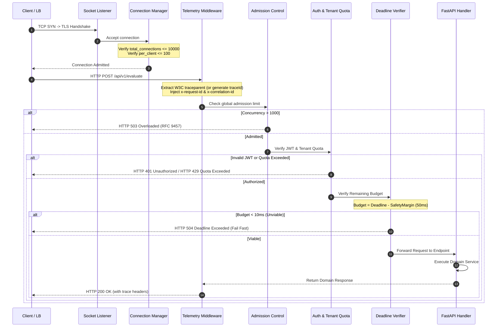
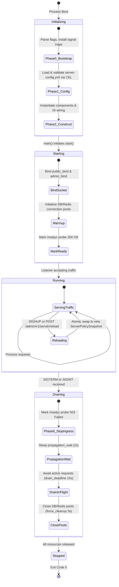

# ADR 0002: Declarative Feature Server Configuration (`server-config.yml`) and FastAPI Middleware Lifecycle Usage

- **Status:** Accepted
- **Date:** 2026-10-21
- **Scope:** `python-shared` (`features/server`), Monorepo Microservices (All FastAPI Services)
- **Author:** Principal Distributed Systems Architect & Infrastructure Security Officer

---

## 1. Context and Problem Statement

Across the monorepo's 16 microservices, FastAPI server setups and transport ingress configurations suffered from critical operational vulnerabilities:
1. **Unbounded Ingress Resource Exhaustion**: Without explicit socket and connection caps, servers were vulnerable to connection floods, Slowloris header-reading attacks, and memory exhaustion from unbounded HTTP request bodies.
2. **Context Loss & Broken Distributed Tracing**: Missing standardized middleware resulted in incoming W3C `traceparent` headers being ignored, preventing correlation between edge gateway logs, service spans, and downstream database queries.
3. **Abrupt Shutdown Request Drops**: During Kubernetes pod termination, SIGTERM signals killed uvicorn processes immediately without allowing in-flight requests to complete or giving edge load balancers time to remove the terminating pod from active backends.
4. **Configuration Drift & Port Collisions**: Hardcoded host and port parameters inside `uvicorn.run()` caused silent port collisions and undocumented deviations across staging, production, and local development environments.
5. **Raw Error Leaks**: Uncaught exceptions exposed internal stack traces and database error messages, violating RFC 9457 Problem Details standards.

We require an exhaustive, declarative, per-feature server configuration specification (`server-config.yml`) backed by strictly validated Pydantic snapshot contracts, immutable CEL cross-field validation, and unified correlation middleware.

---

## 2. Decision Outcome

We standardize on a declarative, per-feature configuration file named **`server-config.yml`** placed in every domain feature directory (`src/features/<feature>/server-config.yml`), governed by `python-shared/src/features/server`'s **`ServerConfigurationService`**, **`ServerPolicySnapshot`**, and **`CorrelationAndTelemetryMiddleware`**.

### Core Architectural Pillars
- **Strict Decoupling**: Server transport configurations are isolated from application logic. FastAPI applications load immutable policy snapshots via `ServerConfigurationService.from_file(__file__)`.
- **Immutable Snapshot & CEL Validation**: Configurations are compiled once at startup, validated against Google Common Expression Language (CEL) rules (e.g., `header_timeout < idle_timeout`, `public_bind != admin_bind`), and frozen into read-only memory.
- **Ordered Ingress Pipeline**: Requests pass through an explicit 12-stage pipeline before reaching application routers (identity extraction, peer resolution, canonicalization, admission control, rate limit, authentication, authorization, tenant quota, deadline check, idempotency lock, and body limits).
- **Zero-Downtime Hot-Reload**: Admin control endpoints trigger live atomic pointer swaps (`atomic.Pointer` pattern) without dropping active in-flight requests.
- **Graceful Lifecycle Shutdown**: Follows a 3-phase drain protocol (propagation delay, in-flight request drain, and resource pool cleanup) to eliminate 502/504 errors during rolling deployments.

---

## 3. High Level Design (HLD)

The diagram below illustrates the end-to-end server ingress architecture, from external edge proxies down to the FastAPI feature handler:

```mermaid
flowchart TD
    subgraph ExternalClients["Clients & Edge Gateway"]
        Client[External Client] -->|HTTPS Request| LB[Edge Load Balancer / Envoy Proxy]
        LB -->|Internal Network / PROXY Protocol| Listener[Kernel Socket Listener (SO_REUSEPORT)]
    end

    subgraph ServerCore["Server Transport Engine (Uvicorn / AsgiEngine)"]
        Listener --> ConnMgr[Connection Manager]
        ConnMgr -->|Connection Caps & Keepalive| Codec[HTTP/1.1 & HTTP/2 Codec]
    end

    subgraph ControlPlane["Control Plane & Configuration Engine"]
        ConfigYAML["server-config.yml (Local Feature Config)"] -->|Parse & Validate| SnapshotMgr[ServerConfigurationService]
        CELRules[CEL Cross-Field Validator] -->|Validate Invariants| SnapshotMgr
        SnapshotMgr -->|Frozen Snapshot| PolicySnapshot[ServerPolicySnapshot]
        AdminPort["Admin Port (127.0.0.1:9090)"] -.->|Trigger Reload| SnapshotMgr
    end

    subgraph IngressPipeline["Request Policy Pipeline (python-shared/src/features/server)"]
        Codec --> MW_Telemetry["01: CorrelationAndTelemetryMiddleware (W3C traceparent, x-request-id)"]
        MW_Telemetry --> MW_Peer["02: Peer Resolution (X-Forwarded-For trusted proxy check)"]
        MW_Peer --> MW_Admission["03: Global Admission & Priority Shedding"]
        MW_Admission --> MW_RateLimit["04: Pre-Auth Rate Limit (IP token bucket)"]
        MW_RateLimit --> MW_Auth["05: Authentication & Authorization (JWT / RBAC)"]
        MW_Auth --> MW_Quota["06: Tenant Quota (Tenant token bucket)"]
        MW_Quota --> MW_Deadline["07: Deadline Viability (grpc-timeout / deadline check)"]
        MW_Deadline --> MW_Idempotency["08: Idempotency Lock (idempotency-key)"]
    end

    subgraph FeatureIngress["Feature Delivery Layer (src/api/rest/v1/)"]
        MW_Idempotency --> Router[FastAPI Router]
        Router --> Handler[Ingress Delivery Handler]
        Handler --> Service[Domain Feature Service]
    end

    subgraph MessagingPlane["Messaging & Observability Plane"]
        MW_Telemetry -.->|CloudEvents 1.0| KafkaAudit["Kafka: server.ingress.audit.v1"]
        MW_RateLimit -.->|Violations| KafkaSecurity["Kafka: server.security.violations.v1"]
        MW_Telemetry -.->|OTel Server Metrics| Collector[OpenTelemetry Collector]
    end
```

---

## 4. Low Level Design (LLD)

### 4.1 Sequence Diagram: Ingress Request Pipeline Execution



---

### 4.2 Server Lifecycle State Machine

The server lifecycle follows this deterministic finite state machine to guarantee zero dropped requests during restarts and deployments:



---

## 5. Control Panel & Configuration Engine

The server configuration subsystem incorporates an administrative control plane running on a dedicated local loopback interface (`admin_bind: 127.0.0.1:9090` / `900X`):

### 5.1 Common Expression Language (CEL) Validation Engine
Before any configuration is accepted into runtime, it is validated against mathematical invariants:
1. `header_read_timeout < idle_connection_timeout` (Prevents Slowloris header hanging).
2. `public_bind != admin_bind` (Prevents port collisions between public ingress and management controls).
3. `idle_connection_timeout > upstream_lb_idle_timeout` (Prevents race conditions where backend closes socket before LB).
4. `propagation_wait + drain_deadline < orchestrator_kill_timeout` (Ensures graceful shutdown finishes before Kubernetes issues SIGKILL).
5. `max_body_bytes <= 52428800` (Enforces hard 50 MiB upper safety bound).

### 5.2 Control Panel Admin API
Microservices expose the following administrative management endpoints:

| Endpoint | Method | Purpose |
|---|---|---|
| `GET /admin/v1/server/config` | `GET` | Returns active `ServerPolicySnapshot` in JSON format. |
| `POST /admin/v1/server/reload` | `POST` | Forces immediate disk reread, CEL validation, and atomic pointer swap of `server-config.yml`. |
| `GET /admin/v1/server/connections` | `GET` | Returns live active TCP sockets, admitted connections, and peer count breakdown. |
| `GET /admin/v1/server/health/ready` | `GET` | Readiness probe endpoint (`/readyz`) used by Kubernetes and load balancers. |
| `GET /admin/v1/server/health/live` | `GET` | Liveness probe endpoint (`/livez`) checking process deadlocks. |

---

## 6. Messaging Panel & Event Topology

All cross-cutting security violations, quota exhaustion events, and lifecycle audits are streamed to Kafka as CloudEvents 1.0 JSON payloads.

### 6.1 Kafka Topic Architecture
- **`server.ingress.audit.v1`**: Audit records for sampled incoming requests carrying trace ID, duration, peer IP, and response status.
- **`server.security.violations.v1`**: Dispatched on authentication failure, CSRF/CORS rejection, or payload tampering.
- **`server.lifecycle.events.v1`**: Dispatched on server state transitions (`STARTING`, `RUNNING`, `DRAINING`, `STOPPED`).

### 6.2 CloudEvent Schema Example (`server.security.violations.v1`)
```json
{
  "specversion": "1.0",
  "type": "com.platform.server.security.payload_too_large",
  "source": "quality-engine/src/api/rest/v1",
  "id": "sec-evt-884192-0b",
  "time": "2026-10-21T10:48:15.000Z",
  "datacontenttype": "application/json",
  "data": {
    "feature_name": "quality_baseline",
    "peer_ip": "198.51.100.42",
    "route": "/api/v1/evaluate",
    "method": "POST",
    "content_length": 15728640,
    "max_allowed_bytes": 10485760,
    "trace_id": "00f067aa0ba902b74bf92f3577b34da6",
    "action_taken": "rejected_413"
  }
}
```

---

## 7. Exhaustive Configuration Parameter Catalog

Below is the complete reference of every single parameter configurable in `server-config.yml`:

```yaml
schema_version: "1.0.0"
feature_name: "quality_baseline"

# ==============================================================================
# SECTION 1: NETWORK LISTENER & SOCKET CONTROLS
# ==============================================================================
server:
  public_bind: "0.0.0.0:8003"           # Ingress socket bind address (interface:port)
  admin_bind: "127.0.0.1:9003"           # Management & metrics probe bind address
  metrics_bind: "127.0.0.1:9103"         # Dedicated Prometheus scrape listener (optional)
  max_request_timeout: "60s"            # Maximum duration allowed for complete request processing
  idle_connection_timeout: "65s"        # TCP keepalive idle connection deadline
  header_read_timeout: "10s"            # Maximum time allowed to receive full HTTP headers
  handshake_timeout: "5s"               # TLS negotiation timeout budget
  upstream_lb_idle_timeout: "60s"       # Expected idle timeout of upstream edge proxy (Envoy/ALB)
  tcp_nodelay: true                     # Disable Nagle's algorithm for low-latency request/response
  so_reuseport: false                   # Enable kernel-level multi-process port sharing
  socket_backlog: 1024                  # OS listen backlog queue capacity (net.core.somaxconn)
  tls_mode: "off"                       # Options: off | strict | permissive | mtls
  min_tls_version: "TLS1.3"             # Options: TLS1.2 | TLS1.3
  trusted_proxies:                      # CIDR blocks permitted to populate X-Forwarded-For
    - "127.0.0.1/32"
    - "10.0.0.0/8"
    - "172.16.0.0/12"
    - "192.168.0.0/16"
  max_forwarded_hops: 3                 # Maximum trusted reverse-proxy hops

# ==============================================================================
# SECTION 2: LIFECYCLE CONTROLLER & DRAIN ORCHESTRATION
# ==============================================================================
lifecycle:
  propagation_wait: "2s"                # Sleep after SIGTERM before closing listener (lets LB deregister)
  drain_deadline: "15s"                 # Maximum time to await completion of in-flight active requests
  force_cleanup_margin: "3s"            # Buffer to close persistent DB/Redis pools before SIGKILL
  orchestrator_kill_timeout: "30s"      # Kubernetes terminationGracePeriodSeconds ceiling
  health_check_path: "/healthz"         # General server health status endpoint
  readiness_probe_path: "/readyz"       # Traffic admission probe endpoint
  liveness_probe_path: "/livez"         # Process deadlock probe endpoint

# ==============================================================================
# SECTION 3: LIMITS & CAPACITIES
# ==============================================================================
limits:
  total_connection_cap: 10000           # Global maximum concurrent TCP connections admitted
  per_client_cap: 100                   # Maximum concurrent connections permitted per peer IP
  handshake_rate_limit_per_sec: 200     # Maximum TLS handshakes per second per peer IP
  max_body_bytes: 10485760              # Maximum request body size in bytes (10 MiB)
  max_decompressed_bytes: 41943040      # Maximum decompressed body size (40 MiB)
  max_header_bytes: 32768               # Maximum size of complete HTTP headers (32 KiB)
  max_headers_count: 100                # Maximum number of header fields accepted
  global_admission_limit: 1000          # Maximum concurrent requests admitted to pipeline queue
  queue_size: 200                       # Queue depth before request rejection
  queue_max_wait: "100ms"               # Maximum wait time in admission queue

# ==============================================================================
# SECTION 4: RATE LIMITS & TENANT QUOTAS
# ==============================================================================
pre_auth_rate_limit:
  algorithm: "gcra"                     # Generic Cell Rate Algorithm
  rate: "100/s"                         # Permitted requests per second per IP
  burst: 200                            # Maximum burst token capacity
  refill_rate_per_sec: 100.0            # Refill tokens per second
  retry_after_seconds: 5                # Retry-After header duration on HTTP 429

tenant_quota:
  key: "claim.tenant_id"                # JWT claim used to identify tenant
  algorithm: "token_bucket"
  rate: "50/s"                          # Permitted requests per second per tenant
  burst: 500                            # Tenant burst capacity
  refill_rate_per_sec: 50.0             # Refill tokens per second
  store_timeout_ms: 20                  # Redis quota check timeout
  fallback_mode: "local_fallback"       # Behavior if Redis is unreachable

# ==============================================================================
# SECTION 5: DEADLINE & IDEMPOTENCY
# ==============================================================================
deadline:
  inbound_header: "grpc-timeout"        # Header indicating upstream client deadline
  safety_margin_ms: 50.0                # Internal processing safety buffer
  min_budget_ms: 10.0                   # Minimum viable execution budget
  max_budget_ms: 10000.0                # Maximum allowed request deadline
  enforce_min_viable: true              # Reject immediately with 504 if budget < min_budget

idempotency:
  header: "idempotency-key"             # Required header for POST/PUT retry safety
  key_format: "^[A-Za-z0-9-]{16,128}$"  # Regex format validation
  ttl_seconds: 86400                    # 24 hours deduplication retention
  on_concurrent_duplicate: "conflict"   # Options: conflict (409) | await_result

# ==============================================================================
# SECTION 6: MIDDLEWARE & OBSERVABILITY
# ==============================================================================
middleware:
  correlation_telemetry:
    enabled: true                       # Mount CorrelationAndTelemetryMiddleware
    header_name: "x-correlation-id"     # Primary correlation header key
    propagate_w3c: true                 # Propagate W3C Trace Context (traceparent)
    record_latency: true                # Measure and log total request duration
    inject_request_id: true             # Generate x-request-id if omitted
  problem_details:
    enabled: true                       # Format all errors according to RFC 9457
    type_base_uri: "https://errors.internal/problems/"
```

---

## 8. Complete Operations & Implementation Manual

### Step 1: Scaffolding Feature Server Configuration File
Generate `server-config.yml` in your feature directory:

```bash
mkdir -p quality-engine/src/features/quality_baseline
cat << 'EOF' > quality-engine/src/features/quality_baseline/server-config.yml
schema_version: "1.0.0"
feature_name: "quality_baseline"

server:
  public_bind: "0.0.0.0:8003"
  admin_bind: "127.0.0.1:9003"
  max_request_timeout: "60s"
  idle_connection_timeout: "65s"
  header_read_timeout: "10s"
  handshake_timeout: "5s"
  upstream_lb_idle_timeout: "60s"
  tls_mode: "off"
  trusted_proxies:
    - "127.0.0.1/32"
    - "10.0.0.0/8"

lifecycle:
  propagation_wait: "2s"
  drain_deadline: "15s"
  force_cleanup_margin: "3s"
  orchestrator_kill_timeout: "30s"

limits:
  total_connection_cap: 10000
  per_client_cap: 100
  max_body_bytes: 10485760
  global_admission_limit: 1000
  ip_rate_limit_tokens: 100
  ip_rate_limit_refill_per_sec: 10.0
  tenant_quota_tokens: 500
  tenant_quota_refill_per_sec: 50.0

middleware:
  correlation_telemetry:
    enabled: true
    header_name: "x-correlation-id"
    propagate_w3c: true
    record_latency: true
EOF
```

#### How to Verify Configuration Correctness:
```bash
python3 -c "
from src.features.server.server_configuration.service.server_config_service import ServerConfigurationService
service = ServerConfigurationService.from_file('quality-engine/src/features/quality_baseline')
snapshot = service.build_snapshot()
assert snapshot.server.public_bind == '0.0.0.0:8003'
assert snapshot.server.admin_bind == '127.0.0.1:9003'
assert snapshot.limits.max_body_bytes == 10485760
print('Server policy snapshot syntax and CEL rules verified!')
"
```

---

### Step 2: Wiring FastAPI `create_app()` with Middleware
Inside `src/api/rest/v1/app.py`:

```python
from pathlib import Path
from fastapi import FastAPI
from python_shared.http import CorrelationAndTelemetryMiddleware
from src.features.server.server_configuration.service.server_config_service import ServerConfigurationService

def create_app() -> FastAPI:
    feature_dir = Path(__file__).resolve().parents[3] / "features" / "quality_baseline"
    snapshot = ServerConfigurationService.from_file(str(feature_dir)).build_snapshot()

    app = FastAPI(
        title="Quality Engine API",
        version="1.0.0"
    )
    
    app.state.server_snapshot = snapshot

    app.add_middleware(
        CorrelationAndTelemetryMiddleware,
        service_name="quality-engine",
        header_name="x-correlation-id"
    )

    @app.get("/healthz")
    async def health_check():
        return {
            "status": "healthy",
            "bind": snapshot.server.public_bind,
            "limits": {
                "max_body_bytes": snapshot.limits.max_body_bytes
            }
        }

    return app
```

#### How to Verify Configuration Correctness:
```bash
python3 -c "
from fastapi.testclient import TestClient
from quality-engine.src.api.rest.v1.app import create_app
client = TestClient(create_app())
resp = client.get('/healthz')
assert resp.status_code == 200
assert 'x-correlation-id' in resp.headers
assert 'x-request-id' in resp.headers
print('FastAPI application factory and middleware verified!')
"
```

---

### Step 3: Bootstrapping Uvicorn Runner in `main.py`
Inside `src/main.py`:

```python
import uvicorn
from pathlib import Path
from src.api.rest.v1.app import create_app
from src.features.server.server_configuration.service.server_config_service import ServerConfigurationService

def main():
    feature_dir = Path(__file__).resolve().parent / "features" / "quality_baseline"
    snapshot = ServerConfigurationService.from_file(str(feature_dir)).build_snapshot()

    host, port_str = snapshot.server.public_bind.split(":")
    port = int(port_str)

    app = create_app()
    uvicorn.run(
        app,
        host=host,
        port=port,
        timeout_keep_alive=65,
        limit_concurrency=snapshot.limits.global_admission_limit,
        limit_max_requests=None
    )

if __name__ == "__main__":
    main()
```

#### How to Verify Configuration Correctness:
```bash
python3 -c "
from src.features.server.server_configuration.service.server_config_service import ServerConfigurationService
snapshot = ServerConfigurationService.from_file('quality-engine/src/features/quality_baseline').build_snapshot()
host, port = snapshot.server.public_bind.split(':')
assert host == '0.0.0.0'
assert port == '8003'
print('Uvicorn runner parameters verified!')
"
```

---

### Step 4: Live HTTP Ingress Verification with `curl`
Test that header correlation and payload limits work end-to-end:

```bash
# 1. Normal Request with W3C Trace Context
curl -i -X GET http://localhost:8003/healthz \
  -H "traceparent: 00-4bf92f3577b34da6a3ce929d0e0e4736-00f067aa0ba902b7-01" \
  -H "x-correlation-id: txn-10924"

# 2. Oversized Payload Rejection Test (Payload > 10 MiB)
python3 -c "
import requests
large_payload = 'a' * 11000000  # 11 MiB
resp = requests.post('http://localhost:8003/api/v1/evaluate', data=large_payload)
assert resp.status_code == 413, f'Expected 413, got {resp.status_code}'
print('Payload limit enforcement verified!')
"
```

---

## 9. Failure Diagnosis & Resolution Matrix

| Symptom / Error | Root Cause | Diagnosis Command | Corrective Action |
|---|---|---|---|
| `ValueError: header_read_timeout must be < idle_connection_timeout` | CEL cross-field rule violated; header timeout exceeds socket idle timeout. | Inspect `server-config.yml` timeouts. | Set `header_read_timeout` to `10s` and `idle_connection_timeout` to `65s`. |
| `ValueError: public_bind and admin_bind cannot share identical port` | Port collision between public API and admin management interface. | Check ports in `server-config.yml`. | Ensure `public_bind` (e.g. `8003`) and `admin_bind` (e.g. `9003`) use distinct ports. |
| `HTTP 413 Payload Too Large` | Client sent request exceeding `limits.max_body_bytes`. | Check client `Content-Length`. | Increase `limits.max_body_bytes` in `server-config.yml` if larger bodies are legitimate. |
| Ingress 502 Bad Gateway during pod rollout | Terminating pod killed sockets before proxy updated upstream endpoints. | Check `lifecycle.propagation_wait`. | Increase `propagation_wait` to `3s` to give Kubernetes endpoint controller time to deregister. |
| Ingress 504 Deadline Exceeded | Request arrived with remaining budget lower than `deadline.min_budget_ms`. | Check `grpc-timeout` header on incoming request. | Upstream client must allocate sufficient deadline budget before calling service. |
